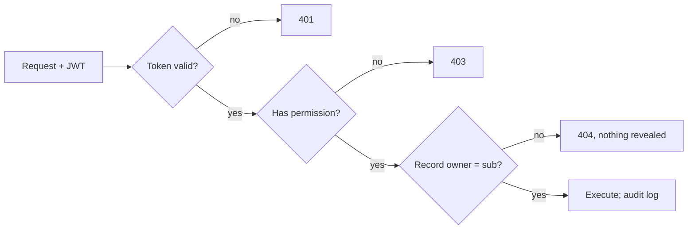

# ADR-SYS-001: Identity and per-user isolation

| Field | Value |
|---|---|
| Status | Accepted in part (identity provider). Token storage and role mapping still Proposed |
| Date | 2026-10-12; IdP accepted 2026-10-13 |
| Owner | Software Architect Assistant; decision by Phan Duy |
| Blocks | ADR-SYS-002 gate; all Phase 1 Core writes; ADR-SYS-005 external agents |
| Depends on | None |

## Context

Today identity is a caller-set `X-User-ID` header, `/api/chat` takes no identity, and a conversation thread is reachable by its id alone. The gate, Decision records and Positions all belong to one user, so every Phase 1 Core write needs a verified user. See the security risk in the [overview](../SYSTEM_OVERVIEW_AND_BOUNDARIES.md).

## Decision to make

How the Backend establishes who the user is, and how every read and write of user-owned records is scoped to that user.

## Options to evaluate

- A. Session login handled by the Backend.
- B. An outside identity provider (OIDC), with the Backend validating tokens.
- For both: where the user id is enforced (service layer versus data access), and how threads and Core records carry an owner.

## Choices for Phan (from the Researcher's proposal, 2026-10-13)

1. **Identity provider (decided: Auth0):** managed (Auth0, Microsoft Entra ID, AWS Cognito) or self-hosted Keycloak. Drives cost and operations.
2. **Token storage in the browser:** in memory with silent refresh, or an HttpOnly cookie held by a small Backend-for-Frontend. The architect leans to the Backend-for-Frontend, which is stronger against XSS and fits one shell and one Backend.
3. **Permissions:** `scope` claims only, or `roles` in the token with the role-to-permission map in the Backend. Recommended: roles in the token, map in the Backend, so a permission change needs no token reissue.

Example access-token claims (no PII beyond need, no portfolio data; a JWT is signed, not encrypted):

```json
{ "iss": "https://idp.example", "sub": "u_123", "aud": "dp-stock-api",
  "exp": 1760330000, "iat": 1760329100, "scope": "research:read thesis:write",
  "roles": ["investor"] }
```

Authorization decision in the Backend application layer:



References: [RFC 7636 PKCE](https://www.rfc-editor.org/rfc/rfc7636), [RFC 9700 OAuth security BCP](https://www.rfc-editor.org/rfc/rfc9700), [RFC 8725 JWT BCP](https://www.rfc-editor.org/rfc/rfc8725), [RFC 9068 JWT access tokens](https://www.rfc-editor.org/rfc/rfc9068), [OAuth for browser-based apps](https://datatracker.ietf.org/doc/draft-ietf-oauth-browser-based-apps/), [OWASP API1 BOLA](https://owasp.org/API-Security/editions/2023/en/0xa1-broken-object-level-authorization/).

## Decision

- **Accepted, 2026-10-13 (Phan Duy):** Auth0 is the identity provider (option B, OpenID Connect). The Backend validates Auth0-issued JWT access tokens and scopes every user-owned record to `sub`.
- **Open:** where the browser keeps tokens (choice 2) and how roles map to permissions (choice 3).

## Follow-ups

- Retire the caller-set `X-User-ID` header.
- Tests that one user cannot read another user's thread or Core records.
