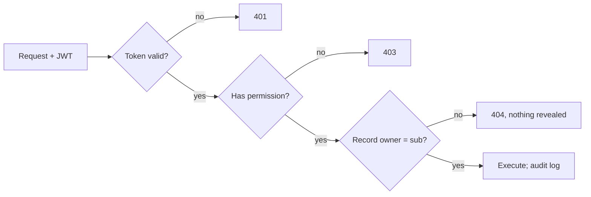

# ADR-SYS-001: Identity and per-user isolation

| Field | Value |
|---|---|
| Status | Accepted in part (identity provider; token storage). Role mapping still Proposed |
| Date | 2026-10-12; IdP accepted 2026-10-13; token storage accepted 2026-11-13 |
| Owner | Software Architect Assistant; decision by Phan Duy |
| Blocks | ADR-SYS-002 gate; all Phase 1 Core writes; ADR-SYS-005 external agents |
| Depends on | None |

## Context

Today identity is a caller-set `X-User-ID` header, `/api/chat` takes no identity, and a conversation thread is reachable by its id alone. The gate, Decision records and Positions all belong to one user, so every Phase 1 Core write needs a verified user. See the security risk in the [overview](../SYSTEM_OVERVIEW_AND_BOUNDARIES.md).

## Decision to make

How the Backend establishes who the user is, and how every read and write of user-owned records is scoped to that user.

## Options to evaluate

- A. Session login handled by the Backend.
- B. An outside identity provider (OIDC), with the Backend validating tokens.
- For both: where the user id is enforced (service layer versus data access), and how threads and Core records carry an owner.

## Choices for Phan (from the Researcher's proposal, 2026-10-13)

1. **Identity provider (decided: Auth0):** managed (Auth0, Microsoft Entra ID, AWS Cognito) or self-hosted Keycloak. Drives cost and operations.
2. **Token storage in the browser (decided: Backend-for-Frontend):** in memory with silent refresh, or an HttpOnly cookie held by a small Backend-for-Frontend. The architect leans to the Backend-for-Frontend, which is stronger against XSS and fits one shell and one Backend.
3. **Permissions:** `scope` claims only, or `roles` in the token with the role-to-permission map in the Backend. Recommended: roles in the token, map in the Backend, so a permission change needs no token reissue.

Example access-token claims (no PII beyond need, no portfolio data; a JWT is signed, not encrypted):

```json
{ "iss": "https://idp.example", "sub": "u_123", "aud": "dp-stock-api",
  "exp": 1760330000, "iat": 1760329100, "scope": "research:read thesis:write",
  "roles": ["investor"] }
```

Authorization decision in the Backend application layer:



References: [RFC 7636 PKCE](https://www.rfc-editor.org/rfc/rfc7636), [RFC 9700 OAuth security BCP](https://www.rfc-editor.org/rfc/rfc9700), [RFC 8725 JWT BCP](https://www.rfc-editor.org/rfc/rfc8725), [RFC 9068 JWT access tokens](https://www.rfc-editor.org/rfc/rfc9068), [RFC 10017 OAuth for browser-based apps](https://www.rfc-editor.org/rfc/rfc10017.pdf), [Auth0 token storage guidance](https://auth0.com/docs/secure/security-guidance/data-security/token-storage), [OWASP API1 BOLA](https://owasp.org/API-Security/editions/2023/en/0xa1-broken-object-level-authorization/).

## Decision

- **Accepted, 2026-10-13 (Phan Duy):** Auth0 is the identity provider (option B, OpenID Connect). The Backend validates Auth0-issued JWT access tokens and scopes every user-owned record to `sub`.
- **Accepted, 2026-11-13 (Phan Duy):** token storage uses a Backend-for-Frontend (choice 2). The Flask Backend is the confidential OAuth client: it runs the authorization code flow with PKCE against Auth0 and keeps access and refresh tokens in a server-side session. The browser holds only an opaque session cookie with the `__Host-` prefix, `Secure`, `HttpOnly` and `SameSite=Strict`, and never sees a token. The Backend acts as both the Backend-for-Frontend and the resource server, so it still validates the access token and scopes records to `sub`. The SPA and the API are served from one origin. The short-lived login-transaction cookie that carries the OAuth `state` and the PKCE verifier is `SameSite=Lax`, because the redirect back from Auth0 is a cross-site navigation and a `Strict` cookie would not be sent to the callback ([MDN SameSite](https://developer.mozilla.org/en-US/docs/Web/HTTP/Reference/Headers/Set-Cookie#samesitesamesite-value)). The session cookie stays `Strict`, so the callback must finish with a same-site navigation before the app loads, or the first page would load as signed out. Route names and the CSRF mechanism are not fixed here; they belong to `docs/openapi.yaml` and the Frontend and Backend technical designs.
- **Why:** RFC 10017 strongly recommends this pattern for business applications and apps holding personal data, because a script injected into the page cannot read or exfiltrate tokens ([RFC 10017 §6.1](https://www.rfc-editor.org/rfc/rfc10017.pdf)). Auth0 advises a cookie-based session when a single-page app calls only an API that can share its cookies ([Auth0 token storage](https://auth0.com/docs/secure/security-guidance/data-security/token-storage)). Our SPA calls only the Flask Backend. In-memory tokens are lost on reload and fall back to a hidden iframe, which fails when third-party cookies are blocked ([Auth0 SPA SDK](https://auth0.com/docs/libraries/auth0-single-page-app-sdk)). Streaming does not decide it: chat streams over a `fetch` `POST`, which works with either option.
- **Accepted cost:** more Backend work in Pitch A (OAuth client, server-side session store, token refresh), CSRF protection on every state-changing call, and a same-origin deployment (a dev proxy locally). An injected script can still send requests through the user's own browser session; the sanitized-output rules in the Frontend architecture remain the defence there.
- **Open:** how roles map to permissions (choice 3).

## Follow-ups

- Retire the caller-set `X-User-ID` header.
- Technical design (Coding Orchestrator): session store, cookie settings, CSRF mechanism, login, callback and logout routes, refresh handling, and the local dev proxy.
- Tests that a session cookie is rejected without its CSRF proof on state-changing calls, and that no token appears in any response the browser can read.
- Tests that one user cannot read another user's thread or Core records.

## Revision history

| Date | Change |
|---|---|
| 2026-10-12 | Proposed. |
| 2026-10-13 | Auth0 accepted as the identity provider. |
| 2026-11-13 | Token storage accepted: Backend-for-Frontend with an HttpOnly session cookie. Role mapping stays open. |
| 2026-11-13 | Same-day clarification: the login-transaction cookie is `Lax` and the session cookie stays `Strict`, with a same-site landing after the callback. |
