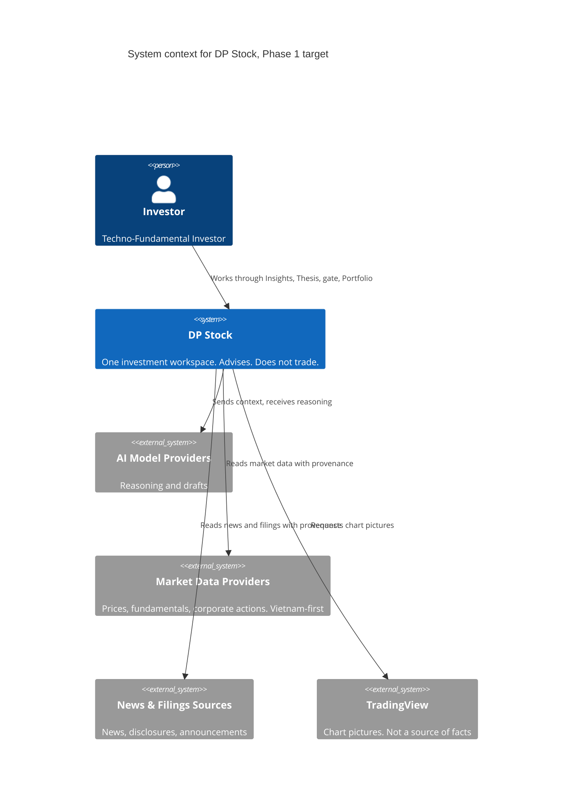
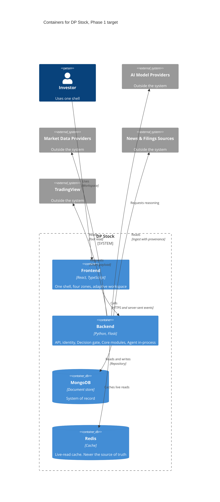
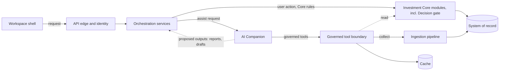
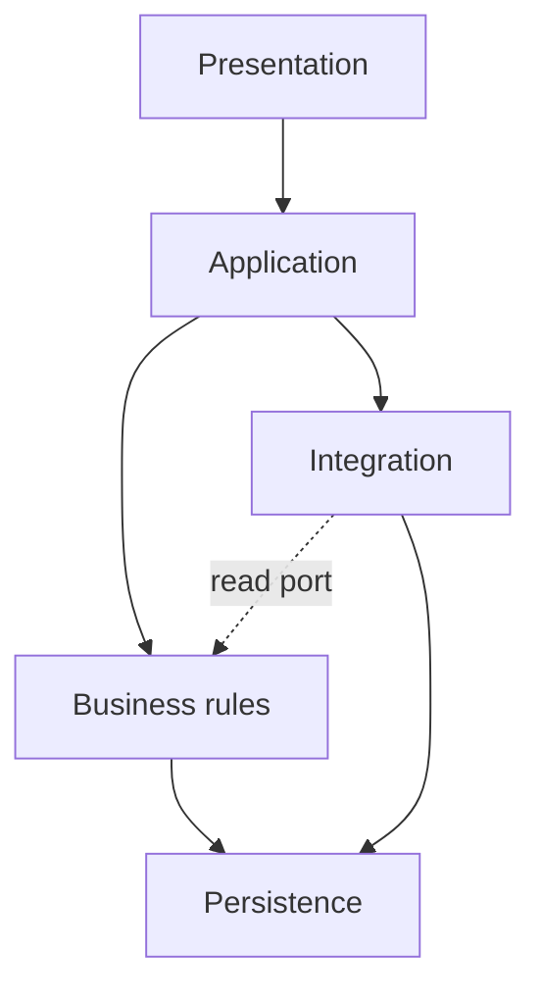
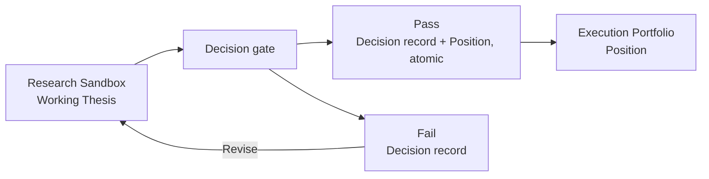
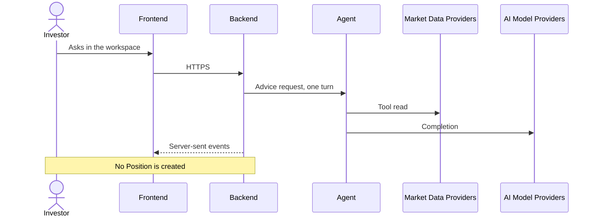
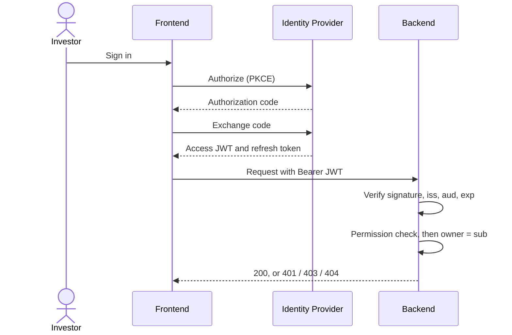
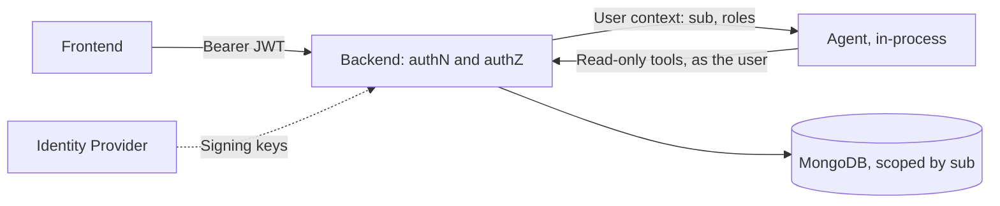

# System Architecture Overview and Boundaries

## Document Control

| Field | Value |
|---|---|
| Document | System architecture description |
| Path | `docs/architecture/SYSTEM_OVERVIEW_AND_BOUNDARIES.md` |
| Version | 0.8.4 |
| Date | 2026-10-14 |
| Status | Local working draft. Not committed. Builds on v0.8.3, on v0.6 committed at `59e26e0`. |
| Standards stance | **Aligned** to ISO/IEC/IEEE 42010. Not a certification claim. |
| Shape | Same architecture-description shape as the [agent architecture description](../domains/agent/ARCHITECTURE_DESIGN.md): entity, stakeholders, viewpoints, views, correspondences, rationale. |
| Target horizon | **Phase 1** of [Spec §3.4 Phase boundaries](../system/PRODUCT_SPECIFICATION.md#34-phase-boundaries). Later phases appear only as labels marked "future". |
| arc42 owned here | §1.2 Quality goals, §2 Constraints, §3 Context and scope, §4 Solution strategy, §5 Building blocks at system level, plus a system-level runtime view, cross-cutting list, and risk list. See §1.7. |
| Product input, frozen | [Spec v1.7.2](../system/PRODUCT_SPECIFICATION.md), [IA map v1.0.1](../system/CONCEPTUAL_IA_MAP.md), [Journeys v1.0.2](../system/USER_JOURNEYS_WITH_WIREFRAMES.md), under `docs/system/`. |
| Governing references, not copied | [Agent architecture description](../domains/agent/ARCHITECTURE_DESIGN.md). [Frontend ADR-001](../domains/frontend/DECISIONS/ADR-FRONTEND-001-MODULAR-APPLICATION.md) and [ADR-002](../domains/frontend/DECISIONS/ADR-FRONTEND-002-MODERNIZE-FRONTEND-FOUNDATION.md). [Data-pipeline ELT proposal](../research/DATA_PIPELINE_PROCESS_ELT_RESEARCH_AND_PROPOSAL.md). |

## 1. Architecture description overview

### 1.1 Purpose

This is the architecture description of the whole system. It describes the **target architecture for Phase 1** and the goals it serves: what the system is, which container owns which responsibility, and how the Phase 1 path is carried by those containers.

Today's code is used to ground the design, not as the thing being described. Each view ends with a short **Today** note that says how far the code at `59e26e0` is from the target. Code may be refactored to reach the target; the target is not bent to fit the code.

It follows the [agent architecture description](../domains/agent/ARCHITECTURE_DESIGN.md) in structure, not in depth. Domain internals, product lists, and deployment procedure stay in the domain documents.

### 1.2 Quality goals

**Prerequisite, not a ranked goal: identity.** Every Phase 1 Core write belongs to one verified user, so the gate and the Core modules are built only after [ADR-SYS-001](./DECISIONS/ADR-SYS-001-IDENTITY-AND-PER-USER-ISOLATION.md) decides how the Backend establishes the user. Today: not met; identity is a caller-set `X-User-ID` header.

Proposed, owner to confirm. Ranked. Each goal comes from the [Spec §1.5 Product principles](../system/PRODUCT_SPECIFICATION.md#15-product-principles) or [Spec §3.5 Integration and trust boundaries](../system/PRODUCT_SPECIFICATION.md#35-integration--trust-boundaries). Each is written as a scenario: stimulus, response, measure.

| Rank | Goal | Scenario (stimulus, response, measure) | Realized in | Today |
|---|---|---|---|---|
| 1 | Dual-Track process integrity, including gate atomicity | Pass is interrupted mid-write or submitted twice. The Decision record and the Position both exist or neither does; a repeat with the same idempotency key creates nothing new. 100% of fault-injection and repeat runs. Only Pass creates a Position; both outcomes write a Decision record. | §4.2, §4.4, [ADR-SYS-002](./DECISIONS/ADR-SYS-002-DECISION-GATE.md) | No Core object exists yet. MongoDB is standalone in compose and not deployed by Helm, so multi-document transactions are unavailable. |
| 2 | Per-user isolation | User B requests user A's thread or Core record by id. It is refused and nothing about the record is returned. 100% of cross-user tests. | §4.7, §4.9 | Not met. A thread is reachable by its id alone. |
| 3 | Evidence integrity | A fact is saved into an Insight or a Thesis. It is stored with source, time, and confidence; a stale or unattributed source is shown as degraded, never silently substituted. 100% of saved facts, by contract test. | §4.3, §4.7 | Provenance is stamped on each answer at runtime, never stored. |
| 4 | A degraded answer is never a wrong one | A provider or source fails or is stale. The user sees a degraded or empty result with its reason, not an invented value. 100% of fault tests; the degraded rate is observable. | §4.7 | Partly met. The Vietnam provider tool fails closed to a degraded state. |
| 5 | Offline testability | The backend suite runs in CI. No paid external service is called. Zero live calls. | Domain test strategy | Not checked for this draft. |

Latency (time to first token), availability, and LLM cost targets: owner to supply. Phase 1 dates follow [Spec §5.2](../system/PRODUCT_SPECIFICATION.md#52-high-level-timeline-12-months).

### 1.3 Environment

Outside the system, as named in [Spec §3.1 System context](../system/PRODUCT_SPECIFICATION.md#31-system-context):

- the investor, and later a mentor or reviewer (future);
- AI Model Providers;
- Market Data Providers, Vietnam-first in the target;
- News & Filings Sources;
- TradingView, for visualization only;
- Broker / Portfolio Sources (future);
- External AI Agents (future). Not yet named in the Spec; added by this architecture.

Inside, but not redesigned here:

- the live chat platform, including short-term session memory and the tool gateway;
- domain documents for agent, backend, frontend, and data, which describe that platform;
- hosting. Recorded only as "the domains are deployable." The deployment view belongs in `DEPLOYMENT_AND_INFRASTRUCTURE.md`.

### 1.4 Scope

This description covers system context, the solution strategy, the containers, how the Spec's bounded contexts map onto them, and the Phase 1 identities.

It does not replace:

- the [agent architecture description](../domains/agent/ARCHITECTURE_DESIGN.md) for agent viewpoints;
- the frontend ADRs for the frontend decision;
- the data-pipeline proposal for ingestion design;
- the Pass and Revise step-by-step flow, the gate decision record, and the data-domain note still to come.

### 1.5 Constraints and principles

**Constraints.** What the architecture is not free to change.

| Constraint | Value or source |
|---|---|
| Phase 1 timeline | Owner to supply |
| Team capacity | Owner to supply |
| LLM budget | Owner to supply |
| Market data licensing | Persisted vendor data must be licensed for that use; yfinance's terms are personal use only. [ADR-SYS-004](./DECISIONS/ADR-SYS-004-DATA-PIPELINE-AND-RECORDS.md) |
| Regulatory posture: the system advises, it does not trade | [Spec §3.3 Scope](../system/PRODUCT_SPECIFICATION.md#33-in-scope-vs-out-of-scope) |
| One deployable shell and one adaptive workspace, not separately deployed frontends | [Frontend ADR-001](../domains/frontend/DECISIONS/ADR-FRONTEND-001-MODULAR-APPLICATION.md), [IA §2.6 Layout lock](../system/CONCEPTUAL_IA_MAP.md#26-layout-lock-normative) |
| Existing stack: React and TypeScript, Python and Flask, MongoDB, Redis | §4.6 |

**Principles.** Settled decisions every view follows. Each line points to where it is decided.

| Principle | Source |
|---|---|
| The Backend owns the Core rules, the Agent advises, the Frontend presents. | Agreed 2026-10-08; [ADR-SYS-003](./DECISIONS/ADR-SYS-003-BACKEND-MODULAR-MONOLITH.md) (Proposed) |
| Pass creates a Position. Fail keeps a Decision record and creates no Position. Fail is an outcome, not a button. Case is optional. | [Spec §4.6 Decision gate](../system/PRODUCT_SPECIFICATION.md#46-decision-gate-and-object-ontology-normative); [ADR-SYS-002](./DECISIONS/ADR-SYS-002-DECISION-GATE.md) |
| Identity and isolation are a Backend-owned prerequisite. The gate design assumes an identified user. | [Spec §3.5](../system/PRODUCT_SPECIFICATION.md#35-integration--trust-boundaries); [ADR-SYS-001](./DECISIONS/ADR-SYS-001-IDENTITY-AND-PER-USER-ISOLATION.md) |
| Market pictures are provenance of the picture, not thesis evidence. | [Agent architecture description](../domains/agent/ARCHITECTURE_DESIGN.md) |
| The ELT data pipeline is adopted by [ADR-SYS-004](./DECISIONS/ADR-SYS-004-DATA-PIPELINE-AND-RECORDS.md), without the proposal's gold-layer naming. | [ELT proposal](../research/DATA_PIPELINE_PROCESS_ELT_RESEARCH_AND_PROPOSAL.md); [ADR-SYS-004](./DECISIONS/ADR-SYS-004-DATA-PIPELINE-AND-RECORDS.md) |

### 1.6 Authority split

| Document | Owns |
|---|---|
| This file | System context, quality goals, containers, Phase 1 boundary, product-to-architecture mapping |
| [Spec](../system/PRODUCT_SPECIFICATION.md), [IA map](../system/CONCEPTUAL_IA_MAP.md), [Journeys](../system/USER_JOURNEYS_WITH_WIREFRAMES.md) | Product meaning, zones, journeys |
| [Agent architecture description](../domains/agent/ARCHITECTURE_DESIGN.md) | Agent viewpoints |
| [Frontend ADR-001](../domains/frontend/DECISIONS/ADR-FRONTEND-001-MODULAR-APPLICATION.md) | Modular shell and multi-pane workspace, not micro-frontends |
| [Frontend ADR-002](../domains/frontend/DECISIONS/ADR-FRONTEND-002-MODERNIZE-FRONTEND-FOUNDATION.md) | Frontend foundation. Domain decision. |
| [Data-pipeline proposal](../research/DATA_PIPELINE_PROCESS_ELT_RESEARCH_AND_PROPOSAL.md) | Ingestion architecture, adopted by [ADR-SYS-004](./DECISIONS/ADR-SYS-004-DATA-PIPELINE-AND-RECORDS.md) without its gold-layer naming. |
| [Runtime flows](./RUNTIME_AND_INTEGRATION_FLOWS.md), ADRs, [data technical design](../domains/data/TECHNICAL_DESIGN.md) | Step-by-step flows, decisions, kept-versus-new records |

### 1.7 How arc42 and C4 are used here

These are two different tools, used together. Neither one is a certification.

**arc42** is the section checklist for this file. It says which question a section must answer.

| arc42 section | Question it answers | Where |
|---|---|---|
| §1.2 Quality goals | What the architecture must be good at | §1.2 |
| §2 Constraints | What the architecture is not free to change | §1.5 |
| §3 Context and scope | What is inside the system, and what sits outside | §4.1 |
| §4 Solution strategy | The few decisions that shape everything else | §4.5 |
| §5 Building blocks, level 1 | The major pieces and what each owns | §4.2, §4.6, and the mapping in §5.1 |
| §6 Runtime view | How a turn moves, and how the Phase 1 path moves | §4.4. The step-by-step stays in the runtime document. |
| §8 Cross-cutting concepts | Rules that cross blocks | §4.7. The full arc42 chapter still waits. |
| §11 Risks | Risks already named | §4.8. No fix steps. |

**C4** is the drawing notation. This file uses only the first two levels:

| C4 level | What the picture shows | Where | Not drawn |
|---|---|---|---|
| Level 1, system context | One system, and the people and systems outside it | §4.1 | Containers |
| Level 2, containers | Frontend, Backend (with the Agent in-process), Data, and Cache, and the external systems | §4.2 | Classes, modules, schemas |

C4 Level 3 (components) and Level 4 (code) do not belong in this file. The Core modules inside the Backend are named as responsibilities, not designed.

**Status words.** Used the same way in every table.

| Word | Meaning |
|---|---|
| Target / Phase 1 target | Intended design; Phase 1 target is in the Phase 1 scope. Future is after Phase 1. |
| Present, Partial, Absent | What the code has today. |
| Proposed, Accepted, Accepted in part | State of a decision record. Agreed means the owner agreed but the ADR is still Proposed. |
| Architecture-derived | A name or neighbour this file adds that the Spec does not use. |

**ISO 42010** is the shape around both: stakeholders, viewpoints, views, and correspondences. The Spec still decides what the words mean.

## 2. Stakeholders and concerns

| Stakeholder | Concern this view must answer |
|---|---|
| Investor | One workspace, advice that does not act for them, work that stays private |
| Product | The Phase 1 path is visible in the architecture, not only in the Spec |
| Architecture | Domains stay separated, and proposals are not mistaken for decisions |
| Frontend | The shell and the canvas direction are acknowledged, not redesigned |
| Agent and backend | The AI Companion stays one agent that advises. The Backend owns Core writes. A later multi-agent aim is recorded, not built |
| Data | Ingestion strategy is named, and it is not allowed to redefine Position or Thesis |

Concerns: where the system stops, which container owns which responsibility, what Phase 1 adds, and which existing documents stay authoritative.

## 3. Viewpoint catalog

| Viewpoint | What this file gives | Model |
|---|---|---|
| Context and boundary | Section 4.1 | C4 Level 1 and a neighbour table |
| Logical | Section 4.2 | C4 Level 2 containers |
| Information | Section 4.3 | Identities and the proposed data layers |
| Process | Section 4.4 | System level. Phase 1 target, then today's chat turn. |
| Cross-cutting | Section 4.7 | Rules that cross blocks |
| Risks | Section 4.8 | Named risks. No fix steps. |
| Correspondence to the product | Section 5.1 | One row per bounded context |
| Development, deployment, operations | Named, not drawn | Domain docs and the deployment document |

## 4. Architecture views

### 4.1 Context and boundary

**Target, Phase 1.** The investor uses one system. The system reasons with AI Model Providers, reads market data and news with provenance, and shows charts from TradingView as pictures only. It does not execute trades. Names follow [Spec §3.1](../system/PRODUCT_SPECIFICATION.md#31-system-context), except TradingView, Auth0 and External AI Agents, which are architecture-derived. The diagram shows Phase 1 neighbours only; future neighbours are in the table.

| Neighbour | Direction | What crosses the boundary | Authority | Phase | Today |
|---|---|---|---|---|---|
| Investor | In and out | Work on Insights, Working Thesis, the gate, Positions; chat with the AI Companion | The user owns all investment meaning ([Spec §4.7](../system/PRODUCT_SPECIFICATION.md#47-core-invariants) #2) | Phase 1 | Chat only |
| AI Model Providers | Out and in | Context out; reasoning and drafts in | Advisory. Never a source of market facts | Phase 1 | Present |
| Market Data Providers | In | Prices, history, fundamentals | Evidence. Attributed, licence-aware, freshness-checked | Phase 1 | Partial. The live read is Yahoo Finance; the Vietnam provider path stamps policy but does not fetch |
| News & Filings Sources | In | Articles, disclosures | Evidence with provenance | Phase 1 | Absent. Schema only |
| TradingView | In | Chart payloads | Visualization provenance only, never financial truth | Phase 1 | Present in chat; the UI shows no chart |
| Broker / Portfolio Sources | In | Positions, fills | External record of holdings | Future | Absent |
| Mentor / Reviewer | In and out | Shared Cases and comments | Read and comment | Future | Absent |
| External AI Agents | In and out | Read requests for the user's own work; proposed changes in | Untrusted caller acting in the user's own sign-in, through a Backend-owned tool interface (for example MCP). Read-only first; any write is a proposal the user confirms through the gate. Output is AI-assisted, never evidence | Future, after the identity decision record | Absent |

**Out of the Phase 1 target:** brokerage execution, long-term memory, and everything [Spec §3.4](../system/PRODUCT_SPECIFICATION.md#34-phase-boundaries) places after Phase 1.

### 4.2 Logical view

**Target, Phase 1.** Four containers inside one system: Frontend, Backend, MongoDB, and Redis. The Backend is one deployable. The Agent runs in-process inside it, and the Investment Core modules are Backend components, not containers of their own; the table below lists those components.

| Container | Owns | Must not | Today |
|---|---|---|---|
| Frontend | One shell with zones Z1 to Z4 ([IA §2](../system/CONCEPTUAL_IA_MAP.md#2-workspace-zones)). Shows the active Core object, the gate surface, and the AI Companion stream. | Decide the gate outcome. Call the Agent, Data, or any external system directly. | A single chat page with a model picker. No zones, no workspace, no chart. |
| Backend: application services | API, identity, calling the Decision gate, and coordinating every write to a Core object. The Core modules own the gate's invariants and writes. | Hold reasoning policy or storage layout. | API and services exist. No identity, no gate. |
| Backend: Investment Core modules | Insights, Working Thesis with Bull and Bear, Decision record, Position and Portfolio, Case link. Their invariants. | Be written by the Agent. Reuse today's records under Spec names (§4.3). | Absent. |
| Backend: Agent, in-process | The AI Companion across the Investment Core: collects data, analyses and drafts reports (Phase 1 target), later generates UI (§4.2.2). Tools, short-term session memory. | Write a Core object directly. Decide the gate. | Present. Built inside the API process. Tools are read-only. Session memory is unused from the UI, which sends no `conversation_id`. Provider fallback exists only on the legacy, non-ReAct path. |
| MongoDB | System of record for Core objects, Decision records, session memory, and today's records. | Hold Phase 1 identities under today's record names. | Standalone `mongo:5.0` in compose, past end-of-life since 31 Oct 2024 (ADR-SYS-002); Helm does not deploy it. No Core object stored. |
| Redis | Cache for live reads. | Act as a source of truth or as session memory. | Cache only. |

**Interfaces, target.**

| From | To | Interface | What crosses it |
|---|---|---|---|
| Investor | Frontend | Workspace | One shell |
| Frontend | Backend | HTTPS and server-sent events | API calls and the companion stream. Not Socket.IO |
| Application services | Agent | In-process advice request | One turn. Never a Core write |
| Agent | Core modules | Governed tools | Reads; its outputs reach Core only through application services |
| Backend | MongoDB | Repository | Records; only application services write Core |
| Backend | Redis | Cache | Live reads |
| Agent | AI Model Providers | API calls: Completion, Reponse, Web Search,... | Reasoning, advice only |
| Agent | Market Data Providers, TradingView | Tool read | Facts with provenance; chart pictures as visualization only |
| Application services | News & Filings Sources | Ingest | Evidence with provenance |

**Dependency rules, target.** Enforcement tests are follow-ups of [ADR-SYS-002](./DECISIONS/ADR-SYS-002-DECISION-GATE.md).

1. The Core modules never depend on the Agent.
2. The Agent reaches Core only through governed tools and writes only through admitted paths. The write rule lives in §4.2.2.
3. Only the Decision gate creates a Position. Sandbox work and Revise never write holding records.
4. The Frontend talks only to the Backend.
5. The Agent holds no Core state and never uses repositories or the database (write rule: §4.2.2). Running it as its own service later is then a redeployment, not a redesign.

**Moving the Agent out.** It stays in-process until one of these appears: scheduled or background agent runs, agent load slowing the API, a separate team owning the Agent, or a choice of a managed agent runtime; the move then gets its own decision record ([ADR-SYS-003](./DECISIONS/ADR-SYS-003-BACKEND-MODULAR-MONOLITH.md)). Today compose and Helm both run an `agent` container that is only a placeholder health check on port 7000.

**Phase 1 identities.** Working Thesis, in the Research Sandbox; Multi-stance is Bull and Bear on that thesis, not a track. Position, created only by Pass; after Pass the Thesis remains why we hold and attaches to the Position. Decision gate, the transition between them, not a container and not a Thesis state. Case, an optional binder, not created by Pass. Tracks are lanes of the workspace, derived from the active object, not a stored status. The chart yielding at the gate is a presentation rule of the Research Sandbox, not a stored layout.

*Reading note.* Platform (workspace, Agent, data, infrastructure) and Investment Core (Insights, Thesis, Decision, Portfolio) are business groupings from the [Spec](../system/PRODUCT_SPECIFICATION.md), not architectural layers. Today the Platform is mostly built and the Core is almost empty, so Phase 1 is mainly about placing the Core.

#### 4.2.1 Logical building blocks

| Building block | Responsibility | Status |
|---|---|---|
| Workspace shell | Presents zones Z1 to Z4, the active Core object, the gate surface and the AI Companion stream. | Target. Today a single chat page. |
| API edge and identity | Accepts requests, authenticates the caller and applies permission and owner checks (§4.9). | Target. Today no identity. |
| Orchestration services | Turn a request into governed work: conversation lifecycle, session context, calls to the Agent and to Core, including the user's gate action. | Present for chat. |
| Investment Core modules | Insights, Working Thesis with Bull and Bear, Decision record, Position and Portfolio, Case link, and their invariants. Includes the Decision gate, the only transition from Research Sandbox to Execution Portfolio: it writes the Decision record and, on Pass, the Position. | Target. Absent today. Gate in [ADR-SYS-002](./DECISIONS/ADR-SYS-002-DECISION-GATE.md). |
| AI Companion (Agent) | The AI-powered assistant across the Investment Core: collects and reads data, analyses, drafts reports, and later generates UI. Every result reaches Core only through the application services. | Read-only analysis today; collect and report are Phase 1 target (below). |
| Governed tool boundary | Exposes capabilities to the Agent, admits each call, and keeps provider choice, licensing, freshness and normalization below the tools. | Present, read-only. |
| Ingestion pipeline | Lands collected and sourced data raw, conforms it, curates it, with provenance ([ADR-SYS-004](./DECISIONS/ADR-SYS-004-DATA-PIPELINE-AND-RECORDS.md)). | Phase 1 target. Absent today. |
| System of record and cache | Durable records, and a cache for live reads that is never the source of truth. | Present. |

The blocks are split so that presentation, authority over Core, reasoning, data acquisition and storage can change on their own. The Agent can do a lot, but it decides nothing that the user or the Backend owns.

#### 4.2.2 Responsibility and dependency boundaries

| Concern | Owner block | Boundary |
|---|---|---|
| Who the caller is and what they may touch | API edge and identity | Applied once per request. No other block repeats or widens it. |
| Core rules and every Core write | Orchestration services and Core modules | A write happens only on a user action or through an admitted Agent output path below. |
| Decision and Position | Investment Core modules, at the Decision gate | Written only at the gate, after the user confirms. Never by the Agent. |
| Data collection | Agent, through the ingestion pipeline | Collected data enters with provenance and stays data, never instructions. Ingestion is an admitted write path. Phase 1 target. |
| Analysis and reports | Agent | Saved through the application services, tagged AI-assisted, never evidence on their own. Phase 1 target; today analysis is returned in chat only. |
| Generated UI | Agent proposes, Frontend renders | Renders only inside existing zones (Z4, or a draft in Z3) and is checked before it is shown. A Z3 draft becomes a Core object only through a user action. Future; outside Phase 1 ([IA §1.2](../system/CONCEPTUAL_IA_MAP.md)). |
| Provider choice and licensing | Governed tool boundary, ingestion pipeline | Never visible to the model as a provider list. |

**Agent write rule (the one home).** The Agent writes nothing directly. Its only write paths are collect (through the ingestion pipeline), save report and propose draft (through the application services). Each has its own admission rule, recorded with [ADR-SYS-002](./DECISIONS/ADR-SYS-002-DECISION-GATE.md) and needed in Phase 1. Decision and Position are written only at the gate after the user confirms. §4.2 and §4.9 link here. **Today** the Agent has four read-only tools (symbol price, Vietnam market data, reporting, TradingView link) and three response formats, and it writes nothing.

#### 4.2.3 Layered boundaries

| Layer | Blocks | Boundary |
|---|---|---|
| Presentation | Workspace shell | Presents only. Talks only to the API edge. |
| Application | API edge and identity, orchestration services, AI Companion | Coordinates work and enforces access. The Agent is an Application component; it holds no Core state. |
| Business rules | Investment Core modules, including the Decision gate | Core objects, invariants and the gate. Depends on no other layer except Persistence through repositories. |
| Integration | Governed tool boundary, ingestion pipeline, provider adapters | Reaches outside sources and AI Model Providers. Reached by the Agent only through governed tools. The tool boundary reads Core through an application port, never repositories. |
| Persistence | System of record, cache | Stores. Reached only through repositories and the cache interface. |

Dependencies point down only. Dependency rules 1 to 5 above are this picture applied to the Agent and Core.

### 4.3 Information view

**Target, Phase 1.** The Phase 1 identities (Insight with its evidence, Working Thesis, Decision record, Position, Case link) are new records beside today's. Evidence and provenance are stored with what they support. Which records are kept and which are new is decided in the [data technical design](../domains/data/TECHNICAL_DESIGN.md), not here.

**Today.** The data domain holds the live platform's records, including holding, idea, report, note, watchlist, and session records. Those stay what they are and are not reused under Spec names. Provenance exists only at runtime.

**Adopted** by [ADR-SYS-004](./DECISIONS/ADR-SYS-004-DATA-PIPELINE-AND-RECORDS.md), from the [data-pipeline proposal](../research/DATA_PIPELINE_PROCESS_ELT_RESEARCH_AND_PROPOSAL.md). Two paths:

1. **Batch path.** ELT: land raw inputs first, conform them, then curate marts, called bronze, silver, and gold on one data store. ELT is the proposal's fill method, not a requirement of the medallion pattern.
2. **Live path.** External market queries skip the batch landing. Services and agent tools read them through a cache so a conversation does not wait on a pipeline.

The proposal's gold layer names session analyses, idea records, and vector memory as marts. This architecture does not accept that naming: those records are not a Working Thesis, a Position, or an Insight. Vector memory stays after Phase 1. ADR-SYS-004 adopts the pipeline with this naming excluded.

### 4.4 Process view

Drawn at system level. The [runtime document](./RUNTIME_AND_INTEGRATION_FLOWS.md) owns the step-by-step.

**Terminology.** The Decision gate has two outcomes, **Pass** and **Fail**. **Revise** is the path the user takes after Fail, not a third outcome.

**Phase 1 target.** The Research Sandbox holds the Working Thesis. The Decision gate is the only way out. Pass creates a Position on the Execution Portfolio, and the Thesis remains why we hold. Fail writes a Decision record and no holding; Revise is the path back to the thesis after Fail. Pass writes its Decision record and creates the Position in one atomic step (goal 1). Only Pass creates a Position. Fail is an outcome, not a button. Case is optional and is not created by Pass. See [Spec §4.6](../system/PRODUCT_SPECIFICATION.md#46-decision-gate-and-object-ontology-normative), [J-TFI-1](../system/USER_JOURNEYS_WITH_WIREFRAMES.md#21-j-tfi-1--pass--position-on-portfolio-primary) and [J-TFI-2](../system/USER_JOURNEYS_WITH_WIREFRAMES.md#22-j-tfi-2--fail--revise--working-thesis-no-position).

**Today.** A chat turn. Nothing in that turn creates a Position.

### 4.5 Patterns applied

Detail stays in the document linked beside each one.

| Pattern | What it means here | Status |
|---|---|---|
| One system, four containers | Frontend, Backend with the Agent in-process, Data, and Cache. Calls follow the dependency rules in §4.2. | Target. Today the Agent is already in-process. |
| Modular monolith frontend | One deployable shell and an adaptive canvas. Modules sit behind a platform layer. | Decided. [Frontend ADR-001](../domains/frontend/DECISIONS/ADR-FRONTEND-001-MODULAR-APPLICATION.md). |
| Modular monolith, backend | One Backend deployable with the Core modules and the Agent in-process, behind the dependency rules in §4.2. | Proposed. [ADR-SYS-003](./DECISIONS/ADR-SYS-003-BACKEND-MODULAR-MONOLITH.md). |
| Services in front of repositories | The presentation domain does not touch storage. | Current. [Backend technical design](../domains/backend/TECHNICAL_DESIGN.md). |
| One ReAct assistant | The enabled agent is the AI Companion. Tools fetch and calculate. The model explains. Output advises and does not trade. | Current. [Agent architecture description](../domains/agent/ARCHITECTURE_DESIGN.md). |
| Medallion layering, with a live bypass | Batch inputs land raw, then are validated, then enriched. Live market queries skip that landing and use a cache. | Adopted, [ADR-SYS-004](./DECISIONS/ADR-SYS-004-DATA-PIPELINE-AND-RECORDS.md). [Data-pipeline proposal](../research/DATA_PIPELINE_PROCESS_ELT_RESEARCH_AND_PROPOSAL.md). |

**Future aim, not a Phase 1 pattern.** Several agents, with robust short-term memory, long-term memory, and a wider tool set. Not drawn as a container here. Long-term memory stays where the Spec places it, after Phase 1.

### 4.6 Domain stacks

One line each. The link is where the stack is actually described. This table does not choose new products.

| Domain | Stack, briefly | Where the description lives |
|---|---|---|
| Frontend | One React and TypeScript shell. The companion stream is server-sent events. The foundation direction is a domain decision, not restated here. | [Frontend architecture](../domains/frontend/ARCHITECTURE.md). [ADR-001](../domains/frontend/DECISIONS/ADR-FRONTEND-001-MODULAR-APPLICATION.md). [ADR-002](../domains/frontend/DECISIONS/ADR-FRONTEND-002-MODERNIZE-FRONTEND-FOUNDATION.md). |
| Backend | Python services on Flask. They own the API, service orchestration, and server-sent event delivery. Socket.IO is named in that design and is not the companion's path. | [Backend technical design](../domains/backend/TECHNICAL_DESIGN.md). |
| Agent | One ReAct assistant, the AI Companion, with session memory and a tool gateway, running in the Backend process. | [Agent architecture description](../domains/agent/ARCHITECTURE_DESIGN.md). |
| Data | MongoDB for records and Redis for cache, as named by the data technical design. A medallion on that same store is adopted by ADR-SYS-004. | [Data technical design](../domains/data/TECHNICAL_DESIGN.md). [ELT proposal](../research/DATA_PIPELINE_PROCESS_ELT_RESEARCH_AND_PROPOSAL.md). |

### 4.7 Cross-cutting concepts

Each line is a rule that crosses blocks, not a design.

| Concept | Rule | Where the detail lives |
|---|---|---|
| Advice boundary | The system advises. It does not trade. Accepted AI content is tagged AI-assisted. | [Spec §3.5](../system/PRODUCT_SPECIFICATION.md#35-integration--trust-boundaries) |
| Model authority | AI Model Providers are never a source of market facts. Facts come only through governed tools. | [Agent architecture description](../domains/agent/ARCHITECTURE_DESIGN.md) |
| Evidence | Evidence carries source, time, and confidence. Market pictures are provenance of the picture, not thesis evidence. | [Spec §4.7](../system/PRODUCT_SPECIFICATION.md#47-core-invariants) #3; agent architecture description |
| Identity and isolation | Every Core object and all memory belong to one identified user. The Backend enforces it. | [Spec §3.5](../system/PRODUCT_SPECIFICATION.md#35-integration--trust-boundaries); [ADR-SYS-001](./DECISIONS/ADR-SYS-001-IDENTITY-AND-PER-USER-ISOLATION.md) (accepted in part) |
| Cache | Redis accelerates. It is never the source of truth. | [Data technical design](../domains/data/TECHNICAL_DESIGN.md) |
| Companion stream | The companion path is server-sent events. | [Backend technical design](../domains/backend/TECHNICAL_DESIGN.md) |
| Memory | Session memory does not store financial facts. Long-term memory is after Phase 1. | [Agent ADR-001](../domains/agent/DECISIONS/ADR-AGENT-001-LAYERED-LLM-ARCHITECTURE.md) |
| Naming | If a proposal name and a Spec name collide, the [Spec glossary](../system/PRODUCT_SPECIFICATION.md#02-glossary-the-only-glossary-other-docs-point-here) wins. | This file |
| Privacy and retention | Open: retention, deletion, export, sharing, and the identity provider as a processor with cross-border transfer. Owner to decide. | Future ADR-SYS-006; R11 |
| State labeling | Views describe the target. "Today" notes describe the code. Proposed is not decided. | This file |

### 4.8 Risks

A light register. Likelihood (L) and impact (I) are initial estimates (H, M, L), owner to confirm.

| ID | Risk | Why it is on this page | L | I | Trigger | Owner | Linked |
|---|---|---|---|---|---|---|---|
| R1 | Security and identity gaps on the live platform. | The [architecture review](../architecture-review.md) rates security as needing work: no auth, hardcoded secrets, no rate limiting. Identity today is a caller-set `X-User-ID` header, `/api/chat` takes no identity, and a thread is reachable by its id alone, so there is no per-user isolation. | H | H | Any multi-user use | Backend | ADR-SYS-001 |
| R2 | Pass leaves a Decision record without a Position, or a duplicate Position. | MongoDB runs standalone, so multi-document transactions are unavailable. | H | H | Gate built on standalone MongoDB; today's setup is standalone `mongo:5.0`, past end-of-life | Backend | ADR-SYS-002 |
| R3 | Prompt injection through news, filings, or tool output steers the Agent. | News ingest is a Phase 1 deliverable. | M | M | News ingest goes live | Agent | §4.9 |
| R4 | Persisting unlicensed vendor data. | The live read is yfinance, whose terms are personal use only. | H | M | Storing vendor data as evidence | Data | ADR-SYS-004 |
| R5 | Agent load slows the API in one process. | The Agent is in-process. | M | M | Long or background agent runs, including scheduled data collection (Phase 1) | Backend | ADR-SYS-003 |
| R6 | A reader treats today's holding, idea, report, or session records as a Thesis or a Position. | The collections already exist and the names are close. | M | M | Core work starts on existing collections | Data | ADR-SYS-004 |
| R7 | A reader takes the adopted pipeline to include the proposal's gold-layer naming. | ADR-SYS-004 adopts the pipeline but excludes that naming. | M | L | Pipeline work starts | Data | ADR-SYS-004 |
| R8 | A reader treats Socket.IO as the companion path. | The backend design names it. Only a test page uses it. | L | L | Frontend streaming work | Backend | §4.6 |
| R9 | Phase 1 is built as several agents, or with long-term memory. | That is the future aim, not the Phase 1 target. | L | M | Scope creep | Architecture | §4.5 |
| R10 | User holdings, theses or identity sent to AI Model Providers beyond what a call needs. | Prompts are assembled in the Backend. There is no data-minimisation rule yet. | M | M | Core data enters prompts | Backend | §4.9 / ADR-SYS-001 |
| R11 | Personal data kept, exported or transferred without a stated rule. | No privacy and retention decision exists. | M | M | Real user data stored, or identity provider in production | Owner | Future ADR-SYS-006 |

**Doc fixes, not architecture risks.**

- The README calls Redis the short-term memory store. Session memory is held in MongoDB; Redis is cache only.
- The README draws the Agent as its own container on port 7000. The code builds the Agent inside the Backend `api` process. `docker-compose.yml` and the Helm chart (`deployment-agent.yaml`) both run an `agent` container that only serves a placeholder health check on port 7000, marked for future background tasks and model warm-up. This file draws the Agent in-process.
- The README marks multi-model fallback as verified. It exists only on the legacy, non-ReAct path (`_generate_with_fallback`); a normal ReAct turn does not switch providers.

### 4.9 Security

**Target, Phase 1.** Every place where untrusted content or callers meet the system is a trust boundary. The Backend enforces every rule below. The Agent and the Frontend never enforce them on their own. Threats follow the [OWASP Top 10 for LLM Applications 2025](https://owasp.org/www-project-top-10-for-large-language-model-applications/assets/PDF/OWASP-Top-10-for-LLMs-v2025.pdf) and the [OWASP Top 10 for Agentic Applications 2026](https://genai.owasp.org/2025/12/09/owasp-top-10-for-agentic-applications-the-benchmark-for-agentic-security-in-the-age-of-autonomous-ai/). This is an architecture view, not a security assessment.

| Boundary | Main threats | Mitigation (target) | Owner | Risk / ADR | Today |
|---|---|---|---|---|---|
| Investor to Frontend to Backend | Cross-user access; spoofed identity | Every request carries an authenticated identity, and every Core record and thread is scoped to its owner (goal 2). | Backend | R1 / ADR-SYS-001 | Not met. Caller-set `X-User-ID`, thread reachable by id. |
| News, filings and tool output to Agent | [Indirect prompt injection (LLM01)](https://genai.owasp.org/llmrisk/llm01-prompt-injection/); [misinformation (LLM09)](https://genai.owasp.org/llmrisk/llm092025-misinformation/) | Ingested content is data in labelled context, never instructions. Agent tools are read-only. Market facts come only from Market Data Providers with provenance. | Agent, Backend | R3 | Partial. The tool gateway admits read-only tools only. News is schema-only. |
| Backend to AI Model Providers | Sensitive information disclosure (LLM02); unbounded consumption (LLM10) | Send the minimum user data per call. Record the provider used in provenance. Per-user rate and loop limits. | Backend | R10 / ADR-SYS-001 | Not met. No rate limiting. Provider fallback runs on the legacy path only and marks the reply `[fallback:<provider>]`. Whether provenance records the provider is not checked. |
| Agent output to Frontend and Core | [Improper output handling (LLM05)](https://genai.owasp.org/llmrisk/llm052025-improper-output-handling/); [excessive agency (LLM06)](https://owasp.org/www-project-top-10-for-large-language-model-applications/2_0_vulns/LLM06_ExcessiveAgency) | Validate and encode output before rendering. The Backend checks tool arguments. Agent writes follow the write rule in §4.2.2. Generated UI is checked before it is shown. | Backend, Frontend | ADR-SYS-002 | Partial. Read-only gateway. No write paths, no tagging yet. |
| External AI Agents to Backend (future) | Tool misuse (ASI02); confused deputy | A Backend-owned MCP server acting as an OAuth 2.1 resource server with audience checks, in the user's own context. Read-only first. Writes are proposals the user confirms at the gate. | Backend | ADR-SYS-005 | Absent. Future. |

Rules that hold across all boundaries:
1. Content the system ingests is data, never instructions.
2. Models are never a source of market facts.
3. AI-assisted content is tagged and never auto-promoted to evidence.
4. The Agent writes only through admitted paths ([§4.2.2](#422-responsibility-and-dependency-boundaries)). Generated UI is checked before it is shown. External agents hold read-only tools.
5. Data sent to a model provider is minimised, and the provider used is recorded.

Detail and sources are in the Researcher's brief (`OWASP_LLM_AGENTIC_BOUNDARY_BRIEF.md`, 2026-10-12, not in the repo).

#### Identity and access (target)

The Investor as user signs in through an identity provider (IdP) with OpenID Connect, a login layer on OAuth 2.0. The Frontend uses the authorization-code flow with PKCE. The IdP issues a short-lived signed JWT access token, and the Backend never handles passwords. The IdP is Auth0. Where the browser keeps tokens and how roles map to permissions are still open in [ADR-SYS-001](DECISIONS/ADR-SYS-001-IDENTITY-AND-PER-USER-ISOLATION.md).

Roles and the identity provider (Auth0) are architecture-derived, not Spec names. The Backend application layer makes two checks once per request, in this order. First, the user's role must grant the permission the call needs, such as `thesis:write`. Second, the record's owner must equal `sub`, the user id in the token. A role never grants access to another user's records. Agent tools do not repeat these checks. They receive the caller's `sub` from the Backend.

| Role | Permissions (examples) | Scope |
|---|---|---|
| investor | `research:read/write`, `thesis:write`, `decision:write`, `portfolio:read` | Own records only |
| viewer (later) | `research:read`, `portfolio:read` | Read-only |
| admin | `admin:ops`, `providers:manage` | No access to other users' theses by default |
| external agent (future) | `research:read`, `proposal:create`, never `decision:write` | Its own delegated, audience-bound token; [ADR-SYS-005](DECISIONS/ADR-SYS-005-EXTERNAL-AI-AGENT-ACCESS.md) |

The Agent holds no token and no rights of its own. It always acts as the calling user, and every Core write still passes the gate with the user's confirmation.

## 5. Correspondences

### 5.1 Product to architecture

One row per bounded context in [Spec §4.9](../system/PRODUCT_SPECIFICATION.md#49-bounded-contexts-logical). Phases follow [Spec §5.3](../system/PRODUCT_SPECIFICATION.md#53-phase-goals--prioritized-deliverables). "Today" is checked against the code at `59e26e0`.

| Bounded context | Layer | Phase | Target owner | Data authority | Today |
|---|---|---|---|---|---|
| Workspace / Canvas | Platform | 1 (P0) | Frontend presents; Backend holds the workspace context | Backend | Partial |
| AI Agents + Memory | Platform | 1 (P1 assistant: analysis, collect, report); memory later | Agent, in-process | Backend; session memory in Data | Partial |
| Data / Information | Platform | 1 (P0) | Backend, through governed tools and ingest | Backend; cache is not authority | Partial |
| Insights | Core | 1 (P0) | Backend Core module | Backend | Absent |
| Thesis + Principles | Core | 1 (P0) | Backend Core module | Backend | Absent |
| Decision + Journal | Core | 1 (Decision P0); Journal 2 | Backend Core module | Backend | Absent |
| Portfolio and Position | Core | 1 (P0 basic) | Backend Core module | Backend | Absent |
| Monitoring | Core | 2 | Future | Future | Absent |
| Investment Case | Cross | 1 (P0 thin) | Backend Core module | Backend | Absent |

| Phase 1 P0 deliverable | Containers it needs | Gap today |
|---|---|---|
| Adaptive Visual Canvas | Frontend shell; Backend workspace context | Shell, zones, layout |
| Vietnam-first Data Hub and provenance | Backend ingest and governed tools; Data | Live Vietnam providers, stored provenance |
| Insights foundation | Insights module; evidence capture | All |
| Dual-Track Workspace IA | Frontend lanes; Backend gate | All |
| Living Thesis v1 and Bull/Bear | Thesis module | All |
| Basic Decision gate and checklist | Decision module and gate | All |
| Basic Portfolio and Position after Pass, optional Case | Portfolio module; Case link | All |

**Reading.** Today the system is a working Platform with no Investment Core. The main Phase 1 task is to place the Core modules in the Backend, not to refine the agent.

### 5.2 Consistency with other documents

| This view says | Must stay consistent with |
|---|---|
| One shell, not micro-frontends | [Frontend ADR-001](../domains/frontend/DECISIONS/ADR-FRONTEND-001-MODULAR-APPLICATION.md) |
| Foundation is a domain decision | [Frontend ADR-002](../domains/frontend/DECISIONS/ADR-FRONTEND-002-MODERNIZE-FRONTEND-FOUNDATION.md) |
| One agent, session memory, visualization is not thesis evidence | [Agent architecture description](../domains/agent/ARCHITECTURE_DESIGN.md) |
| Medallion layers plus a live bypass. ELT is the proposal's fill method | [Data-pipeline proposal](../research/DATA_PIPELINE_PROCESS_ELT_RESEARCH_AND_PROPOSAL.md), adopted by ADR-SYS-004 |
| Pass creates a Position. Fail keeps a Decision record and creates no Position; Revise is the path after Fail. Case is optional. | [Spec §0.4](../system/PRODUCT_SPECIFICATION.md#04-phase-1-conceptual-cut-line-what-we-prove-next); [Spec §4.6](../system/PRODUCT_SPECIFICATION.md#46-decision-gate-and-object-ontology-normative) |
| TradingView, Auth0, External AI Agents, admin and viewer roles | This file; [Spec §3.1](../system/PRODUCT_SPECIFICATION.md#31-system-context) does not name them |
| Zones and layout lock | [IA map §2](../system/CONCEPTUAL_IA_MAP.md#2-workspace-zones) |

If a gold mart in the proposal and a Phase 1 identity share a word, the Spec wins. The proposal must be amended before it is adopted, not the other way around.

## 6. Rationale

- The agent document is the structural model because it already separates viewpoints, views, and decision authority.
- The views describe the Phase 1 target so the code can be refactored toward it. Today's code appears only as status, so the design is grounded without being bound to it.
- The Agent is drawn inside the Backend because it runs in that process today and no decision moves it out. Drawing it as a separate service would be a decision this file has not made.
- The Core modules sit in the Backend because the Backend owns the Core rules. The Agent can only propose.
- The product mapping lives here, as a correspondence, so a reader can trace each bounded context to its owner without a second document.
- ADR-001 and ADR-002 are frontend decisions, so this file records their outcome and links them.
- The data proposal is included as proposed, with the gold-layer conflict called out, so Phase 1 does not inherit today's records as its objects.

## 7. Left for later

**Decision index, in order of work.**

| ADR | Decision | Status | Blocks |
|---|---|---|---|
| [ADR-SYS-001](./DECISIONS/ADR-SYS-001-IDENTITY-AND-PER-USER-ISOLATION.md) | Identity and per-user isolation | Accepted in part: Auth0 is the IdP. Token storage and role mapping open | All Phase 1 Core writes; ADR-SYS-002; ADR-SYS-005 |
| [ADR-SYS-002](./DECISIONS/ADR-SYS-002-DECISION-GATE.md) | Decision gate: atomic Pass, idempotency key, immutable Decision records, and the admission rules for the Agent's write paths (Phase 1); `mongo:5.0` end-of-life. Also carries the note that [Spec §4.6](../system/PRODUCT_SPECIFICATION.md#46-decision-gate-and-object-ontology-normative) #2 does not yet say Fail keeps a Decision record | Proposed | Gate and Position deliverables; runtime v0.2 |
| [ADR-SYS-003](./DECISIONS/ADR-SYS-003-BACKEND-MODULAR-MONOLITH.md) | Backend modular monolith; when the Agent moves out | Proposed | §4.2 rules; the placeholder `agent` container |
| [ADR-SYS-004](./DECISIONS/ADR-SYS-004-DATA-PIPELINE-AND-RECORDS.md) | ELT pipeline adopted, without the gold-layer naming; kept versus new records; licensing | Accepted | Data Hub deliverable |
| [ADR-SYS-005](./DECISIONS/ADR-SYS-005-EXTERNAL-AI-AGENT-ACCESS.md) | External AI agent access through a Backend-owned tool interface, read-only first, writes only as proposals the user confirms | Proposed, future | None in Phase 1 |

Domain decisions stay in their domains: [Frontend ADR-001](../domains/frontend/DECISIONS/ADR-FRONTEND-001-MODULAR-APPLICATION.md), [ADR-002](../domains/frontend/DECISIONS/ADR-FRONTEND-002-MODERNIZE-FRONTEND-FOUNDATION.md), and the agent ADRs starting at [ADR-AGENT-001](../domains/agent/DECISIONS/ADR-AGENT-001-LAYERED-LLM-ARCHITECTURE.md).

Anything else waits.

| Topic | Document |
|---|---|
| Pass and Revise as a step-by-step flow | [Runtime and integration flows](./RUNTIME_AND_INTEGRATION_FLOWS.md) |
| Kept records versus new identities | [Data technical design](../domains/data/TECHNICAL_DESIGN.md) |
| Hosting | `DEPLOYMENT_AND_INFRASTRUCTURE.md` |

## 8. Revision history

| Version | Date | Notes |
|---|---|---|
| 0.0 | 2026-04-03 | Empty skeleton. |
| 0.1–0.3 | 2026-09-30 | Earlier drafts. Superseded. 0.3 was a thin skeleton and is the one replaced here. |
| 0.4 | 2026-09-30 | Published as `f88ed92`. Restructured on the agent architecture-description shape. Frontend ADR-001 and ADR-002 and the ELT proposal brought in as governing references, with the proposal's gold-layer conflict called out. |
| 0.5 | 2026-10-02 | Local only. Patterns, a one-line stack pointer per domain, and an explicit arc42-to-C4 map. The current agent is named as the AI Companion. Multi-agent with robust short-term memory, long-term memory, and tools is recorded as a future aim. Lanes renamed to Research Sandbox and Execution Portfolio. |
| 0.6 | 2026-10-02 | Committed at `59e26e0`. C4 context and container diagrams replace the flowcharts. Call direction is the eight interfaces, not inward. Process view, cross-cutting concepts, and risks added at system level. Section order restored. |
| 0.7 | 2026-10-09 | Local only. Target-first with a Phase 1 horizon and "Today" notes. Quality goals and a constraints table replace key characteristics. Context split into Spec §3.1 externals with a neighbour table. Agent drawn in-process inside the Backend, with Core modules and dependency rules. Product-to-architecture mapping added as §5.1. Trust, identity, and cache rules; identity risk; README drift. Unverified provider fallback removed. References linked. Agent placement: a rule that keeps the Agent movable, triggers for moving it out, and External AI Agents as a future neighbour. |
| 0.8 | 2026-10-12 | Local only. Additive on v0.7b. Identity as a prerequisite; quality goals as scenarios. Constraints split from principles. Context diagram shows Phase 1 neighbours only. Containers redrawn as Frontend, Backend, MongoDB, Redis, with an interface table restored from v0.6. Terminology line and a Fail node in the gate flow. Backend modular-monolith pattern. Risk register, doc-fix list, security placeholder (§4.9), decision index. Provider fallback recorded as legacy path only. |
| 0.8.1 | 2026-10-13 | Local only. §4.9 Security from the Researcher's brief, R10, and an identity-and-access subsection: OIDC sign-in with PKCE, JWT checks, permission then owner check in the Backend application layer, roles table, Agent acts as the calling user. IdP, token storage and claims detail moved to ADR-SYS-001. |
| 0.8.2 | 2026-10-13 | Local only. ADR-SYS-001 accepted in part (Auth0 as IdP). ADR-SYS-004 accepted: ELT pipeline adopted without the gold-layer naming. Decision index, pipeline status text and R7 updated to match. |
| 0.8.3 | 2026-10-13 | Local only. Logical view gains 4.2.1 building blocks (Decision gate inside the Investment Core block), 4.2.2 responsibility and dependency boundaries, 4.2.3 layered boundaries (Presentation, Application, Business rules, Integration, Persistence); Platform and Core as a reading note; ingestion pipeline as a Phase 1 block. Agent role broadened with status per responsibility; §4.9 write rules updated to match. |
| 0.8.4 | 2026-10-14 | Local only. Review fixes: four containers everywhere, gate ownership, one home for the Agent write rule (§4.2.2), read port from Integration to Business rules, gate wording in Pass and Fail terms, status pass and status legend. Agent collect and report as Phase 1 target; R5 to M; R2 to H. Architecture-derived labels. `mongo:5.0` end-of-life noted. Privacy and retention row and R11. |
