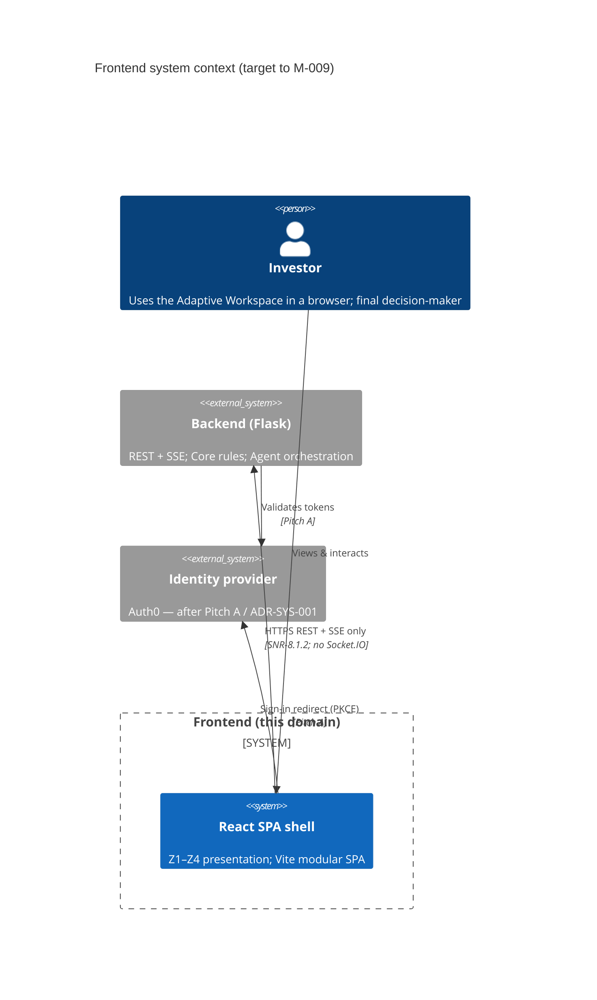
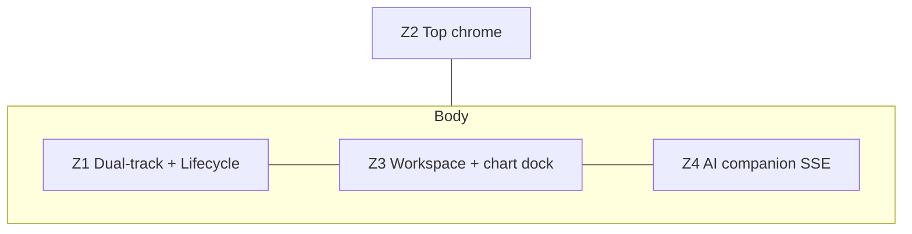
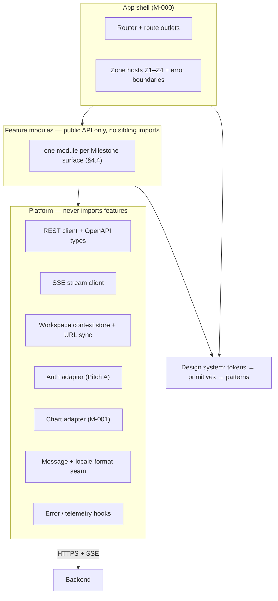
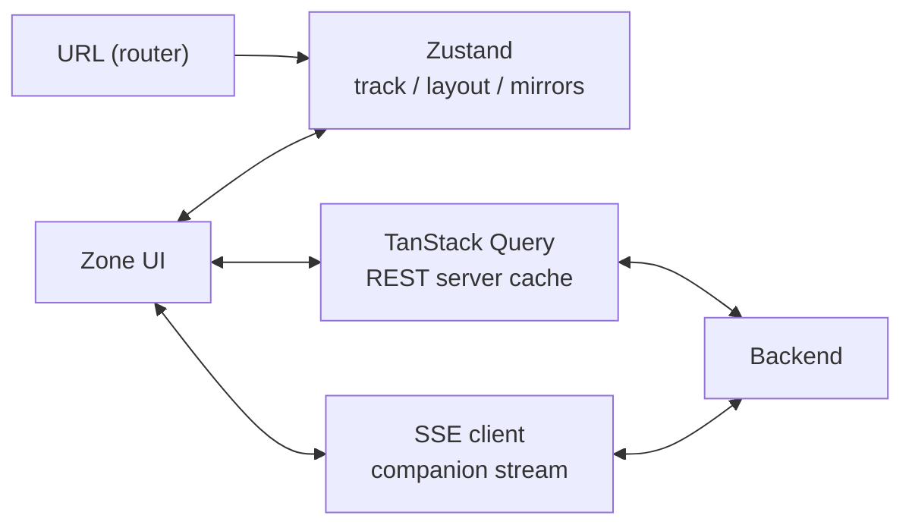
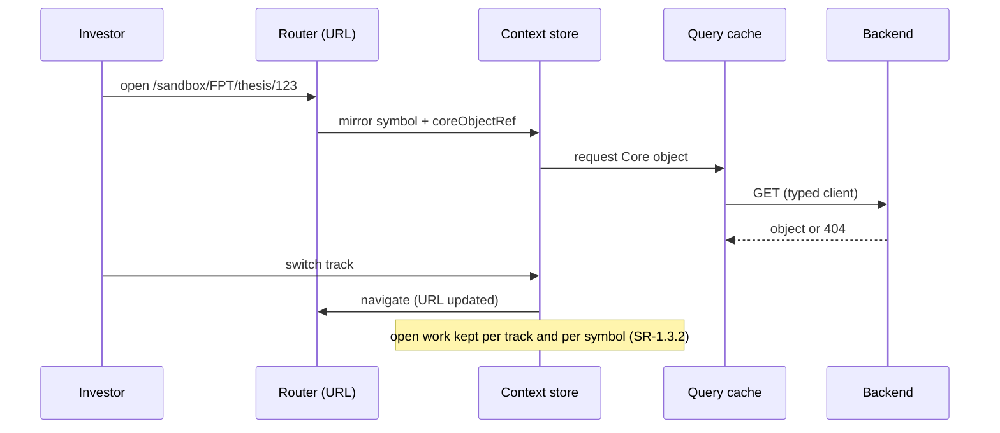
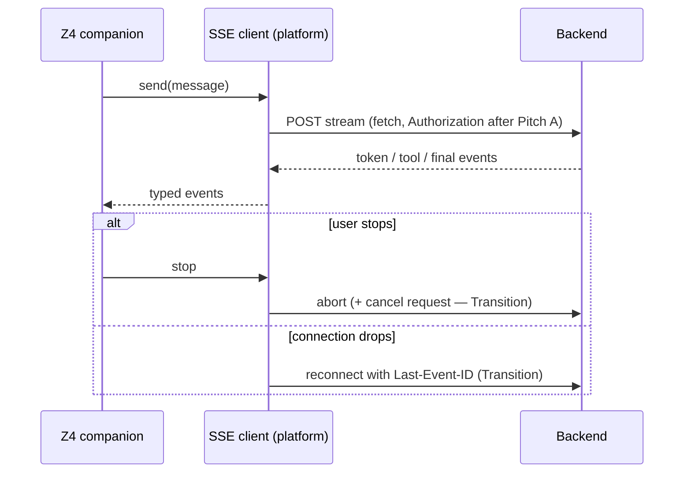

# Frontend Architecture — Target (M-000 → M-009)

> **Viewpoint:** C4-style structure and boundaries for the presentation Frontend, from the M-000 foundation through Milestone M-009.
> **Realization** (packages, store shapes, SSE client, file tree, lint rules) lives in [TECHNICAL_DESIGN.md](./TECHNICAL_DESIGN.md), owned by Coding Orchestrator.
> **Presentation contract** (shell geometry, tokens, zone and pattern states, a11y floor): [DESIGN_LOCK.md](./DESIGN_LOCK.md) and [DESIGN_SYSTEM.md](./DESIGN_SYSTEM.md) (Maintainer: UX Designer). Cited here, not duplicated.

**State labels used in this document:** **Current** = as built today (Appendix A). **Target** = committed for a named Milestone up to M-009. **Transition** = migration step between the two. **Future** = beyond M-009; only a seam is reserved.

---

## 1. Document control

| Field | Value |
|-------|-------|
| **Document** | Frontend domain architecture (target) |
| **Version** | 0.3.4 (local draft, not committed) |
| **Status** | Target — M-000 Pitch B foundation, extended with building blocks to M-009 |
| **Canonical path** | `docs/domains/frontend/ARCHITECTURE.md` |
| **Owners** | Software Engineer (maintainer) · UX / UI Designer (presentation viewpoint) |
| **Architecture decisions** | Software Architect Assistant (ADR-FRONTEND-001 … 008) |
| **Horizon** | Product §5.3 Milestones M-000 … M-009 plus foundation blocks; M-010 and later appear only as Future seams |
| **Date** | 2026-11-13 |

### Governing links

| Artifact | Role |
|----------|------|
| [PRODUCT_SPECIFICATION.md](../../system/PRODUCT_SPECIFICATION.md) — M-000 … M-009 | Milestones; M-000 Pitch B = FE foundation; Pitch A = identity |
| [SYSTEM_REQUIREMENTS_SPECIFICATION.md](../../system/SYSTEM_REQUIREMENTS_SPECIFICATION.md) | **SR-1.3.1–1.3.5** canvas (SR-1.3.5 M-001 chart proof of concept, approved 2026-11-10) · **SR-1.4.1** modular shell · **SR-1.4.2** workspace context · **SNR-6.1.4** FE Vitest+RTL · **SNR-8.1.2** HTTPS+SSE only · SR-10.1.x identity (Pitch A) |
| [ADR-FRONTEND-001](./DECISIONS/ADR-FRONTEND-001-MODULAR-APPLICATION.md) | **Accepted** — modular shell = IA Z1–Z4; presentation-only |
| [ADR-FRONTEND-008](./DECISIONS/ADR-FRONTEND-008-MSW-AND-STORYBOOK-IN-M000.md) | **Accepted** — MSW and Storybook in M-000; fixtures serve the M-001 chart proof of concept |
| [ADR-FRONTEND-002](./DECISIONS/ADR-FRONTEND-002-MODERNIZE-FRONTEND-FOUNDATION.md) | **Accepted** — Vite / Router / panels / Zustand / TanStack Query / Tailwind+Radix / OpenAPI types / Vitest; carve-outs |
| [ADR-FRONTEND-003](./DECISIONS/ADR-FRONTEND-003-URL-OWNED-SHAREABLE-STATE.md) | **Accepted** — URL owns shareable workspace state; store mirrors it and owns per-symbol context |
| [ADR-FRONTEND-004](./DECISIONS/ADR-FRONTEND-004-CHART-ENGINE-ADAPTER.md) | **Accepted** — chart engine behind an adapter; M-001 proof of concept (Sandbox, mock data), M-006 enhancement; governs chart capabilities |
| [ADR-FRONTEND-005](./DECISIONS/ADR-FRONTEND-005-I18N-READINESS-SEAM.md) | **Accepted** — message and locale seam; launch UI `vi-VN`, board-style prices; more languages Future |
| [ADR-FRONTEND-006](./DECISIONS/ADR-FRONTEND-006-GENERATED-UI-COMPONENT-REGISTRY.md) | **Proposed, Future** — allow-listed registry for Agent-proposed UI |
| [ADR-FRONTEND-007](./DECISIONS/ADR-FRONTEND-007-DESIGN-TOKEN-ARCHITECTURE.md) | **Accepted** — semantic token groups; colour values live in `DESIGN_SYSTEM.md`; replaces ADR-002's colour line |
| [ADR-SYS-001](../../architecture/DECISIONS/ADR-SYS-001-IDENTITY-AND-PER-USER-ISOLATION.md) | Identity; tokens held by a Backend-for-Frontend, browser holds only an HttpOnly cookie (Pitch A) |
| [ADR-SYS-002](../../architecture/DECISIONS/ADR-SYS-002-DECISION-GATE.md) | Decision gate rules the Frontend presents but never decides |
| [CONCEPTUAL_IA_MAP.md](../../system/CONCEPTUAL_IA_MAP.md) §2.6 | Normative layout lock Z1–Z4 |
| [USER_JOURNEYS_WITH_WIREFRAMES.md](../../system/USER_JOURNEYS_WITH_WIREFRAMES.md) — W1 | Empty Adaptive Workspace shell frame |
| [TECHNICAL_DESIGN.md](./TECHNICAL_DESIGN.md) | Realization (S0 full, M-001 … M-009 outline); not this document |

---

## 2. Scope & boundaries

### In scope (this document)

- Durable structure of the Frontend SPA as a **presentation-only** modular shell for the Adaptive Workspace.
- Building blocks and dependency rules (§4.3) and the feature modules each Milestone adds up to M-009 (§4.4).
- Zone geometry (Z1–Z4), state ownership (§6.1), Backend integration boundary (HTTPS + SSE).
- Runtime views from the Frontend side (§6.3).
- Stack baseline, candidates and carve-outs (§5); design-system constraints and quality tactics (§7).
- Transition gates G1–G6 and Milestone evolution (§8).

### Out of scope (Frontend must not own)

| Concern | Owner |
|---------|-------|
| Gate / Pass / Fail / Promote decisions | Backend ([ADR-SYS-002](../../architecture/DECISIONS/ADR-SYS-002-DECISION-GATE.md)) |
| Direct Agent, Data Hub, or external market APIs | Backend only |
| Identity, token storage, role mapping (**SR-10.1.x**) | Pitch A / ADR-SYS-001 |
| Wire schemas (REST payloads, SSE event schema) | Executable contract `docs/openapi.yaml` |
| Package paths, Vite config, store APIs, SSE client impl, lint rules | TECHNICAL_DESIGN.md (CO) |
| Pixel tokens, palette values, Figma frames, copy | [DESIGN_LOCK.md](./DESIGN_LOCK.md) / [DESIGN_SYSTEM.md](./DESIGN_SYSTEM.md) (Designer) |
| Real-time channel for market ticks and alerts | **Future** (beyond M-009; no ADR in this scope) |
| Price series and price-band data (wire contract and source) | Backend, `docs/openapi.yaml`, [ADR-SYS-004](../../architecture/DECISIONS/ADR-SYS-004-DATA-PIPELINE-AND-RECORDS.md); M-001 uses prepared mock data |
| Additional languages (English) and the translation library | **Future** — launch UI is `vi-VN` (ADR-FRONTEND-005) |
| Generated UI rendering | **Future** — seam reserved by ADR-FRONTEND-006 |

**Boundary rule:** Browser → Frontend shell → Backend. No Frontend → Agent / Data / third-party LLM or market endpoints.

---

## 3. Context diagram



**Transport (normative):** HTTPS REST for queries and commands; **SSE** for companion streams. **WebSocket / Socket.IO is retired** from the target (SNR-8.1.2 amend). A separate real-time channel for market ticks and alerts is **Future**.

---

## 4. Logical blocks

### 4.1 Shell zones (IA §2.6 / [DESIGN_LOCK.md](./DESIGN_LOCK.md))

| Zone | Name | Presentation role |
|------|------|-------------------|
| **Z2** | Top chrome | Context + header utilities; never includes Z1 |
| **Z1** | Left sidebar | Dual-track A/B **both visible at the same time** + Lifecycle status cues |
| **Z3** | Main workspace | Core object surfaces and the Decision gate; **chart dock** (M-001 proof of concept, M-006 enhanced and yields at the gate) |
| **Z4** | AI companion | Helps; never replaces Core objects; streams via Backend SSE |



### 4.2 Workspace context ownership

Summary; the full matrix is §6.1 and the decision is [ADR-FRONTEND-003](./DECISIONS/ADR-FRONTEND-003-URL-OWNED-SHAREABLE-STATE.md).

| Concern | Owner | Rule |
|---------|-------|------|
| `track`, `symbol`, `coreObjectRef` | **URL** (route + params) | Shareable and reload-safe; the store **mirrors** them, never the other way |
| Pane sizes, UI flags | **Frontend store** (session) | Survives track switch (SR-1.3.2, SR-1.4.2) |
| Per-symbol context | **Frontend store**, keyed by symbol or index code; kept in `sessionStorage` | Investor preference, not link content: last open object, chart range, interval, series type, Z4 scroll (SR-1.3.2; Product Owner 2026-11-13) |
| Z4 thread | **Backend**: `sessionRef` = session id + conversation id | FE holds the references only; the unsent draft is kept in `sessionStorage` per conversation |
| Active workspace | **Backend** workspace id, held in the store as a reference | Assumes one active workspace per investor until a Milestone needs more; not in the URL |
| Cross-reload preferences, layout presets | Pitch A + **M-009** | Per-user persistence needs identity |

### 4.3 Building blocks (target)



**Dependency rules (target, enforced at build time; mechanism in TECHNICAL_DESIGN):**

1. Shell → features → platform / design system. Never the reverse.
2. Features never import other features. The shell composes them; anything two features share moves to platform or the design system.
3. Only platform clients talk to the Backend. No feature `fetch` and no direct Agent, Data or vendor calls.
4. Only design-system patterns read `market.*` and `state.*` tokens (§7.1).
5. Third-party engines (chart, i18n library) sit behind a platform adapter, so a swap stays inside one block.

| Block | Responsibility | State label | Decided by |
|-------|----------------|-------------|------------|
| App shell | Routes, Z1–Z4 hosts, error boundaries per zone | Target M-000 | ADR-001, ADR-002 |
| Workspace context + URL sync | Shareable state in URL; session state and per-symbol context in store | Target M-000 | ADR-003 |
| REST client + OpenAPI types | Typed calls; contract is wire truth | Target M-000 (types when codegen wired) | ADR-002 |
| SSE stream client | Companion stream, abort, typed events; resume later | Target M-000; resume = Transition | ADR-002; contract follow-up |
| Auth adapter | Sign-in redirect to the Backend, same-origin cookie credentials, CSRF proof on state-changing calls, 401 and session expiry; no token in the browser | Target Pitch A | ADR-SYS-001 |
| Chart adapter | Engine-neutral chart API, annotation layer | Target M-001; enhanced M-006 | ADR-004 |
| Message + locale-format seam | `t()` keys, one number/date/VND formatter | Target M-000 (seam only); adoption Future | ADR-005 |
| Error / telemetry hooks | Error boundaries, client error reporting | Target M-000 (hooks); tooling TBD | TECHNICAL_DESIGN |
| Design system | Token tiers, primitives, patterns, provenance styling | Target M-000 onward | ADR-002, ADR-007; DESIGN_LOCK |
| Generated-UI registry | Allow-listed components the Agent may propose | **Future** | ADR-006 |

### 4.4 Feature modules by Milestone

Milestone names follow Product §5.3. Each module mounts in its zones through the shell and presents a Core object owned by the Backend.

| Milestone | Feature module | Zones | Presents | Notes |
|-----------|----------------|-------|----------|-------|
| M-000 | shell, companion (chat), models | Z1–Z4 | Session, model catalog | Pitch B foundation; Pitch A identity in parallel |
| M-001 | canvas, chart (proof of concept) | Z3 | Workspace panes, price chart | SR-1.3.1/1.3.2/**1.3.5**; basic chart via adapter (ADR-004); **Research Sandbox only**; runs on prepared mock data, not production quality |
| M-002 | — (no own module) | Z3, Z4 | Provenance on evidence | Data Hub is Backend; FE shows source and freshness via patterns |
| M-003 | insights / evidence | Z3, Z4 | Evidence | Evidence row pattern; citations in Z4 |
| M-004 | dual-track | Z1, Z3 | Track (Sandbox / Portfolio) | Track-scoped views; no research write reaches Portfolio |
| M-005 | thesis | Z3 | Thesis, Bull/Bear stances | Change view "what changed since last review" |
| M-006 | decision-gate, chart (enhanced) | Z3 | Decision gate, Decision record | SR-1.3.4 chart yields at the gate; named levels are Backend-owned Core data (Thesis / Decision) that the chart only displays and that carry to the Position on Pass; FE presents, Backend decides |
| M-007 | portfolio / position | Z1, Z3 | Position | Execution track. The Investment Case is an optional binder (Product §0.2) that no Milestone owns yet, so it has no module or route |
| M-008 | companion (reasoning) | Z4 | Agent reasoning | Assistant advises; content tagged AI-suggested |
| M-009 | layouts | Z2, shell | Saved layout presets | Per-user persistence after Pitch A |
| Future | monitoring / alerts, journal, memory, generated UI | — | M-010+ | Seams only; real-time channel undecided |

---

## 5. Stack baseline

### 5.1 Decided

| Concern | Current | Target | Milestone | Source |
|---------|---------|--------|-----------|--------|
| Build | CRA | Vite | M-000 | ADR-002 |
| Language | Mixed JS/TS | TypeScript | M-000 | ADR-002 |
| Routing | None | React Router | M-000 | ADR-002, ADR-003 |
| Panes | None | `react-resizable-panels` on Z1/Z3/Z4; Z2 fixed; session-only | M-000 | ADR-002 |
| Fast state | Component-local | Zustand | M-000 | ADR-002 |
| Server state | Ad hoc clients | TanStack Query | M-000 | ADR-002 |
| UI | Ad hoc CSS | Tailwind + Radix / shadcn; dark-first | M-000 | ADR-002 |
| Types | Handwritten | OpenAPI → TS (`openapi-typescript`) | When codegen wired | ADR-002 |
| Transport | HTTP/SSE + Socket.IO | HTTPS + SSE only | M-000 (G6) | ADR-002, SNR-8.1.2 |
| Tests | None | Vitest + RTL | M-000 (G5) | ADR-002, SNR-6.1.4 |
| Network mocks and component catalogue | None | MSW (typed handlers serving prepared fixtures in browser and tests) and Storybook; both kept out of the production bundle | M-000 | ADR-008 |
| Charts | None | Lightweight Charts behind chart adapter | M-001 PoC, M-006 enhanced | ADR-004 (engine and capabilities; no built-in indicators) |
| Auxiliary charts | None | Chart.js for non-price charts (allocation, fundamentals bars, comparisons, macro graphs) behind its own adapter; features never import `chart.js` directly; never price or time-series | Seam may exist early; kept out of the bundle until a slice uses it (not M-001) | ADR-002 (auxiliary role, confirmed by the Product Owner 2026-11-13); ADR-004 rejects it for price |

### 5.2 Candidates (not decided)

| Concern | Candidate | Decides in |
|---------|-----------|------------|
| End-to-end + a11y checks | Playwright + axe | TECHNICAL_DESIGN |
| i18n library | react-i18next or FormatJS | ADR-005 at adoption (Future) |
| Error reporting | TBD | TECHNICAL_DESIGN |

### 5.3 Carve-outs

| Item | Disposition |
|------|-------------|
| Socket.IO / WebSocket client | **Out** — SNR-8.1.2 |
| GenUI / structured artifact dispatcher | **Future** — ADR-006 reserves the registry seam |
| Saved layout presets | **M-009** — session-only layout before |
| Chart in the M-000 foundation | **Not in M-000.** Chart proof of concept → **M-001**; chart yield at the gate → **M-006** (SR-1.3.4) |
| Auth / Auth0 / SR-10.1.x | **Pitch A / ADR-SYS-001** |
| Real-time market / alert channel | **Future** |

---

## 6. State & data flow

### 6.1 State ownership matrix

| State class | Home | Examples | Rule |
|-------------|------|----------|------|
| Shareable / navigational | **URL** | `track`, `symbol`, `coreObjectRef`, open route | Source of truth; store mirrors (ADR-003) |
| Session UI | Zustand | Pane sizes, UI flags, mirrors of URL values | No React Context for high-frequency data; market ticks are Future |
| Per-symbol context | Zustand, persisted to `sessionStorage` | Keyed by symbol or index code: last open object, chart range, interval, series type, Z4 scroll | Preference, not shareable; durable per-user copy after Pitch A / M-009 |
| Unsent Z4 draft | `sessionStorage`, per conversation | Draft text | Survives reload and sign-in redirect; cleared on send |
| Server truth | TanStack Query | Evidence, Thesis, Decision, Position, model catalog | Backend owns Core objects; FE caches and invalidates |
| Stream | SSE client | Z4 tokens, tool events | Parsed in platform; features subscribe via hooks |
| Conversation identity | Backend `sessionRef` = session id + conversation id | Z4 thread (`docs/openapi.yaml` sessions and conversations) | FE never invents durable chat identity |
| Durable per-user preferences | Backend, after Pitch A | Layout presets (M-009) | Needs identity |

### 6.2 Dual-speed model



### 6.3 Runtime views (Frontend side)

**a. Deep link and track switch (Target M-000 / M-004).** The URL is read first; the store follows.



**b. Z4 companion stream.** Current: `fetch`-based SSE reader with `AbortController`; no resume, because the Backend emits no event ids today. Transition (needs a contract change): every event carries an `id`, the Backend keeps a short replay buffer per run, the client resumes with `Last-Event-ID`, a cancel request stops server work, and heartbeats keep proxies open. `EventSource` is not used because it supports only GET without custom headers ([WHATWG HTML §9.2](https://html.spec.whatwg.org/multipage/server-sent-events.html)).



**c. Decision gate submit (Target M-006).** The Frontend shows the checklist and sends one submit with an idempotency key; the Backend decides Pass or Fail and records it ([ADR-SYS-002](../../architecture/DECISIONS/ADR-SYS-002-DECISION-GATE.md)).

```mermaid
sequenceDiagram
  participant G as Gate panel (Z3)
  participant C as REST client
  participant B as Backend
  G->>C: submit(checklist, idempotencyKey)
  C->>B: POST decision
  B-->>C: Pass (Decision + Position) or Fail (Decision only)
  C-->>G: render outcome; invalidate Thesis / Position queries
  Note over G,B: a retried submit with the same key returns the same outcome
```

**d. Session expiry (Target Pitch A).** On 401 the auth adapter keeps the URL, the unsent Z4 draft is already in `sessionStorage`, sign-in runs again, then the app returns to the same route and restores the draft. Token storage is decided in ADR-SYS-001, not here.

### 6.4 Persistence phases

1. **M-000 Pitch B:** session-only workspace context and per-symbol context in `sessionStorage`; shareable state in the URL; Z4 by Backend `sessionRef` (session id + conversation id).
2. **Pitch A:** identity and auth headers; durable user session (SR-10.1.x).
3. **M-009:** saved layout presets, per user.

### 6.5 Security (presentation)

- No secrets or API keys in the bundle.
- CORS and credential policy owned by Backend.
- After Pitch A the Frontend sends no `Authorization` header and stores no token: the Backend-for-Frontend session cookie (`HttpOnly`) carries identity, and state-changing calls carry a CSRF proof (ADR-SYS-001).
- **Current (known issue, not reachable):** `frontend/src/components/MessageFormatter.js` builds HTML from model text with regex and injects it via `dangerouslySetInnerHTML` without escaping. Nothing imports it today; the live chat renders replies as React-escaped text. **Fixed in the M-000 Pitch B slices, not as a separate patch** (Product Owner decision 2026-11-10): the cleanup slice deletes the file and the shell split adds a sanitized `MessageBody` with a regression test (`` and `<script>` render as inert text). Slice detail lives in [TECHNICAL_DESIGN.md](./TECHNICAL_DESIGN.md).
- **Target — Agent output is untrusted.** Render model output as sanitized markdown with no raw HTML ([OWASP LLM05 Improper Output Handling](https://genai.owasp.org/llmrisk/llm052025-improper-output-handling/)); this is the Frontend half of the overview's trust rule for Agent output.
- Generated UI (Future) renders only allow-listed registry components (ADR-006).

---

## 7. Quality floor and constraints

### 7.1 Design-system constraints

Values live in [DESIGN_SYSTEM.md](./DESIGN_SYSTEM.md) / [DESIGN_LOCK.md](./DESIGN_LOCK.md); the decision is [ADR-FRONTEND-007](./DECISIONS/ADR-FRONTEND-007-DESIGN-TOKEN-ARCHITECTURE.md) (Accepted). These are the architectural rules they must keep.

| Constraint | Why |
|------------|-----|
| Three token tiers from one source (primitive → semantic → component), compiled to CSS variables and the Tailwind theme | Themes and chart skins change values, not components |
| Separate semantic groups: `market.*` (up, down, reference, ceiling, floor), `state.*` (system status), `ai.*` (AI-suggested vs investor-confirmed) | Price, status and provenance must never be confused |
| `market.*` colours come from Backend reference/ceiling/floor data; never computed in the FE | Exchange rules change; Backend owns market data |
| Never colour alone: price moves also carry a sign or arrow ([WCAG 2.2 SC 1.4.1](https://www.w3.org/WAI/WCAG22/Understanding/use-of-color.html)); focus and selection ≥ 3:1 ([SC 1.4.11](https://www.w3.org/WAI/WCAG22/Understanding/non-text-contrast.html)) | AA floor |
| Accent clearly apart from `market.floor` and `market.ceiling` (Bone, approved 2026-11-10; values in DESIGN_SYSTEM.md) | Product Owner decision 2026-11-10 |
| Dark theme in M-000; light kept working on the same tokens | Product Owner decision 2026-11-10 |
| Provenance styling uses one hook every pattern honours (`data-origin`) | The investor decides; AI content always looks different |

### 7.2 Quality floor

| Area | Requirement / tactic | State |
|------|----------------------|-------|
| Tests | Vitest + RTL — **SNR-6.1.4** | Target G5 |
| Transport | HTTPS+SSE only — **SNR-8.1.2** | Target G6 |
| Accessibility | WCAG 2.2 AA; keyboard paths Z2 → Z1 → Z3 → Z4; reduced motion | Target M-000 |
| Viewport | Primary design and test width **1920** px; supported **768–1920** px (Product Owner 2026-11-13); layout per width in [DESIGN_LOCK.md](./DESIGN_LOCK.md). SNR-7.1.1 (320 px) awaits amendment | Target M-000 |
| Locale | Launch UI `vi-VN`, `Asia/Ho_Chi_Minh`; prices in board style (thousands of VND, two decimals, dot decimal, e.g. `25.30`); dot only as the decimal mark (`+6.98%`) and comma only for thousands (volume `1,234,500`); dates in `vi-VN` format; one formatter (ADR-005) | Target M-000 |
| Zone and pattern states | One list, owned by [DESIGN_LOCK.md](./DESIGN_LOCK.md) §5. AI-suggested is provenance (§7.1), not a state | DESIGN_LOCK |
| Resilience | Error boundary per zone; a stream failure never blanks Z1–Z3 | Target M-000 |
| Performance | Route code-splitting; chart engine lazy-loaded; budgets **TBD** with SNR owners (no numbers until measured) | Target M-001 |
| Boundaries | Build fails on a forbidden import (§4.3 rules) | Target M-000 |

---

## 8. Transition and evolution

### 8.1 Current → Target (M-000)

| | Current (pre–M-000) | Target (Pitch B) |
|--|---------------------|------------------|
| Build | CRA (`react-scripts`) | Vite |
| Shell | Single-column chat `App.tsx` | Z1–Z4 Adaptive Workspace shell |
| Transport | HTTP/SSE **+ Socket.IO** | HTTPS + SSE only |
| State | Component-local / ad hoc | URL + Zustand + TanStack Query |
| UI | Ad hoc CSS | Tailwind + Radix/shadcn + token tiers |
| Tests | No FE foundation | Vitest + RTL |
| Model-output rendering | Unused unsafe HTML formatter (`MessageFormatter.js`); live path escaped text | Sanitized markdown `MessageBody`; formatter deleted in Pitch B cleanup |

### 8.2 Gates G1–G6 → M-001

| Gate | Outcome | Cites |
|------|---------|-------|
| **G1** | Vite + chat smoke | SNR-6.1.4 path; transport prep for SNR-8.1.2 |
| **G2** | Z1–Z4 shell | **SR-1.4.1** |
| **G3** | Workspace context store + URL sync | **SR-1.4.2**; ADR-003 |
| **G4** | Design tokens wired | [DESIGN_LOCK.md](./DESIGN_LOCK.md) |
| **G5** | Vitest+RTL baseline green | **SNR-6.1.4** |
| **G6** | Drop Socket.IO; SSE-only | **SNR-8.1.2** |

### 8.3 Evolution by Milestone

| Block | M-000 | M-001 | M-003 – M-005 | M-006 | M-007 – M-008 | M-009 | Future |
|-------|-------|-------|---------------|-------|---------------|-------|--------|
| Shell | Z1–Z4, routes | Canvas panes | — | Gate surface in Z3 | — | Layout presets | — |
| Context + URL | Session + URL | Per-symbol context | Evidence / Thesis refs | Gate ref | Position ref | — | — |
| SSE client | Chat stream, abort | — | Citations in Z4 | — | Reasoning stream | — | Resume; real-time channel |
| Auth adapter | Pitch A | — | — | — | — | Per-user presets | — |
| Chart adapter | — | **PoC** (SR-1.3.5), Sandbox only, prepared mock data: basic series, volume, reference / ceiling / floor as supplied | Evidence markers | **Enhanced**; named levels from Backend; yields at gate | — | — | Indicators / drawing tools |
| Locale seam | `t()` + formatter | — | — | — | — | — | vi/en adoption |
| Design system | Tokens, primitives | Chart theme | Evidence row, thesis card, change view | Gate panel | Position row, `ai.*` provenance | — | Generated-UI registry |

Realization steps, worktrees and file moves → TECHNICAL_DESIGN.md (Coding Orchestrator).

---

## 9. References

### Project
1. ADR-FRONTEND-001 — Modular application / Z1–Z4 shell (Accepted).
2. ADR-FRONTEND-002 — Modernization stack with M-000 carve-outs (Accepted).
3. ADR-FRONTEND-003, 004, 005, 007 — Accepted 2026-11-13 (URL state, chart adapter, i18n seam, design-token architecture); ADR-FRONTEND-006 — Proposed, Future (generated-UI registry).
4. ADR-SYS-001 (identity), ADR-SYS-002 (Decision gate).
5. CONCEPTUAL_IA_MAP.md §2.6; USER_JOURNEYS_WITH_WIREFRAMES.md W1.
6. PRODUCT_SPECIFICATION.md §5.3 — Milestones M-000 … M-009.
7. SYSTEM_REQUIREMENTS_SPECIFICATION.md — SR-1.3.1–1.3.5, SR-1.4.1, SR-1.4.2, SNR-6.1.4, SNR-8.1.2; SR-10.1.x.
8. [DESIGN_LOCK.md](./DESIGN_LOCK.md); [DESIGN_SYSTEM.md](./DESIGN_SYSTEM.md) (Designer).
9. TECHNICAL_DESIGN.md — FE realization (Coding Orchestrator).

### External
- [WHATWG HTML — Server-sent events](https://html.spec.whatwg.org/multipage/server-sent-events.html)
- [MDN — Using server-sent events](https://developer.mozilla.org/en-US/docs/Web/API/Server-sent_events/Using_server-sent_events)
- [OWASP GenAI — LLM05 Improper Output Handling](https://genai.owasp.org/llmrisk/llm052025-improper-output-handling/)
- [WCAG 2.2 — Understanding SC 1.4.1 Use of Color](https://www.w3.org/WAI/WCAG22/Understanding/use-of-color.html)
- [WCAG 2.2 — Understanding SC 1.4.11 Non-text Contrast](https://www.w3.org/WAI/WCAG22/Understanding/non-text-contrast.html)
- [C4 model](https://c4model.com/)

---

## Revision history

| Version | Date | Author | Change |
|---------|------|--------|--------|
| 0.1 | 2026-11-05 | Chief of Staff (synthesis) | M-000 Pitch B target |
| 0.2 | 2026-11-10 | Software Architect Assistant | Horizon to M-009: building blocks and dependency rules, feature modules by Milestone, stack table with candidates, state ownership matrix (URL owns shareable state), runtime views (deep link, Z4 stream, gate submit, session expiry), design-system constraints, quality tactics, evolution table; ADR-FRONTEND-003 … 007 Proposed; SR-1.3.5 chart PoC in M-001; unsafe formatter recorded as known issue fixed in Pitch B slices |
| 0.3 | 2026-11-13 | Software Architect Assistant | Review round decisions (Product Owner 2026-11-13): ADR-003/004/005/007 Accepted; per-symbol context in the store (`sessionStorage`), not the URL; `sessionRef` = session id + conversation id, active workspace as a Backend reference; Z4 draft in `sessionStorage`; no feature-to-feature imports; M-001 chart Sandbox only on prepared mock data; named levels Backend-owned (M-006); Case has no Milestone; viewport 1920 primary, 768–1920 supported; launch UI `vi-VN` with board-style prices; zone states owned by DESIGN_LOCK; fast ticks marked Future |
| 0.3.1 | 2026-11-13 | Software Architect Assistant | URL owns `track` (route carries it; matches TECHNICAL_DESIGN §5 and DESIGN_LOCK); volume formatted as grouped whole numbers, not board-style prices |
| 0.3.2 | 2026-11-13 | Software Architect Assistant | Dot decimal for every number, including percent; Chart.js row for auxiliary non-price charts (ADR-002 role confirmed); WCAG 2.2 AA stays as written, not raised to P1; Chart.js sits behind its own adapter |
| 0.3.3 | 2026-11-13 | Software Architect Assistant | Comma groups thousands (`1,234,500`), dot only as decimal; MSW and Storybook move from candidates to M-000 (ADR-008) |
| 0.3.4 | 2026-11-13 | Software Architect Assistant | ADR-SYS-001 token storage accepted: auth adapter uses the Backend-for-Frontend cookie session with CSRF proof, no token in the browser; Version field brought in line with the revision history |

---

## Appendix A — As-built (pre–M-000)

> Historical snapshot of the CRA chat SPA. **Not** the target narrative. Kept briefly for migration evidence; detailed file lists and CRA→Vite moves belong in TECHNICAL_DESIGN.md / CO notes.

- **Shape:** `App.tsx` header (ModelSelector, provider override, status) + messages area + input; React 18.3.1 CRA SPA.
- **Integrations:** Flask REST (`/api/health`, `/api/chat`, `/api/config`, `/api/models/openai/*`) with SSE chat streaming; **also** `webSocketService.ts` / Socket.IO (to be removed at G6).
- **Services:** `modelsApi.ts`, `restApiClient.js`, `webSocketService.ts`.
- **State:** Component-local in `App.tsx` / `ModelSelector` (messages, provider, loading) — no dual-speed store.
- **Build:** CRA `build/` ~50 KB gzipped main bundle (as previously measured).
- **Auth:** None in local-dev frontend; no secrets in bundle (preserved as a target invariant).

See also duplicate stub: [`frontend/ARCHITECTURE.md`](../../../frontend/ARCHITECTURE.md) → points here.
