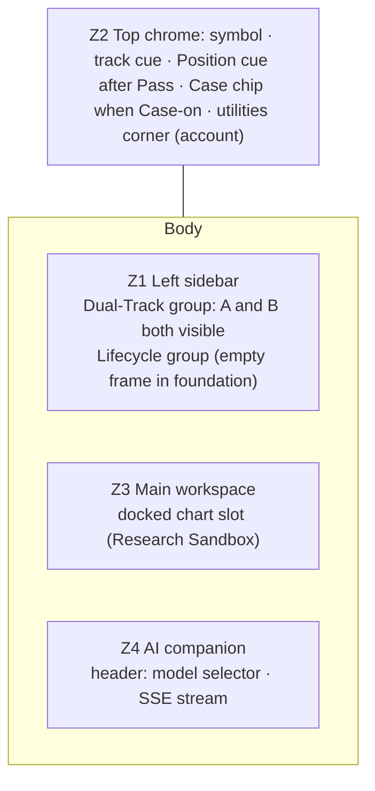
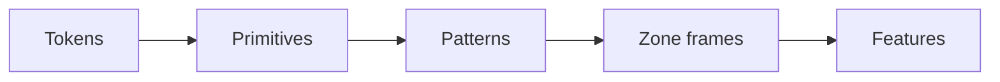

# Frontend Design-Lock

> **Viewpoint:** Presentation contract for the Frontend shell and patterns, from the M-000 foundation through Milestone M-009. Cited by [ARCHITECTURE.md](./ARCHITECTURE.md). Token values and pattern specs live in [DESIGN_SYSTEM.md](./DESIGN_SYSTEM.md). Realization lives in [TECHNICAL_DESIGN.md](./TECHNICAL_DESIGN.md).

## Document control

| Field | Value |
|-------|-------|
| **Version** | 0.3.1 (draft) |
| **Status** | Draft — M-000 Pitch B foundation, extended with presentation rules to M-009 |
| **Product Owner** | Phan Duy |
| **Maintainer** | UX Designer |
| **Date** | 2026-11-13 |
| **Requirements** | SR-1.4.1 (modular shell), SR-1.4.2 (workspace context), SR-1.3.1–1.3.4 (canvas and chart yield), SR-1.3.5 (approved 2026-11-10; M-001 docked chart PoC), SR-10.1.x (identity surfaces, Pitch A) |
| **Normative sources** | [CONCEPTUAL_IA_MAP.md](../../system/CONCEPTUAL_IA_MAP.md) §2.6 · [USER_JOURNEYS_WITH_WIREFRAMES.md](../../system/USER_JOURNEYS_WITH_WIREFRAMES.md) W1 · [ARCHITECTURE.md](./ARCHITECTURE.md) · [PRODUCT_SPECIFICATION.md](../../system/PRODUCT_SPECIFICATION.md) §5.3 |
| **Token values** | [DESIGN_SYSTEM.md](./DESIGN_SYSTEM.md) |

## Change log

| Version | Date | Change |
|---------|------|--------|
| 0.1 | 2026-11-05 | M-000 Pitch B presentation contract |
| 0.3.1 | 2026-11-13 | Minimum supported width 768 px with breakpoint behaviour (Phan Duy); volume in whole shares with comma grouping `1,234,500` (Phan Duy); ₫ totals `25,300,000 ₫` (Phan Duy); percent in price rows uses the dot (Phan Duy); Chart.js data charts themed from tokens (Phan Duy, DESIGN_SYSTEM); price-board number format decided (Phan Duy); numbers use `mono` (IBM Plex Mono) because Be Vietnam Pro v1.002 has no tabular digits |
| 0.3 | 2026-11-13 | Review round (Phan Duy decisions 2026-11-13): 1920 px design focus with a proposed zone width budget, zones never stack (Z4 → toggle, Z1 → rail); Z1 is one sidebar with Dual-Track and Lifecycle groups (IA v0.9.0, no Z1a/Z1b); Z2 content aligned to IA §2.3 and the model selector moved to the Z4 header; context kept per symbol or index; Z4 draft kept in `sessionStorage`; one zone-state list (adds Ready and Stale; provenance is not a state); `data-origin` values `ai` / `investor`; M-001 chart is Research Sandbox only, no marker content, candles carry a shape cue; launch UI language vi-VN; ADR-FRONTEND-003/004/005/007 cited as Accepted |
| 0.2.1 | 2026-11-10 | Bone approved as accent (Phan Duy); colour-token architecture cites [ADR-FRONTEND-007](./DECISIONS/ADR-FRONTEND-007-DESIGN-TOKEN-ARCHITECTURE.md) (Proposed) — Design-Token Architecture; Colour Values Live in the Design System; SR-1.3.5 (approved 2026-11-10) for the M-001 docked chart proof of concept |
| 0.2 | 2026-11-10 | Component layers; URL owns shareable state ([ADR-FRONTEND-003](./DECISIONS/ADR-FRONTEND-003-URL-OWNED-SHAREABLE-STATE.md) Proposed); `market.*` / `state.*` / `ai.*` rules; Z4 interrupted + retry; chart M-001 proof of concept and M-006 enhancement, Backend-supplied ref/ceiling/floor lines, TradingView attribution slot ([ADR-FRONTEND-004](./DECISIONS/ADR-FRONTEND-004-CHART-ENGINE-ADAPTER.md) Proposed); translation-ready copy ([ADR-FRONTEND-005](./DECISIONS/ADR-FRONTEND-005-I18N-READINESS-SEAM.md) Proposed); values moved to [DESIGN_SYSTEM.md](./DESIGN_SYSTEM.md) |

---

## 1. Shell geometry (W1)

- One zone = one layout region + one route outlet. Routes change Z3 content, never the shell.
- Z1 is **one** left sidebar ([IA map](../../system/CONCEPTUAL_IA_MAP.md) v0.9.0 merged the former Z1a / Z1b). Its Dual-Track group shows **both tracks at once** (two lanes, not modes); its Lifecycle group shows the stage cue.
- Z2 answers "what am I working on right now?" and follows IA §2.3: symbol, track cue, Position cue after Pass, Case chip when Case-on, and the utilities corner (account menu). **The model selector lives in the Z4 header**, because it configures the AI companion, not the work context. ([TECHNICAL_DESIGN.md](./TECHNICAL_DESIGN.md) §3.5 to follow.)
- Z2 is fixed chrome. Z1, Z3, Z4 may be resized **within the session only**; saved sizes/presets are M-009.

### 1.1 Viewport and zone width budget (Proposed)

Design focus is **1920 px** wide (Phan Duy, 2026-11-13). Budget at 1920 × 1080, compact density:

| Zone | Default | Min | Max | Collapsed |
|------|---------|-----|-----|-----------|
| Z1 | 240 px | 200 px | 320 px | 56 px rail (track and stage icons + labels on hover/focus) |
| Z3 | remainder (about 1240 px) | 712 px (at 768) | — | never |
| Z4 | 440 px | 360 px | 560 px | toggle button in Z2 utilities corner |
| Z3 chart dock | 55% of Z3 height | 320 px | 70% | yields at the gate (M-006) |

Supported range **768–1920 px** (Phan Duy, 2026-11-13; SNR-7.1.1). Phone widths are Future.

| Window | Z1 | Z3 | Z4 |
|--------|----|----|----|
| ≥ 1920 (focus) | 240 px docked | remainder | 440 px docked |
| 1440–1919 | 240 px docked | remainder | 360 px docked |
| 1024–1439 | 240 px docked | remainder | Toggle; opens as an overlay drawer (360 px) over Z3, so Z3 never shrinks below its minimum |
| 768–1023 | 56 px rail | remainder (≥ 712 px) | Toggle; overlay drawer |

- Zones **never stack**: stacking would push one track out of view and break SR-1.3.1. The Z1 rail still shows **both** track icons, each with an `aria-label` and a tooltip, plus the active-track mark.
- Frames and Playwright checks run at **1920, 1440, 1024 and 768 px**.

## 2. Workspace context seam

Summary; the decision is [ADR-FRONTEND-003](./DECISIONS/ADR-FRONTEND-003-URL-OWNED-SHAREABLE-STATE.md) (Accepted 2026-11-13). Full matrix: [ARCHITECTURE.md](./ARCHITECTURE.md) §4.2, §6.1 (Software Architect Assistant owns the final split).

| Concern | Owner | Rule |
|---------|-------|------|
| Track, `symbol`, `coreObjectRef` | **URL** (route + params, [TECHNICAL_DESIGN.md](./TECHNICAL_DESIGN.md) §5) | Shareable and reload-safe. The store **mirrors** these values and changes them only by navigating. |
| Context per symbol or index | **Frontend store**, keyed by symbol or index (for example `FPT`, `VNINDEX`) | Coming back to a symbol restores its open Core object, chart range and Z4 scroll (SR-1.3.2; Phan Duy, 2026-11-13). Session-scoped until Pitch A, then saved as per-user preferences. |
| Pane sizes, UI flags | **Frontend store** (session) | Pane (zone) sizes are session-only; saved presets are M-009. |
| Z4 unsent draft | **`sessionStorage`** | Survives a re-auth redirect and a reload in the same tab (Phan Duy, 2026-11-13). |
| Z4 thread | **Backend** session + conversation ids | Frontend holds the references only; never copies the thread. |
| Reload | — | Shareable state restores from the URL; the draft from `sessionStorage`. Other session UI returns to defaults until Pitch A; per-account restore after. Layout presets: M-009. |

## 3. Identity surfaces (Pitch A, rendered in Pitch B shell)

- **Sign-in** screen; **sign-out** returns to it.
- **Expired session:** re-auth that keeps unsent Z4 input (from `sessionStorage`) and returns to the same URL.
- **First run:** W1 empty shell with a quiet invitation to start a Case.
- Account menu lives in Z2.

## 4. Component layers and token sheet

### 4.1 Component layers

| Layer | Owns | May not |
|-------|------|---------|
| **Tokens** | Primitive, semantic and component values ([DESIGN_SYSTEM.md](./DESIGN_SYSTEM.md)) | Feature-specific one-offs |
| **Primitives** | Themed shadcn / Radix basics (button, input, and so on) | `market.*` or `state.*` utilities |
| **Patterns** | `PriceCell`, `Delta`, `StatusBadge`, AI provenance, stream message, chart frame | Feature business rules; direct vendor-chart imports |
| **Zone frames** | Z1–Z4 hosts and empty / loading / error / interrupted / streaming frames | Core-object logic |
| **Features** | Milestone modules; compose patterns and frames | Direct `market.*` / `state.*` reads; raw user-facing strings |

This is the presentation view of [ARCHITECTURE.md](./ARCHITECTURE.md) §4.3 (design system = tokens → primitives → patterns; zone frames belong to the shell; features compose them and never import a third-party engine directly).

### 4.2 Token groups (IA-named; Tailwind theme + shadcn primitives)

Values live in [DESIGN_SYSTEM.md](./DESIGN_SYSTEM.md). Colour-token architecture is governed by [ADR-FRONTEND-007](./DECISIONS/ADR-FRONTEND-007-DESIGN-TOKEN-ARCHITECTURE.md) (Accepted 2026-11-13) — Design-Token Architecture; Colour Values Live in the Design System, which supersedes ADR-FRONTEND-002's colour line. No one-off styles in feature code.

| Group | Tokens |
|-------|--------|
| Surface | `surface.bg` `surface.card` `surface.text` `surface.text2` `surface.line` `surface.z1` `surface.z2` `surface.z3` `surface.z4` `surface.overlay` |
| Track | `track.a` (Sandbox) · `track.b` (Portfolio) — accents only, never on prices or status |
| Market | `market.up` `market.down` `market.ref` `market.ceiling` `market.floor` — numbers only |
| State | `state.info` `state.success` `state.warn` `state.danger` `state.streaming` |
| Provenance | `ai.suggested` `ai.confirmed` — edge + label, never hue alone |
| Type | `display` `title` `body` `caption` `mono` (tickers, numbers) |
| Space / radius / elevation | 4-pt scale · `radius.sm/md/lg` · `elevation.0–3` |

Dark-first in M-000; light is built on the same tokens and is contrast-checked from day one. See [ADR-FRONTEND-007](./DECISIONS/ADR-FRONTEND-007-DESIGN-TOKEN-ARCHITECTURE.md) (Accepted 2026-11-13).

### 4.3 Colour and provenance rules

- **`market.*`** — price numbers only, and only through the `PriceCell` and `Delta` patterns. Always paired with an arrow or a sign ([WCAG 2.2 SC 1.4.1](https://www.w3.org/WAI/WCAG22/Understanding/use-of-color.html)). Exposed as CSS variables only, never as Tailwind utilities.
- **`state.*`** — system status only, and only through `StatusBadge`, which always shows an icon and a label. Exposed as CSS variables only, never as Tailwind utilities. Every `state.*` / `market.*` pair stays ≥ 10 dE2000 apart, because a badge can sit next to a price.
- **`ai.*`** — provenance, not status or price. AI-suggested vs investor-confirmed is shown by a **dashed vs solid edge plus a visible label**, never by hue alone. Tests assert `data-origin="ai"` and `data-origin="investor"`. Values and labels: [DESIGN_SYSTEM.md](./DESIGN_SYSTEM.md) §3.6.
- HOSE convention for market colours: green up, red down, yellow reference, purple ceiling, cyan floor.
- `market.*` colours, and the reference / ceiling / floor **values**, come from the Backend. The Frontend never computes price bands.
- Accent stays clearly apart from `market.floor` and `market.ceiling`. **Bone** (`#D8CDBB` / `#6E6352`) is the approved accent (Phan Duy, 2026-11-10); measured values and the WCAG 1.4.11 table live in [DESIGN_SYSTEM.md](./DESIGN_SYSTEM.md).

Structure carries the rule; ESLint / Stylelint are the backstop (see DESIGN_SYSTEM.md and Coding Orchestrator's enforcement note).

## 5. Zone state matrix

This is the **one** list of zone states; [ARCHITECTURE.md](./ARCHITECTURE.md) §7.2 and [TECHNICAL_DESIGN.md](./TECHNICAL_DESIGN.md) cite it. States: **empty, loading, ready, stale, error, interrupted, streaming**. AI-suggested vs confirmed is provenance (§4.3), not a zone state.

| Zone | Empty | Loading | Ready | Stale | Error | Interrupted | Streaming |
|------|-------|---------|-------|-------|-------|-------------|-----------|
| Z1 | Both tracks, no items | Skeleton list | Lists | — | Inline retry | — | — |
| Z2 | "Chưa chọn mã" (no symbol) | Skeleton chips | Context chips | Stale badge on the price cue | Inline retry | — | — |
| Z3 | Invitation + chart slot | Panel skeleton | Core object + chart | Stale badge + data time | Panel retry | — | — |
| Z4 | Prompt hint | Typing frame | Thread | — | Message retry | Interrupted + "Tạo lại" (no automatic resume) | Token stream + stop |

## 6. Quality floor

- WCAG 2.2 AA, including SC 1.4.1 (colour is never used alone) and SC 1.4.11 (focus rings and selected edges ≥ 3:1 against adjacent colours).
- Keyboard order Z2 → Z1 → Z3 → Z4, with skip link and visible focus.
- Desktop-first, **1920 px design focus**, supported down to **768 px** (§1.1). Narrower windows collapse Z4 to a drawer, then Z1 to a rail; zones never stack.
- Motion honours `prefers-reduced-motion` (tokens in [DESIGN_SYSTEM.md](./DESIGN_SYSTEM.md)).

## 7. Chart

[ADR-FRONTEND-004](./DECISIONS/ADR-FRONTEND-004-CHART-ENGINE-ADAPTER.md) (Accepted 2026-11-13). Feature code uses a platform `ChartEngine` adapter only; no feature imports a chart library directly.

| Milestone | Presentation |
|-----------|----------------|
| **M-001** | Simple proof of concept in the Z3 chart dock, **Research Sandbox only** (SR-1.3.5, approved 2026-11-10): symbol, time range, price series, volume. Data is **prepared mock data** for the pitch (Phan Duy, 2026-11-13), labelled as such in the frame. No marker content yet; evidence markers arrive with M-003. Engine: Lightweight Charts (Apache-2.0) behind the adapter. |
| **M-006** | Enhanced series and annotations; the chart **yields** its space to the Decision gate in the Research Sandbox (SR-1.3.4). |

Rules that apply from M-001:

- Reference, ceiling and floor **price lines are rendered as supplied by the Backend**. The Frontend never computes bands. Those bands differ by exchange (HOSE ±7%, HNX ±10%, UPCoM ±15%; on UPCoM the reference is the previous day's average price) and can change.
- Candles never rely on colour alone: up candles are hollow, down candles filled, and the crosshair readout shows O / H / L / C with a signed change (SC 1.4.1).
- TradingView attribution (the library's built-in logo or link, required by Lightweight Charts) is part of the chart frame from M-001. The chart-frame pattern reserves a **fixed, non-overlapping corner slot** for it. See [DESIGN_SYSTEM.md](./DESIGN_SYSTEM.md) and ADR-FRONTEND-004.

## 8. Translation-ready copy

[ADR-FRONTEND-005](./DECISIONS/ADR-FRONTEND-005-I18N-READINESS-SEAM.md) (Accepted 2026-11-13). Translation adoption is **Future**; the seam is reserved now.

- No hard-coded user-facing strings. Every string goes through a `t()` message layer, even while one language is shipped.
- **Launch UI language is vi-VN** (Phan Duy, 2026-11-13). Copy is written in Vietnamese first; English is the second catalogue.
- Numbers, prices, percents, currency and dates go through one format helper. **One number style across the app** (Phan Duy, 2026-11-13): the dot is only a decimal mark and the comma only groups thousands. Copy and dates stay `vi-VN`, in `Asia/Ho_Chi_Minh`. **Price-board format for prices** (Phan Duy, 2026-11-13): prices are shown in thousands of VND, always with two decimals and a dot as the decimal mark (`25.30` = 25,300 ₫; `6.81` = 6,810 ₫). `Intl.NumberFormat('vi-VN')` would render `25,30`, so `PriceCell` uses its own board formatter ([TECHNICAL_DESIGN.md](./TECHNICAL_DESIGN.md) §8.3).
- **Change and percent use the dot too** (Phan Duy, 2026-11-13): inside `PriceCell` and `Delta`, change and percent use the dot decimal (`+0.45`, `+6.98%`), so one row never mixes `.` and `,`. ₫ totals use the same comma grouping (`25,300,000 ₫`; Phan Duy, 2026-11-13). Prose and dates use `vi-VN`. **Volume** is shown in whole shares, never lots, grouped with a **comma** and no decimals (`1,234,500`; Phan Duy, 2026-11-13), so inside price-board rows a dot always means a decimal. The unit "CP" sits in the column header, and volume never goes through the price formatter.
- Layouts allow about 30% longer Vietnamese text than the English source.
- Fonts cover the full Vietnamese diacritic set (Be Vietnam Pro; see [DESIGN_SYSTEM.md](./DESIGN_SYSTEM.md)).

## 9. Out of scope

- Generated UI rendering (**Future**, [ADR-FRONTEND-006](./DECISIONS/ADR-FRONTEND-006-GENERATED-UI-COMPONENT-REGISTRY.md)).
- i18n library choice and shipped translations (**Future**; seam reserved by ADR-FRONTEND-005).
- Saved layout presets (M-009).
- Full shadcn component library.
- Real-time market tick / alert channel (**Future**, beyond M-009).
- Computing exchange price bands or reference / ceiling / floor values in the Frontend.

## 10. Done means

- Each lock in §1–§3 has a matching W1 frame, checked at 1920, 1440, 1024 and 768 px.
- §4 tokens exist in the Tailwind theme (gate G4); values match [DESIGN_SYSTEM.md](./DESIGN_SYSTEM.md); colour-token architecture follows [ADR-FRONTEND-007](./DECISIONS/ADR-FRONTEND-007-DESIGN-TOKEN-ARCHITECTURE.md) (Accepted 2026-11-13).
- §5 matrix, including Z4 interrupted + retry, is covered by shell tests (gate G5).
- The chart-frame attribution slot and Backend-supplied ref / ceiling / floor lines are specified for the M-001 proof of concept (SR-1.3.5, approved 2026-11-10).
- Copy rules in §8 are testable (no raw user-facing strings in feature UI).
