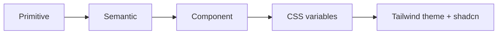

# Frontend Design System

> **Viewpoint:** Token values, typography, motion, icons, patterns and content voice for the Adaptive Workspace. The presentation contract is [DESIGN_LOCK.md](./DESIGN_LOCK.md). Architectural constraints are [ARCHITECTURE.md](./ARCHITECTURE.md) §7.1. Realization (pipeline, lint, file layout) is [TECHNICAL_DESIGN.md](./TECHNICAL_DESIGN.md).

## Document control

| Field | Value |
|-------|-------|
| **Version** | 0.3.1 (draft) |
| **Status** | Draft |
| **Product Owner** | Phan Duy |
| **Maintainer** | UX Designer |
| **Date** | 2026-11-13 |
| **Cited by** | [DESIGN_LOCK.md](./DESIGN_LOCK.md) v0.3.1 · [ARCHITECTURE.md](./ARCHITECTURE.md) |

## Change log

| Version | Date | Change |
|---------|------|--------|
| 0.1 | 2026-11-10 | Initial token sheet, palette, type, patterns and 1.4.11 measurements; Bone proposed |
| 0.2 | 2026-11-10 | Bone approved as accent (Phan Duy); colour-token architecture governed by [ADR-FRONTEND-007](./DECISIONS/ADR-FRONTEND-007-DESIGN-TOKEN-ARCHITECTURE.md) (Proposed) — Design-Token Architecture; Colour Values Live in the Design System, superseding ADR-FRONTEND-002's colour line (cyan copilot, emerald/rose gains-losses); copilot/AI has no brand hue; gains/losses use `market.up` / `market.down`; `track.*` group listed (accents only, never on prices) |
| 0.3 | 2026-11-13 | Review round (Phan Duy decisions 2026-11-13): `state.success`, `state.warn`, `state.danger` re-tuned so every state/market pair is ≥ 10 dE2000 in both themes (was 3.2–9.2); `ai.suggested` / `ai.confirmed` given values and `data-origin` values fixed (`ai` / `investor`); chart candles carry a shape cue (hollow up / filled down); lint backstop narrowed to arbitrary **colour** values; vi-VN first for copy and labels; ADR-FRONTEND-003/004/005/007 cited as Accepted; Storybook and visual regression marked Proposed (adoption via TECHNICAL_DESIGN) |
| 0.3.1 | 2026-11-13 | Be Vietnam Pro v1.002 checked: no `tnum` feature and proportional digits, so all numbers use `mono` = **IBM Plex Mono** (full Vietnamese set incl. `₫`); price-board number format, percent in price rows with the dot, volume `1,234,500`, ₫ totals `25,300,000 ₫`, Storybook in M-000 per ADR-FRONTEND-008, Chart.js data charts themed from tokens (Phan Duy, 2026-11-13) |

## 1. Principles

- Calm and analytical. The investor is the decision-maker; the UI reports, it does not cheer or alarm without cause.
- **Dark-first in M-000.** Light is built on the same tokens and is contrast-checked from day one — not deferred.
- Colour is never the only cue ([WCAG 2.2 SC 1.4.1](https://www.w3.org/WAI/WCAG22/Understanding/use-of-color.html)). Focus rings and selected edges meet ≥ 3:1 against adjacent colours ([SC 1.4.11](https://www.w3.org/WAI/WCAG22/Understanding/non-text-contrast.html)).
- Accent stays clearly apart from `market.floor` and `market.ceiling`. **Bone** is the approved accent (Phan Duy, 2026-11-10).

## 2. Token architecture

- Colour-token architecture is governed by [ADR-FRONTEND-007](./DECISIONS/ADR-FRONTEND-007-DESIGN-TOKEN-ARCHITECTURE.md) (Accepted 2026-11-13) — Design-Token Architecture; Colour Values Live in the Design System. That ADR supersedes the colour line in [ADR-FRONTEND-002](./DECISIONS/ADR-FRONTEND-002-MODERNIZE-FRONTEND-FOUNDATION.md) (cyan copilot, emerald/rose gains and losses). Values live in this document. Semantic groups: `market.*`, `state.*`, `ai.*`, and `track.*`.
- The copilot / AI has **no brand hue**. Provenance uses `ai.*`: a dashed edge plus a visible label, never a dedicated AI or copilot colour. Gains and losses use `market.up` and `market.down`, not emerald or rose.
- Three layers from **one source**. Suggested source format: [W3C Design Tokens (DTCG)](https://tr.designtokens.org/format/). Themes change values, not components.
- CSS variables feed the Tailwind theme and shadcn. Feature code uses semantic or component tokens, never raw hex.
- **`market.*` and `state.*` are CSS variables only.** They are not exposed as Tailwind utility classes. The only readers are `PriceCell` and `Delta` (`market.*`) and `StatusBadge` (`state.*`, always with an icon and a label). Structure carries the rule; ESLint (no `var(--market-*)` / `var(--state-*)`, and no arbitrary Tailwind **colour** values such as `text-[#…]` or `bg-[var(--market-up)]`, outside `design-system/patterns/`) and Stylelint are the backstop. Arbitrary layout values (widths, heights, grid tracks) stay allowed.

## 3. Palette

HOSE convention on `market.*`: green up, red down, yellow reference, purple ceiling, cyan floor. Applied to **numbers only**.

### 3.1 Surface and market / state (both themes)

| Token | Dark | Light | Role |
|-------|------|-------|------|
| `surface.bg` | `#0D1014` | `#F4F5F7` | Page / zone background |
| `surface.card` | `#15191E` | `#FFFFFF` | Cards, panels, list rows |
| `surface.text` | `#E6E8EB` | `#14181D` | Primary text |
| `surface.text2` | `#9AA3AE` | `#5A6470` | Muted text, captions |
| `surface.line` | `#2A313B` | `#D9DDE3` | Borders, dividers |
| `market.up` | `#2EBD6B` | `#13834A` | Price up (with arrow / sign) |
| `market.down` | `#F0524A` | `#C9302C` | Price down (with arrow / sign) |
| `market.ref` | `#E8B931` | `#946C00` | Reference price |
| `market.ceiling` | `#C062F0` | `#9338C2` | Ceiling price |
| `market.floor` | `#22B8D9` | `#08799A` | Floor price |
| `state.info` | `#8FB3E0` | `#2F63A8` | Informational badge |
| `state.success` | `#6ACAA1` | `#2C725A` | Success badge |
| `state.warn` | `#DFA045` | `#9B5903` | Warning badge |
| `state.danger` | `#F38275` | `#953E32` | Danger badge |
| `state.streaming` | `#B8C2CF` | `#4F5B6B` | Live / streaming badge |

`surface.z1`–`surface.z4` and `surface.overlay` are semantic aliases onto this scale (a distinct zone step needs its own contrast check before it ships).

### 3.2 Track (`track.*`)

| Token | Role |
|-------|------|
| `track.a` | Accent for Track A — Sandbox |
| `track.b` | Accent for Track B — Portfolio |

Used only as track accents. They never colour prices (`market.*` only), never system status (`state.*`), and never provenance (`ai.*`). Hex values are still open; they must not collide with `market.*` or Bone, and they are contrast-checked before they ship.

### 3.3 Accent

**Bone** (`#D8CDBB` / `#6E6352`) — **Approved by Phan Duy 2026-11-10**.

| | Dark | Light |
|--|------|-------|
| `accent` (Bone) | `#D8CDBB` | `#6E6352` |

Selection rule (all must hold in both themes):

- OKLCH chroma ≤ 0.05 (reads as a neutral, not a market colour).
- CIEDE2000 ≥ 15 from **every** `market.*` colour.
- Contrast ≥ 4.5:1 on `surface.card` (usable as text or a link).

Measured (palette sheet v0.3): Bone passes in both themes (dark chroma 0.027, nearest market dE 21.6, on-card 11.24:1; light chroma 0.029, nearest 18.5, on-card 5.88:1). Slate and blue-grey also pass this rule; Amber-neutral, Deep teal and Indigo fail chroma and / or market separation.

Bone is the accent for focus rings, primary actions and selected edges. A dedicated `focus.ring` token is not required: Bone clears 3:1 against card, bg and line in both themes.

### 3.4 WCAG 1.4.11 — non-text contrast (≥ 3:1)

Focus rings and selected edges are measured against **adjacent** colours: `surface.card`, `surface.bg`, `surface.line`. Contrast vs `surface.text2` is informational — muted text is never next to a ring; hue separation (dE2000) is what distinguishes the accent from muted text.

| Theme | Accent | Hex | vs card | vs bg | vs line | vs text2 (info) | dE vs text2 | Adjacent 3:1 |
|-------|--------|-----|---------|-------|---------|-----------------|-------------|--------------|
| Dark | Slate | `#8E9DB4` | 6.42 | 6.93 | 4.77 | 1.08 | 5.2 | Pass |
| Dark | Blue-grey | `#7F8FA3` | 5.35 | 5.78 | 3.97 | 1.29 | 7.7 | Pass |
| Dark | Bone | `#D8CDBB` | 11.24 | 12.14 | 8.35 | 1.63 | 19.2 | Pass |
| Light | Slate | `#4D5B70` | 6.89 | 6.32 | 5.06 | 1.15 | 5.2 | Pass |
| Light | Blue-grey | `#556274` | 6.20 | 5.69 | 4.55 | 1.03 | 2.8 | Pass |
| Light | Bone | `#6E6352` | 5.88 | 5.39 | 4.31 | 1.02 | 16.8 | Pass |

All three candidates clear 3:1 on card / bg / line in both themes. Bone is the only one that also stays clearly apart from muted text (dE 19.2 / 16.8). Light blue-grey vs `text2` is only dE 2.8 — they will be hard to tell apart. Sheet: `palette_sheet_v0.3.png`.

### 3.5 State / market separation

These pairs share a meaning family, so they sit near each other in hue. A badge can sit next to a price (for example a "Halted" badge beside a last price), so **usage alone is not enough**. Rule: every `state.*` / `market.*` pair is **≥ 10 dE2000** in both themes, on top of the usage rule (`state.*` only in `StatusBadge` with icon + label; `market.*` only on numbers in `PriceCell` / `Delta` with arrow or sign). Every `state.*` colour is ≥ 4.5:1 on `surface.card` and `surface.bg`.

| Pair | Dark dE (v0.2 → v0.3) | Light dE (v0.2 → v0.3) |
|------|-----------------------|------------------------|
| `state.success` / `market.up` | 6.1 → **10.2** | 4.4 → **10.1** |
| `state.warn` / `market.ref` | 9.2 → **10.1** | 9.2 → **10.4** |
| `state.danger` / `market.down` | 8.4 → **10.1** | 3.2 → **10.1** |

Re-tuned values (v0.3, measured 2026-11-13; contrast on card / bg):

| Token | Dark | Contrast | Light | Contrast |
|-------|------|----------|-------|----------|
| `state.success` | `#6ACAA1` | 8.89 / 9.60 | `#2C725A` | 5.74 / 5.26 |
| `state.warn` | `#DFA045` | 7.78 / 8.40 | `#9B5903` | 5.49 / 5.03 |
| `state.danger` | `#F38275` | 6.94 / 7.50 | `#953E32` | 6.97 / 6.39 |

`state.info` and `state.streaming` are unchanged and already ≥ 14 dE from every `market.*` colour. Market colours are not moved: they follow the HOSE board convention investors already read.

### 3.6 Provenance (`ai.*`)

The copilot / AI has no brand hue. AI-suggested vs investor-confirmed is a **dashed vs solid edge plus a visible label**, never a cyan (or any other) copilot colour. Do not recode provenance as green / red or as a `state.*` badge.

| Token | Dark | Light | Use |
|-------|------|-------|-----|
| `ai.suggested.edge` | `#9AA3AE` (= `surface.text2`) | `#5A6470` (= `surface.text2`) | 1 px **dashed** edge (4 / 3 dash) on AI-produced content |
| `ai.suggested.label` | `#9AA3AE` | `#5A6470` | Label "AI gợi ý" (vi-VN; en "AI suggested") with a Lucide `sparkles` icon |
| `ai.confirmed.edge` | `#E6E8EB` (= `surface.text`) | `#14181D` (= `surface.text`) | 1 px **solid** edge once the investor confirms |
| `ai.confirmed.label` | `#E6E8EB` | `#14181D` | Label "Đã xác nhận" (vi-VN; en "Confirmed") with a Lucide `check` icon |

Measured edge contrast (card / bg): suggested 6.91 / 7.47 dark, 6.01 / 5.51 light; confirmed 14.38 / 15.53 dark, 17.82 / 16.34 light. All clear SC 1.4.11.

- The confirmed edge is **not** Bone, so a confirmed item never reads as "selected" (Bone is the selection and focus edge).
- **`data-origin` values are fixed:** `data-origin="ai"` (suggested) and `data-origin="investor"` (confirmed). Tests assert both.
- The value comes from the Core object's origin field in the Backend contract once one exists (M-003 / M-005); the Frontend never infers it.

## 4. Typography

| Token | Size / line | Weight | Use |
|-------|-------------|--------|-----|
| `display` | 28 / 36 | 600 | Rare page titles |
| `title` | 18 / 26 | 600 | Zone and panel titles |
| `body` | 13 / 20 | 400 | Default UI (compact, 1920 px focus) |
| `caption` | 11 / 16 | 400 | Metadata, timestamps, hints |
| `mono` | 13 / 20 | 400 | Prices, changes, percents, volumes, tickers — **IBM Plex Mono** |

- UI typeface: **Be Vietnam Pro**. It covers the Vietnamese diacritic set.
- **Numbers use `mono`.** Checked 2026-11-13: Be Vietnam Pro v1.002 (the Google Fonts build) has **no `tnum` feature**, and its digits are proportional (Regular advance widths 385–710 units), so `font-variant-numeric: tabular-nums` does nothing. `PriceCell`, `Delta`, volumes and tickers use **IBM Plex Mono** (OFL), which covers the full Vietnamese set including `₫`. Re-check if a later Be Vietnam Pro release adds `tnum`.
- Do not truncate Vietnamese diacritics; do not substitute a font that drops them.

## 5. Density, space, radius

- **Compact is the default** from M-000. A **comfortable** option arrives with M-006 (body 14 / 22, caption 12 / 18, looser padding).
- Space scale is 4-pt: 4, 8, 12, 16, 24, 32, 48.
- Radius: `sm` 4 · `md` 8 · `lg` 12. Elevation: `0–3`.

## 6. Motion

| Token | Value |
|-------|-------|
| `motion.fast` | 120 ms |
| `motion.base` | 200 ms |
| `motion.slow` | 320 ms |
| `motion.easing` | standard ease-out |

Honour `prefers-reduced-motion`: no decorative animation, instant state change, no token-stream fade or pulse. Functional movement (scroll, expand) may snap.

## 7. Icons

- **Lucide** only, so one optical size and stroke across the shell.
- Compact default 16 px; comfortable (M-006) 20 px.
- `StatusBadge` always pairs an icon with a visible label. Price movement always pairs colour with an arrow or a sign — an icon is welcome, colour alone is not.

## 8. Patterns

| Pattern | Rule |
|---------|------|
| `PriceCell` | The only place a last / mark / reference price takes `market.*`. Colour + arrow or sign. Values as supplied by the Backend. |
| `Delta` | The only place a change or percent takes `market.*`. Colour + sign (and arrow where it helps). |
| `StatusBadge` | The only place `state.*` is used. Icon + label, always. Storybook interaction tests assert both. |
| AI provenance chip | Dashed edge + "AI gợi ý" vs solid edge + "Đã xác nhận" (§3.6). `data-origin="ai"` / `data-origin="investor"`. Never hue alone. |
| Stream message | States: empty (prompt hint), loading (typing frame), streaming (token stream + stop), error (message retry), **interrupted + retry**. Interrupted means the connection dropped or stopped; the investor retries. The action is labelled **"Tạo lại" (Regenerate)**, not "Resume": with no resume contract, a retry runs the request again. Automatic resume via `Last-Event-ID` is Transition and needs a Backend contract change. |
| Chart frame | M-001 proof of concept (SR-1.3.5, approved 2026-11-10) behind the `ChartEngine` adapter ([ADR-FRONTEND-004](./DECISIONS/ADR-FRONTEND-004-CHART-ENGINE-ADAPTER.md), Accepted 2026-11-13): Research Sandbox only; symbol, range, price series, volume, `market.*` theme. The adapter keeps a marker API, but no M-001 content uses it (evidence markers arrive with M-003). **Candles never rely on colour alone:** up candles are hollow (outline in `market.up`), down candles are filled (`market.down`), and the crosshair readout shows O / H / L / C with a signed change. **Ref / ceiling / floor price lines are rendered as supplied by the Backend**; the Frontend never computes bands (they differ by exchange: HOSE ±7%, HNX ±10%, UPCoM ±15%; UPCoM reference = previous day's average price). From M-001, a **fixed, non-overlapping corner slot** is reserved for TradingView attribution (built-in logo or link, required by Lightweight Charts). At M-006 the frame enhances and **yields** space to the Decision gate (SR-1.3.4). |
| Data charts | **Chart.js** is included for non-price charts such as allocation, metrics and comparisons (Phan Duy, 2026-11-13). The price chart stays on the `ChartEngine` adapter. Both chart kinds take colours from tokens through one shared chart theme (no literal colours), use `mono` for axis numbers and the same number formats as DESIGN_LOCK §8, and never rely on colour alone (direct labels or patterns, plus a table or text summary for screen readers). Which milestone ships the first one follows the roadmap. |

## 9. Content voice

- Calm, factual, short. Name the object, the figure and the state. Do not dramatise a move the investor can already see.
- The investor decides. AI output is advice or a draft, never a verdict. Provenance is always visible (§3.6, §8).
- **Launch UI language is vi-VN** (Phan Duy, 2026-11-13); copy is written in Vietnamese first, with English kept as the second catalogue.
- **Prices use the price-board format** (Phan Duy, 2026-11-13): thousands of VND, two decimals, dot decimal (`25.30`). Change and percent inside `PriceCell`/`Delta` use the dot too (`+6.98%`), and volume groups with a comma (`1,234,500`), so in a price row a dot always means a decimal (Phan Duy, 2026-11-13). ₫ totals use comma grouping too (`25,300,000 ₫`). Prose and dates use `vi-VN`. Rules: [DESIGN_LOCK.md](./DESIGN_LOCK.md) §8.
- Translatable from day one: no hard-coded user-facing strings; `t()` for copy; one format helper for numbers (dot decimal, comma grouping) and `vi-VN` dates in `Asia/Ho_Chi_Minh`; allow ~30% longer Vietnamese than the English source; no concatenated fragments that break in translation ([ADR-FRONTEND-005](./DECISIONS/ADR-FRONTEND-005-I18N-READINESS-SEAM.md), Accepted 2026-11-13; adoption is Future).

## 10. Quality

- Patterns get **Storybook** stories, including both themes, compact density, and the AI-suggested / confirmed pair, from **M-000** (ADR-FRONTEND-008, Accepted 2026-11-13: Storybook and MSW come in with M-000).
- Visual regression on those stories (tool choice in TECHNICAL_DESIGN).
- **axe** (or equivalent) on stories and on the W1 shell; keyboard path Z2 → Z1 → Z3 → Z4; visible focus.
- Interaction tests: every `StatusBadge` has an icon and a label; provenance hooks are present (`data-origin="ai"` and `data-origin="investor"`).
