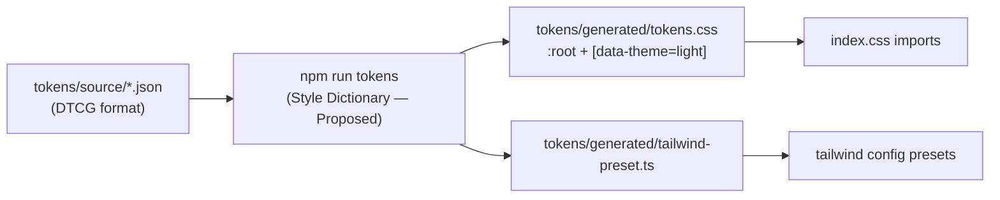

# Frontend Technical Design — Realization (M-000 → M-009)

> **Viewpoint:** how the Frontend target in [ARCHITECTURE.md](./ARCHITECTURE.md) is built: module tree, boundary enforcement, store and query shapes, API and SSE clients, component contracts, the token pipeline, tests per gate, and the CRA → Vite migration.
> **Not here:** structure and decisions ([ARCHITECTURE.md](./ARCHITECTURE.md), ADR-FRONTEND-001 … 006); pixel values and patterns ([DESIGN_LOCK.md](./DESIGN_LOCK.md), [DESIGN_SYSTEM.md](./DESIGN_SYSTEM.md)); wire schemas ([`docs/openapi.yaml`](../../openapi.yaml)).
> **Depth:** M-000 (Pitch B, gates G1–G6) is specified in full. M-001 … M-009 are outlines, detailed when each Milestone is shaped.

**State labels:** **Current** = as built. **Target** = committed for a named Milestone. **Transition** = migration step. **Future** = beyond M-009, seam only. **Proposed** = a choice made in this document that the owner has not yet confirmed.

---

## 1. Document control

| Field | Value |
|-------|-------|
| **Document** | Frontend technical design (realization) |
| **Version** | 0.2 (local draft, not committed) |
| **Status** | Draft — M-000 full, M-001 … M-009 outline |
| **Canonical path** | `docs/domains/frontend/TECHNICAL_DESIGN.md` |
| **Owner** | Coding Orchestrator (realization); Software Engineer (maintainer) |
| **Reviewers** | Software Architect Assistant (fit to ARCHITECTURE / ADRs) · UX / UI Designer (fit to DESIGN_LOCK / DESIGN_SYSTEM) |
| **Date** | 2026-11-13 |

### Traceability

| Source | What this document realizes |
|--------|-----------------------------|
| ARCHITECTURE §4.3 | Building blocks and the five dependency rules → §3 module tree and §3.3 lint |
| ARCHITECTURE §6 · ADR-FRONTEND-003 | State ownership → §4 URL, store, query keys |
| ARCHITECTURE §6.3b · ADR-FRONTEND-002 | Z4 stream → §6.3 SSE client |
| ARCHITECTURE §6.5 | Untrusted Agent output → §6.5 safe rendering |
| ADR-FRONTEND-004 · SR-1.3.5 | Chart adapter and M-001 chart proof of concept → §3.4, §11 M-001 / M-006 |
| ADR-FRONTEND-005 | i18n seam → §8.3 |
| ADR-FRONTEND-007 (Accepted) · DESIGN_SYSTEM §2 | Token pipeline and `market.*` / `state.*` rule → §8.1, §8.2 |
| ARCHITECTURE §8.2 | Gates G1–G6 → §9 tests, §10 migration |
| SR-1.4.1, SR-1.4.2, SNR-6.1.4, SNR-8.1.2 | Cited per gate in §9.2 |

---

## 2. Domain scope and boundaries

**In scope:** the `frontend/` package: source layout, build, tooling, client libraries, shell and feature code, tests.

**Out of scope:** Backend endpoints and SSE event schema (changes go to `docs/openapi.yaml` first, then the Backend); identity flows (ADR-SYS-001, Pitch A; token storage is decided as Backend-for-Frontend, and the Frontend side is in §3.4 and §6.1); token values and copy (Designer).

**Invariants carried from ARCHITECTURE:**

1. Browser → Frontend → Backend only. No Agent, Data Hub, LLM or market-vendor endpoint is called from the browser.
2. HTTPS REST + SSE only (SNR-8.1.2). No WebSocket client in the bundle.
3. The Frontend presents Core objects and the Decision gate; the Backend decides.
4. No secrets in the bundle. Only `VITE_*` public settings are read at build time.

---

## 3. Module and component architecture

### 3.1 Module tree (Target M-000)

```text
frontend/
  index.html
  vite.config.ts
  tsconfig.json                 # strict: true, noUncheckedIndexedAccess: true
  eslint.config.js              # flat config; boundary rules §3.3
  stylelint.config.js
  src/
    main.tsx                    # createRoot, providers, router
    app/                        # SHELL — composition only
      providers.tsx             # QueryClientProvider, theme, i18n seam, error reporting
      router.tsx                # route table §5
      layout/
        WorkspaceShell.tsx      # Z2 over (Z1 | Z3 | Z4) panels
        ZoneHost.tsx            # error boundary + zone state frame per zone
      routes/                   # thin route components; read params, mount features
    features/                   # FEATURES — one folder per surface (§3.2)
      companion/                # M-000 chat in Z4 (reasoning view in M-008)
      models/                   # M-000 model catalog / selector in Z2
      canvas/                   # M-001
      ...                       # added per Milestone, see §11
    platform/                   # PLATFORM — never imports features or app
      api/                      # typed REST client, error model, generated types
        generated/schema.d.ts   # openapi-typescript output; not hand-edited
      stream/                   # fetch-based SSE client + event adapter
      workspace/                # Zustand store + URL sync hook
      auth/                     # AuthAdapter interface; NoAuth for Pitch B
      chart/                    # ChartEngine interface (M-001, Lightweight Charts)
      stat-chart/               # StatChart wrapper (Chart.js) for non-price charts
      i18n/                     # t() passthrough
      format/                   # Intl wrappers: price, percent, VND, volume, date/time
      observability/            # reportError(), boundary hooks
    design-system/              # DESIGN SYSTEM
      tokens/                   # tokens source + generated CSS (§8.1)
      primitives/               # Radix / shadcn wrappers: Button, Dialog, Tabs, Tooltip ...
      patterns/                 # PriceCell, Delta, StatusBadge, AiOrigin, MessageBody, ZoneFrame ...
    test/                       # setup, MSW handlers, render helpers
```

### 3.2 Feature module contract

Every feature folder has the same shape:

```text
features/<name>/
  index.ts          # PUBLIC API: route elements, zone slots, hooks other code may use
  components/       # private
  hooks/            # private; queries and mutations use platform/api
  model/            # private types and pure functions
  <name>.test.tsx   # behaviour tests through the public API
```

- Only `index.ts` is importable from outside the folder.
- A feature never imports another feature. When two surfaces must cooperate (for example insights adding markers to the chart), the shell composes them, or they meet through platform state (workspace store, query cache).
- A feature never calls `fetch`. It uses `platform/api` or `platform/stream`.

### 3.3 Boundary enforcement (Target G2)

ARCHITECTURE §4.3 rules 1–5, realized as build-failing lint. ESLint runs in `npm run lint` and in CI; `npm run build` runs lint first.

| Rule | Mechanism (Proposed) |
|------|----------------------|
| 1. app → features → platform / design-system, never reverse | `eslint-plugin-boundaries` element types `app`, `feature`, `platform`, `design-system`, with allow-lists in that direction only |
| 2. No sibling-feature or deep imports | `boundaries/element-types` (feature → feature disallowed) + `boundaries/entry-point` (only `index.ts`) |
| 3. Only platform talks to the Backend | `no-restricted-globals` / `no-restricted-syntax` for `fetch`, `XMLHttpRequest`, `EventSource`, `WebSocket` outside `platform/api` and `platform/stream`; `no-restricted-imports` for `socket.io-client`, `axios` |
| 4. Only patterns read `market.*` / `state.*` | `no-restricted-syntax` on string literals matching `var(--market-` / `var(--state-` and Tailwind arbitrary values `[...]` outside `design-system/patterns/`; Stylelint `declaration-property-value-disallowed-list` for CSS files |
| 5. Third-party engines behind adapters | `no-restricted-imports` for `lightweight-charts` outside `platform/chart`, for `chart.js` outside `platform/stat-chart`, and for any i18n library outside `platform/i18n` |
| i18n raw strings (ADR-005) | `react/jsx-no-literals` in `app/`, `features/`, `design-system/patterns/` with `noStrings: false`, `ignoreProps: true` and an `allowedStrings` list for punctuation and symbols (`·`, `—`, `/`, `%`, `₫`, `+`, `−`). Tickers and numbers come from data, so they never need allow-listing. Library-agnostic; works before an i18n library is chosen |
| Agent output | `react/no-danger` = error everywhere; no exceptions |

### 3.4 Platform contracts (interfaces only)

```ts
// platform/auth — Pitch A fills this in; Pitch B ships NoAuth
// Backend-for-Frontend (Product Owner, 2026-11-13; ADR-SYS-001): the browser never holds OAuth tokens.
// Flask keeps them server-side; the browser holds only an HttpOnly `__Host-` session cookie.
export interface AuthAdapter {
  getSession(): Promise<SessionInfo | null>;  // null = signed out / anonymous (Pitch B); no tokens in the result
  csrfHeaders(): Record<string, string>;      // added to state-changing requests (POST/PUT/PATCH/DELETE)
  signIn(ctx: { returnTo: string }): void;    // full-page redirect to the Backend login route
  signOut(): Promise<void>;
  onUnauthorized(ctx: { returnTo: string }): Promise<void>; // 401 = session expired: flush the Z4 draft to sessionStorage first, then signIn({ returnTo: current URL }) in the same tab (ARCHITECTURE §6.3d; DESIGN_LOCK §2–3)
}
export interface SessionInfo { userId: string; displayName?: string; expiresAt: string }

// platform/chart — M-001; engine-neutral (ADR-FRONTEND-004)
export interface ChartEngine {
  mount(el: HTMLElement, theme: ChartTheme): void;
  setSeries(price: OhlcBar[], volume?: VolumeBar[]): void;
  setPriceLines(lines: { kind: 'ref' | 'ceiling' | 'floor'; value: number }[]): void; // values from Backend only
  setMarkers(markers: ChartMarker[]): void;   // our annotation layer, survives an engine swap
  setRange(range: TimeRange): void;
  setLevels(levels: { id: string; label: string; value: number; source: 'thesis' | 'decision' }[]): void; // M-006: named levels are Backend Core data (Thesis / Decision); the chart only displays them (SR-1.3.4)
  resize(): void;
  destroy(): void;
}

// platform/stat-chart — Chart.js (Product Owner, 2026-11-13) for non-price charts:
// allocation, fundamentals, scenario and comparison charts. Price and time-series charts
// stay on ChartEngine (ADR-FRONTEND-004); a feature never picks the engine itself.
export interface StatChartProps {
  kind: 'bar' | 'line' | 'doughnut' | 'scatter';
  series: { id: string; label: MessageKey; points: { x: string | number; y: number }[] }[];
  valueFormat: 'price' | 'pct' | 'vnd' | 'count';  // goes through platform/format, never Chart.js defaults
  ariaLabel: MessageKey;                         // plus a visually hidden data table fallback (canvas is not readable)
}
export function StatChart(props: StatChartProps): JSX.Element; // lazy chunk; registers only the controllers it uses; colours from tokens

// platform/observability
export function reportError(error: unknown, ctx: { zone?: ZoneId; route?: string }): void;
```

### 3.5 Shell and zone component contracts (Target G2)

| Component | Props / inputs | Renders | Guarantees |
|-----------|----------------|---------|-----------|
| `WorkspaceShell` | none (reads workspace store for pane sizes) | Z2 header; `PanelGroup` Z1 \| Z3 \| Z4 (`react-resizable-panels`) | Z2 fixed height, not resizable; Z1 and Z4 collapsible; design first at 1920 px, supported from 768 to 1920 px (Product Owner, 2026-11-13); narrow-width collapse of Z1/Z4 per DESIGN_LOCK; landmarks: Z2 `header`, Z1 `nav`, Z3 `main`, Z4 `aside` |
| `ZoneHost` | `zone: 'z1'\|'z2'\|'z3'\|'z4'`, `children` | Error boundary + `ZoneFrame` | A throw inside one zone renders that zone's error frame with retry and calls `reportError`; other zones keep rendering (ARCHITECTURE §7.2 resilience) |
| `ZoneFrame` (pattern) | `state: 'empty'\|'loading'\|'error'\|'stale'\|'interrupted'\|'streaming'\|'ready'`, `onRetry?` | DESIGN_LOCK §5 matrix per zone | `data-zone`, `data-state` attributes for tests; `aria-busy` on loading/streaming |
| `Z2` slot | `features/models` selector, track, symbol, Core-object chips | Context chrome | Never contains Z1 content |
| `Z1` slot | track A / B lists | Both tracks visible together | Switching track navigates (URL), never only mutates store |
| `Z3` slot | route outlet | Core object surface; chart dock from M-001 | — |
| `Z4` slot | `features/companion` | Header with the model selector (moved from Z2 per DESIGN_LOCK), thread, composer, stop, retry ("Tạo lại" = regenerate) | Streams via `platform/stream`; AI messages carry `data-origin="ai"` |

**Provenance hook (all patterns):** any element showing Agent-produced content sets `data-origin="ai"` and, once the investor confirms it, `data-origin="investor"`. Styling (dashed vs solid edge + label) keys off the attribute; tests assert it. Naming of the confirmed value follows DESIGN_LOCK §4 when the Designer fixes it.

**Keyboard path (Target M-000):** focus order Z2 → Z1 → Z3 → Z4; a "skip to workspace" link; `F6` cycles zones (Proposed); every resize handle reachable and operable by keyboard (built into `react-resizable-panels`).

---

## 4. State management and data flow

### 4.1 Ownership (from ARCHITECTURE §6.1)

| State | Home | Realization |
|-------|------|-------------|
| Route, `symbol`, `coreObjectRef` | URL | React Router params (§5) |
| Mirrors of the above | Zustand `workspace` slice | Written only by `useUrlSync()`; read-only to features |
| `activeTrack`, pane sizes, UI flags | Zustand | `workspace` + `layout` + `ui` slices |
| Server data | TanStack Query | Keys in §4.3 |
| Z4 stream | `platform/stream` | Run state in `features/companion` (local reducer) |
| Z4 thread identity | Backend `sessionRef` | Held in companion state; sent with every chat request |

### 4.2 Zustand store (Target G3)

```ts
type Track = 'sandbox' | 'portfolio';
type CoreObjectRef = { type: CoreObjectType; id: string };   // type list grows per Milestone

interface WorkspaceSlice {
  // mirrors — the URL owns symbol, coreObjectRef and track; these are set only by useUrlSync
  symbol: string | null;
  coreObjectRef: CoreObjectRef | null;
  activeTrack: Track;          // mirror of the :track route param; the URL owns it (ADR-003, ARCH §6.1)
  // open work kept per track (SR-1.3.2)
  lastRouteByTrack: Record<Track, string | null>;
}
type InstrumentCode = string;  // a stock ticker (FPT) or an index code (VNINDEX, VN30)
interface SymbolContext {      // SR-1.3.2: context is stored per symbol / index (Product Owner, 2026-11-13)
  lastCoreObjectRef: CoreObjectRef | null;
  chart: { range: TimeRange; interval: BarInterval; seriesType: 'candle' | 'line' }; // chart preferences per symbol
  z4ScrollTop: number;
}
interface ContextSlice {
  bySymbol: Record<InstrumentCode, SymbolContext>; // restored when the user switches back to a symbol
}
interface LayoutSlice {
  paneSizes: Record<Track, [z1: number, z3: number, z4: number]>; // session only until M-009
  collapsed: { z1: boolean; z4: boolean };
}
interface UiSlice { theme: 'dark' | 'light'; density: 'compact' | 'comfortable'; }
```

- One store, four slices (`workspace`, `context`, `layout`, `ui`), `zustand/middleware` `devtools` in development only.
- **Persistence:** `context` and pane sizes persist to `sessionStorage` (same tab, survives reload and the sign-in redirect). Durable per-user preferences wait for Pitch A / M-009 (ARCHITECTURE §6.4).
- **Chart range lives in the store, not the URL:** it is a per-symbol preference, so it does not appear in links.
- **Z4 draft (Product Owner, 2026-11-13):** the unsent composer text is saved to `sessionStorage` keyed by the Z4 conversation reference, restored after reload or an auth redirect, and cleared on send. It holds draft text only, never tokens or credentials.
- Features select with narrow selectors (`useWorkspace(s => s.symbol)`) to avoid re-render storms; no React Context carries fast-changing values.
- **Write rule (ADR-003):** a component that wants to change symbol, object or track calls `navigate()`. `useUrlSync()` (mounted once in the shell) parses params and writes the mirror. A unit test asserts the store never changes these fields without a navigation.

### 4.3 Query key taxonomy (Target M-000, grows per Milestone)

Keys are built by one factory in `platform/api/keys.ts`, so invalidation is typed and greppable.

```ts
export const qk = {
  health:        () => ['health'] as const,
  config:        () => ['config'] as const,
  models:        (provider: string) => ['models', provider] as const,
  // M-001+
  workspace:     (id: string) => ['workspace', id] as const,
  prices:        (symbol: string, range: TimeRange) => ['prices', symbol, range] as const,
  // M-003+
  evidence:      (symbol: string) => ['evidence', symbol] as const,
  // M-005+
  thesis:        (id: string) => ['thesis', id] as const,
  // M-006+
  decision:      (id: string) => ['decision', id] as const,
  // M-007+
  positions:     (track: 'portfolio') => ['positions', track] as const,
};
```

Defaults (Proposed): `staleTime` 30 s for catalog/config, 0 for Core objects; `retry` only for `ApiError.retriable`; `refetchOnWindowFocus` on for Core objects. Mutations invalidate by key prefix (for example the gate submit invalidates `thesis` and `positions`, ARCHITECTURE §6.3c).

---

## 5. Routing and navigation (Target G3)

React Router (data router, `createBrowserRouter`). Routes are a public surface (ADR-003 consequence), so each path below needs a test that a deep link renders the right zone content.

| Path | Meaning | Milestone |
|------|---------|-----------|
| `/` | Redirect to `/sandbox` | M-000 |
| `/:track` | Track home; `track ∈ {sandbox, portfolio}`; anything else → not found | M-000 |
| `/:track/:symbol` | Symbol or index in context (uppercase ticker or index code such as `VNINDEX`, validated by pattern) | M-000 |
| `/:track/:symbol/:coreType/:coreId` | Core object open; `coreType ∈ {evidence, thesis, decision, position}` as each ships (no `case` type until a Milestone introduces it) | M-001+ |
| `*` | Not-found frame inside the shell | M-000 |

- Parsing and validation live in `platform/workspace/routeParams.ts` (pure functions, unit tested).
- A valid-looking ref the Backend answers with 404 or 403 renders the not-found state (ADR-003); the Frontend never decides access.
- Route components are lazy (`lazy()` per feature) for code-splitting (ARCHITECTURE §7.2).
- Search params are reserved for shareable view options; none ship in M-000. Chart range is a per-symbol preference in the store (§4.2), not a URL param.
- **Chart dock is Sandbox only** (SR-1.3.5, L6): `app/` mounts the chart slot in Z3 only when `track === 'sandbox'`; on `/portfolio/...` the slot is absent (a route test asserts it).

---

## 6. API integration and streaming

### 6.1 Typed REST client (Target G1; types when codegen wired)

- **Source of truth:** `docs/openapi.yaml` (hand-written today). `npm run gen:api` runs `openapi-typescript ../docs/openapi.yaml -o src/platform/api/generated/schema.d.ts`. CI fails if the generated file differs from the committed one.
- **Client:** `openapi-fetch` over the generated `paths` type (Proposed; same author as `openapi-typescript`, a few KB, plain `fetch`). One instance in `platform/api/client.ts` with:
  - base URL from `import.meta.env.VITE_API_BASE_URL` (empty = same origin via dev proxy);
  - `credentials: 'same-origin'` on every request, so the session cookie rides along. The SPA and the Backend are served from one origin (the dev proxy locally, one host at the ingress), because a `__Host-` cookie can't cross origins. No `Authorization` header and no token anywhere in JS, storage or MSW fixtures;
  - a request hook that adds `AuthAdapter.csrfHeaders()` to state-changing requests, including `POST /api/chat`. The chat stream uses the same `fetch` client and reader (§6.2), so streaming needs nothing extra;
  - a response hook that maps every non-2xx to `ApiError` and calls `AuthAdapter.onUnauthorized` on 401.
- **One error model:**

```ts
export class ApiError extends Error {
  constructor(
    readonly status: number,          // HTTP status, 0 = network
    readonly code: string,            // Backend error code if present, else 'http_<status>' / 'network'
    message: string,                  // safe to show; never raw HTML
    readonly retriable: boolean,      // network, 502–504, 429
  ) { super(message); }
}
```

- **Drift guard:** the contract test HOWTO (Schemathesis against the running Backend) covers Backend ↔ spec; generated types cover spec ↔ Frontend. Both must pass for a contract change.

### 6.1a Sign-in through the Backend-for-Frontend (Target Pitch A; ADR-SYS-001)

Flask is the OAuth client and holds the tokens. The Frontend only redirects, sends cookies and attaches CSRF proof. Route names below are **Proposed** until they are added to `docs/openapi.yaml`.

| Concern | Frontend realization | Backend side (follow-up for the Backend technical design) |
|---|---|---|
| Routes (Proposed) | `signIn` does a full-page `location.assign('/api/auth/login?returnTo=<same-origin path>')`; `signOut` POSTs `/api/auth/logout`; `getSession` GETs `/api/auth/session` (TanStack Query `qk.session`, no tokens in the body) | `/api/auth/callback` checks `state` and PKCE, swaps the code for tokens, stores them server-side and sets the session cookie |
| Cookies | None readable by JS | Session cookie `__Host-` prefix, `Secure`, `HttpOnly`, `SameSite=Strict`, `Path=/`. The short-lived login cookie that holds `state` and PKCE is `SameSite=Lax` (a `Strict` cookie is not sent on the cross-site return from Auth0, [MDN SameSite](https://developer.mozilla.org/en-US/docs/Web/HTTP/Reference/Headers/Set-Cookie#samesitesamesite-value)) and is deleted in the callback |
| Return after login | `returnTo` must be a same-origin path (`/`-prefixed, no `//`); anything else falls back to `/` | The callback ends with a **same-site 302 to `returnTo`**, so the first page load already sends the `Strict` session cookie and never flashes a signed-out screen (DESIGN_LOCK §3) |
| CSRF | `csrfHeaders()` returns `{ 'X-CSRF-Token': <value from /api/auth/session> }` on POST/PUT/PATCH/DELETE, including `POST /api/chat` | Synchronizer token bound to the server session (Proposed); reject state-changing calls without it with 403 |
| Expiry and refresh | 401 → flush Z4 draft → `signIn({ returnTo })` (§3.4). The Frontend never refreshes tokens | Flask refreshes tokens server-side; session lifetime per SR-10 |
| Dev | Vite `server.proxy` sends `/api` to Flask, so the SPA and API share `localhost:5173` and the `__Host-` cookie works over a local HTTPS dev cert (`Secure` needs HTTPS outside `localhost` exceptions) | Auth0 dev tenant callback set to the proxied origin |
| Tests | MSW handlers for `/api/auth/session` (signed in / signed out / 401), a CSRF-header test on the client hook, an open-redirect test on `returnTo`, and a Playwright re-auth path that keeps the Z4 draft | Backend tests for `state`/PKCE, cookie flags and CSRF rejection |

### 6.2 Today's stream contract (Current)

`POST /api/chat` with `stream: true` answers `text/event-stream`; the schema in `docs/openapi.yaml` is `type: string` with this example:

```text
data: {"event":"meta","provider":"openai","model":"gpt-4"}
data: {"chunk":"AAPL "}
data: {"event":"done","fallback":false,"provider":"openai","model":"gpt-4"}
data: [DONE]
```

No `id:` fields, no typed tool events, no cancel endpoint, no heartbeat.

**Stream delivery requirements (Backend contract ask, Target G6):** the chat stream response sends `Cache-Control: no-cache` and `X-Accel-Buffering: no` so proxies don't buffer it, plus a comment heartbeat (`: ping`) at least every 15 s so idle connections aren't dropped (interval Proposed). The ingress serves HTTP/2, because browsers allow only six HTTP/1.1 connections per origin and open streams would starve REST calls. The client treats a missed heartbeat window as `interrupted`.

### 6.3 SSE client (Target G1 / G6)

`platform/stream` reads the response body with `fetch` + `ReadableStream` + `TextDecoderStream` and a spec-conformant line parser (WHATWG §9.2: `data:` / `event:` / `id:` / `retry:` fields, `:` comments ignored, blank line dispatches). `EventSource` is not used (no POST, no headers). Parser choice: `eventsource-parser` (Proposed, small and spec-tested) or an in-house parser of ~60 lines with tests; either sits behind the same API.

```ts
export type StreamEvent =
  | { type: 'meta';  provider: string; model: string }
  | { type: 'token'; text: string }
  | { type: 'final'; provider: string; model: string; fallback: boolean }
  | { type: 'error'; error: ApiError };
  // 'tool' and 'citation' events join when the contract defines them (M-003 / M-008)

export interface StreamHandle {
  events: AsyncIterable<StreamEvent>;
  abort(): void;                        // AbortController; closes the reader
}

export function openChatStream(
  body: ChatRequest,                    // generated type from openapi.yaml
  opts?: { signal?: AbortSignal },
): StreamHandle;
```

**Event adapter (`legacyChatAdapter`):** maps today's frames to the union — `{"event":"meta"}` → `meta`, `{"chunk"}` → `token`, `{"event":"done"}` → `final`, `[DONE]` → end of iterable, `{"error"}` or a malformed frame → `error`. When the contract gains named, typed events, a second adapter replaces this one; features do not change.

**Companion run states (`features/companion`):** `idle → streaming → (done | interrupted | error)`; `stop` from `streaming` → `interrupted`. `interrupted` and `error` show retry (DESIGN_LOCK §5). Retry sends the same user message again as a new run; there is no mid-run resume (Target).

**Transition (needs a contract change, Backend follow-up):**

| Capability | Contract change in `docs/openapi.yaml` | Frontend change |
|-----------|------------------------------------------|-----------------|
| Resume | Every event has `id:`; short replay buffer per run | Reconnect with `Last-Event-ID`; new adapter |
| Cancel | `POST` cancel by `runId` | `abort()` also sends cancel |
| Heartbeat | `:` comment every N s | Idle timeout → `interrupted` |
| Typed events | Named events (`token`, `tool`, `citation`, `final`, `error`) with JSON schemas | New adapter, generated payload types |

### 6.3a Mock price data for the M-001 proof of concept (Product Owner, 2026-11-13)

The pitch verifies the chart concept on prepared mock data, not production data.

- **Draft shape (Proposed, input to the later Backend contract):** `PriceSeries { symbol, exchange: 'HOSE'|'HNX'|'UPCOM', interval, bars: { t, o, h, l, c, v }[], reference, ceiling, floor, asOf, source: 'mock' }`.
- **Fixtures:** `src/mocks/fixtures/prices/<SYMBOL>.json` for a few HOSE, HNX and UPCoM tickers plus `VNINDEX`; bands in the fixtures follow each exchange's rule so the UI is exercised on all three.
- **Serving:** MSW handlers in `src/mocks/` intercept the same path the Backend will serve, planned as `GET /api/market/prices/{symbol}` (not yet in `docs/openapi.yaml`; the name is confirmed when the Backend contract is added), so features call one path whether data is mocked or live (ADR-FRONTEND-008). They run in dev (`VITE_USE_MOCKS=true`, MSW browser worker) and in tests. The production build never bundles `src/mocks/`.
- **Honesty:** the chart frame shows a visible "Mock data" tag whenever `source === 'mock'`, so mock prices are never mistaken for real ones.
- **Exit:** the real endpoint goes into `docs/openapi.yaml` (Backend + data source per ADR-SYS-004) before any production use; then the handler is deleted and generated types replace the draft shape.

### 6.4 Socket.IO removal (Target G6)

`webSocketService.ts` is used only by `WebSocketTest.tsx`, which nothing imports. G6 deletes both, removes `socket.io-client` and `@types/socket.io-client`, deletes `API_CONFIG.WEBSOCKET` from `config.ts`, and adds the `no-restricted-imports` rule so it cannot return. The skeleton section "WebSocket Integration" is retired by this section.

### 6.5 Safe rendering of Agent output (Target M-000, must)

Agent output is untrusted (ARCHITECTURE §6.5, OWASP LLM05).

- **Pattern:** `design-system/patterns/MessageBody` renders model text with `react-markdown` + `remark-gfm`. No `rehype-raw`; `skipHtml` on; default `urlTransform` (blocks `javascript:` and other unsafe schemes); links render with `rel="noopener noreferrer nofollow"` and `target="_blank"`; images off until a need is shown.
- **Lint:** `react/no-danger` is an error (§3.3). There is no sanctioned `dangerouslySetInnerHTML` in the codebase.
- **Tests (G5):** ``, `<script>alert(1)</script>`, `[x](javascript:alert(1))` and an `<a onclick>` render inert (no element with an event handler attribute, no `script` element, no `javascript:` href). Markdown tables, lists and bold still render.
- **Current finding:** `src/components/MessageFormatter.js` builds HTML with regex and injects it with `dangerouslySetInnerHTML` (lines 83, 132, 186) without escaping. It is **not imported anywhere** today (`App.tsx` renders `{m.content}` as text, which React escapes), so the hole is latent, not live.
- **Disposition (Product Owner, 2026-11-10):** not patched now. The fix ships inside the M-000 Pitch B slices: step **T0** deletes `MessageFormatter.js`, and step **T4** adds `MessageBody` with the regression tests above (§10.2). The Pitch B slice specs cite this section and §10.2 as their design reference.

---

## 7. Accessibility and responsive behaviour

| Item | Realization | Test |
|------|-------------|------|
| WCAG 2.2 AA floor | Radix primitives for focus management; tokens meet DESIGN_SYSTEM §3.3 contrast table | axe on shell routes (G5) |
| Never colour alone | `PriceCell` / `Delta` always render sign or arrow; `StatusBadge` always icon + label | Pattern unit tests assert the glyph / label |
| Keyboard zones | Focus order and skip link (§3.5) | Playwright keyboard walk (Proposed, G5) |
| Reduced motion | Motion tokens collapse under `prefers-reduced-motion: reduce` | Unit test on token output |
| Streaming announcements | Z4 thread `aria-live="polite"`; announce at message end, not per token | RTL test |
| Viewport | Design first at 1920 px; supported range 768–1920 px (Product Owner, 2026-11-13). Below 768 px is Future. Which zones collapse at which breakpoint is the Designer's call in DESIGN_LOCK; SNR-7.1.1 follows | Playwright + axe at 1920, 1440, 1024 and 768 (DESIGN_LOCK breakpoints: Z4 becomes a drawer below 1440, Z1 an icon strip below 1024); no horizontal scroll and every zone reachable at each |
| Vietnamese text | Be Vietnam Pro with Vietnamese subset; `lang` attribute from the locale setting | Visual check in Storybook |

---

## 8. Design system realization

### 8.1 Token pipeline (Target G4)



- One source, three tiers (primitive → semantic → component), values owned by the Designer in DESIGN_SYSTEM.
- Dark is the default on `:root`; light overrides under `[data-theme="light"]`; `UiSlice.theme` sets the attribute on `<html>`.
- The Tailwind preset exposes surface, text, border, accent, `ai.*`, spacing, radius, type and motion. It **does not** expose `market.*` or `state.*` (DESIGN_SYSTEM §2), so `text-market-up` cannot be written.
- Density: `[data-density="compact"]` default; `comfortable` from M-006.
- Generated files are committed; CI fails if `npm run tokens` changes them.

### 8.2 Pattern rules

| Pattern | Reads | Contract |
|---------|-------|----------|
| `PriceCell` | `market.up/down/ref/ceiling/floor` | Props: `value`, `reference`, `ceiling?`, `floor?` — all Backend-supplied; picks colour by comparison only, never computes bands; tabular digits; sign/arrow always |
| `Delta` | `market.up/down` | Props: `change`, `percent?`; sign always |
| `StatusBadge` | `state.*` | Props: `status`, `label`; icon + label always |
| `AiOrigin` | `ai.*` | Wraps content; sets `data-origin`; dashed vs solid edge + label |
| `MessageBody` | text tokens | §6.5 |
| `ZoneFrame` | surface, text | §3.5 |

Storybook (ADR-FRONTEND-008, in M-000 for G4): stories for every pattern in both themes, compact density, and the AI-suggested / confirmed pair (DESIGN_SYSTEM §10). Visual regression is a later add-on.

### 8.3 i18n and locale seam (Target M-000, ADR-FRONTEND-005)

```ts
// platform/i18n — passthrough until adoption
export type MessageKey = keyof typeof messages;      // messages/vi.ts is the launch catalogue (vi-VN first, Product Owner 2026-11-13)
export function t(key: MessageKey, params?: Record<string, string | number>): string;

// platform/format — Intl wrappers; the only place numbers and dates are formatted
export const fmt = {
  price(v: number): string;               // tabular, fixed decimals per instrument (Backend-supplied precision)
  percent(v: number): string;             // always signed
  vnd(v: number): string;                 // whole VND, comma grouping, ' ₫' suffix: 25300000 → '25,300,000 ₫'
  volume(v: number): string;              // compact notation
  dateTime(d: Date | string): string;     // timeZone: 'Asia/Ho_Chi_Minh' by default
};
```

- Locale and time zone are settings in `UiSlice`; launch default `vi-VN` and `Asia/Ho_Chi_Minh` (not hard-coded inside formatters).
- **Price notation (Product Owner, 2026-11-13): price-board style.** `fmt.price` is its own formatter, not `Intl` (which would print `25,30`): it takes integer VND and shows thousands of VND with a dot decimal and two decimals (25,300 ₫ → `25.30`). All numbers render in IBM Plex Mono, because Be Vietnam Pro has no fixed-width digits (DESIGN_LOCK). `fmt.volume` never goes through the price formatter: volume is a whole number of shares with comma grouping and no decimals (`1,234,500`), so in a market row the dot always means a decimal and the comma always means thousands (Product Owner, 2026-11-13). Price change and percent change in market rows also use a dot decimal, so one row never mixes `.` and `,` (Product Owner, 2026-11-13): `fmt.change(1750) === '+1.75'`, `fmt.pct(0.0698) === '+6.98%'`. Money totals are whole VND with comma grouping and a ` ₫` suffix (`fmt.vnd(25300000) === '25,300,000 ₫'`; Product Owner, 2026-11-13), built by the same formatter rather than `Intl` `vi-VN` currency (which would print `25.300.000 ₫`). Dates use standard `vi-VN` `Intl` formatting. Tests: `fmt.price(25300) === '25.30'`, ceiling and floor values, the change and percent cases, `fmt.vnd(25300000) === '25,300,000 ₫'`, plus `fmt.volume(1234500) === '1,234,500'`, so the styles can't get mixed up.
- No string concatenation for sentences; parameters go through `t()`.
- Exchange sessions, price bands and ref/ceiling/floor come from the Backend (ADR-005); no constants for them in the Frontend.
- `react/jsx-no-literals` (§3.3) blocks raw JSX strings.

---

## 9. Testing

### 9.1 Pyramid

| Layer | Tool | Scope | Runs |
|-------|------|-------|------|
| Unit | Vitest | Pure functions: route params, SSE parser and adapter, formatters, query keys, store write rule | `npm test` |
| Component | Vitest + React Testing Library + `@testing-library/user-event` | Patterns, zone frames, companion run states | `npm test` |
| Network | MSW (ADR-FRONTEND-008, in M-000) | REST and SSE handlers built from `docs/openapi.yaml` examples | inside component tests |
| E2E + a11y | Playwright + `@axe-core/playwright` (Proposed) | Shell boot, deep links, keyboard walk, chat round-trip against MSW or local Backend | `npm run e2e` |
| Contract | openapi-typescript diff (FE) · Schemathesis (Backend) | Spec ↔ code drift | CI |

Rules: test behaviour through public APIs (feature `index.ts`, rendered DOM), not internals; tests select by role, label and the `data-zone` / `data-state` / `data-origin` hooks, never by CSS class.

### 9.2 Tests mapped to gates

| Gate | Requirement | Done when (evidence) |
|------|-------------|----------------------|
| **G1** Vite + chat smoke | SNR-6.1.4 path | `npm run build` and `npm run dev` work on Vite; Vitest runs; a component test sends a chat and renders streamed tokens from an MSW SSE handler using the §6.2 frames |
| **G2** Z1–Z4 shell | SR-1.4.1 | Shell test: four landmarks present; Z2 not resizable; a throw in Z3 shows Z3 error frame while Z1, Z2, Z4 still render; lint fails on a planted forbidden import (fixture) |
| **G3** Context store + URL | SR-1.4.2, ADR-003 | Deep link `/sandbox/FPT` sets mirrors; track switch navigates and restores `lastRouteByTrack`; store never changes `symbol` without navigation; unknown track → not found |
| **G4** Tokens wired | DESIGN_LOCK | `tokens.css` generated and committed; theme toggle flips `data-theme`; lint fails on `var(--market-up)` outside patterns; `PriceCell`/`Delta`/`StatusBadge` tests assert sign/icon + label |
| **G5** Baseline green | SNR-6.1.4 | All of the above green in CI; DESIGN_LOCK §5 zone state matrix covered including Z4 interrupted + retry; §6.5 XSS cases inert; axe finds no serious/critical issues on shell routes |
| **G6** SSE only | SNR-8.1.2 | `socket.io-client` absent from `package.json` and bundle (`rg socket.io dist` empty); lint rule present; chat stream works over SSE only |

---

## 10. Build, deployment and migration

### 10.1 Build and run (Target)

| Item | Value |
|------|-------|
| Node | Current LTS, pinned in `.nvmrc` and `engines` |
| Scripts | `dev`, `build` (`tsc -b && vite build`), `preview`, `test`, `test:watch`, `e2e`, `lint`, `gen:api`, `tokens` |
| Env | `VITE_API_BASE_URL` (replaces `REACT_APP_API_URL`); `REACT_APP_WS_URL` removed |
| Dev proxy | Vite `server.proxy` `/api` → `http://localhost:5000`, so the browser stays same-origin in development |
| Output | Static `dist/`; hosting and CDN are a Backend/infra decision (TBD) |
| Headers (Proposed for hosting) | CSP `default-src 'self'; connect-src 'self' <api origin>; script-src 'self'; style-src 'self' 'unsafe-inline'` (Radix/Tailwind inline styles) — confirm when hosting is chosen |
| CI | lint → typecheck → unit/component → build → e2e (smoke) |

### 10.2 CRA → Vite migration (Transition → G1 … G6)

Each step is one reviewable change in a worktree on the assigned branch, with its own test evidence. Phan's working tree is never edited directly.

| Step | Change | Evidence | Gate |
|------|--------|----------|------|
| **T0 subtract** | Delete unused files: `components/OptimizedApp.js`, `components/PerformanceProfiler.js`, `components/WebSocketTest.tsx`, `components/MessageFormatter.js`, `services/apiService.ts`, and `utils/performance.js` if still unreferenced (none is imported today, verified by import scan). Removes the latent XSS in `MessageFormatter.js` (§6.5) | Import scan empty; `rg dangerouslySetInnerHTML src` empty; app builds and chat works | pre-G1 |
| **T1 types fix** | Align `@types/react` / `@types/react-dom` with React 18 (currently `^19`) | `tsc --noEmit` clean | pre-G1 |
| **T2 Vite** | Replace `react-scripts` with Vite + `@vitejs/plugin-react`; move `public/index.html` to root `index.html`; `REACT_APP_*` → `VITE_*`; add Vitest + RTL + MSW and the first chat smoke test | G1 row | G1 |
| **T3 platform/api + stream** | Fold `restApiClient.js` and `modelsApi.ts` into `platform/api` (one client, `ApiError`) and `platform/stream` (§6.3); convert remaining JS to TS | Adapter and parser unit tests; chat smoke still green | G1 |
| **T4 shell** | Split `App.tsx` (282 lines) into `app/` shell + `features/companion` + `features/models`; add `MessageBody` (§6.5) and turn on `react/no-danger` | G2 row; §6.5 XSS cases inert | G2 |
| **T5 router + store** | React Router, `platform/workspace`, `useUrlSync` | G3 row | G3 |
| **T6 tokens + Tailwind + Radix** | Token pipeline, Tailwind preset, primitives, patterns, theme toggle; delete `UI_CONFIG.THEME` and ad hoc CSS | G4 row | G4 |
| **T7 boundary lint + a11y** | ESLint/Stylelint rules §3.3; Playwright + axe smoke | G5 row | G5 |
| **T8 drop Socket.IO** | §6.4 | G6 row | G6 |

Order rationale: subtract first so later steps move less code; Vite before the shell so every later step has tests; Socket.IO last only because nothing live uses it (it can move earlier at no risk).

---

## 11. Milestone outlines (M-001 … M-009)

Detailed when each Milestone is shaped. Each line names the new feature module, platform work, patterns, and the main test.

| Milestone | Feature module | Platform / design-system work | Key tests |
|-----------|----------------|-------------------------------|-----------|
| **M-001** Canvas + chart PoC (SR-1.3.5; pitch slices S1–S3, chart = S3 `canvas-chart-poc`) | `canvas`, `chart` (Z3 dock) | Mock `PriceSeries` fixtures via MSW (§6.3a); `platform/chart` with Lightweight Charts engine, lazy-loaded; chart slot Sandbox only; chart theme from tokens; ref/ceiling/floor lines from Backend values; markers layer; fixed TradingView attribution slot; `qk.prices`; pane context per track | Adapter contract tests with a fake engine; "Mock data" tag shown; chart absent on Portfolio routes; attribution present; no band computed in FE; bundle split check (engine not in initial chunk) |
| **Chart.js (`StatChart`)** (Product Owner, 2026-11-13) | `platform/stat-chart` | Supported for non-price charts. The first consumer is the first Milestone that needs one (candidates: M-007 allocation, M-003 evidence comparisons); themed from tokens | Formatter and token use, hidden data table present, not in the initial chunk |
| **M-002** Data provenance | none | `SourceTag` / freshness pattern; stale state in `ZoneFrame` | Stale badge from Backend timestamp |
| **M-003** Insights / evidence | `insights` | Evidence row pattern; citation events in stream adapter (needs contract); evidence markers into chart via shell composition | Citation rendering; marker sync without feature-to-feature import |
| **M-004** Dual-track | `dual-track` | Track-scoped query keys; Z1 both tracks; guard that research writes never target Portfolio endpoints | Track switch keeps work per track; write-guard test |
| **M-005** Thesis | `thesis` | Thesis card, Bull/Bear stance, change view ("what changed since last review") from Backend diff | Change view renders Backend diff; `data-origin` on AI-proposed changes |
| **M-006** Decision gate + chart enhanced | `decision-gate` | Gate panel; submit with idempotency key; chart yields space at the gate (SR-1.3.4); comfortable density; named levels via `setLevels` from Backend Thesis/Decision data; indicators/annotations via engine plugin API | Retry with same key renders same outcome; yield layout test |
| **M-007** Portfolio / position | `portfolio` | Position row pattern; link to its Thesis or Decision (no Case object until ARCH defines one) | Position view only in portfolio track |
| **M-008** Companion reasoning | `companion` (extended) | Reasoning/tool events in stream adapter (needs contract); `ai.*` provenance across Z4 | Tool/reasoning events typed; AI-suggested vs confirmed assertions |
| **M-009** Layout presets | `layouts` | Per-user presets via Backend after Pitch A; `LayoutSlice` hydrates from server | Preset save/restore round-trip |
| **Future** | monitoring, journal, memory, generated UI | Real-time channel (undecided); `platform/genui` registry (ADR-006); i18n library adoption (ADR-005) | — |

---

## 12. Domain-specific constraints and open items

| Item | Owner | Status |
|------|-------|--------|
| SSE ids, replay buffer, cancel, heartbeat, typed events; `X-Accel-Buffering: no`; HTTP/2 at ingress | Backend + `docs/openapi.yaml`; hosting | Follow-up; blocks resume (§6.3) |
| Auth flow details: login, callback, session and CSRF route names; CSRF scheme | ADR-SYS-001 (Pitch A) + `docs/openapi.yaml` | Storage decided: Backend-for-Frontend with HttpOnly cookie (Product Owner, 2026-11-13); route names open; `AuthAdapter` ready |
| Performance budgets | SNR owners | TBD; measure after T2 before setting numbers |
| Error reporting tool | This document | Open; `reportError` seam in M-000, console sink only |
| Accent | Designer | **Bone** accepted by Product Owner (2026-11-10); values in DESIGN_SYSTEM |
| `track.a` / `track.b` token values | Designer | Open in DESIGN_SYSTEM |
| ADR-FRONTEND-002 colour line vs DESIGN_SYSTEM | Software Architect Assistant | Replaced by ADR-FRONTEND-007 (Accepted 2026-11-13); colour values live only in DESIGN_SYSTEM |
| Frontend context ↔ Backend workspace / session / conversation mapping (`qk.workspace`, `sessionRef`) | Software Architect Assistant (ARCH §6.1) | Accepted fix 2026-11-13; TD §4 follows ARCH |
| Mock price fixtures rules (bands, ticks, sessions, edge cases) | Researcher spec → Coding Orchestrator builds MSW fixtures | In progress |
| Latent XSS in `MessageFormatter.js` | M-000 Pitch B slices | Fix deferred to T0 / T4 by Product Owner (2026-11-10); §6.5 |
| MSW and Storybook | ADR-FRONTEND-008 | **Accepted** 2026-11-13; in M-000 |
| E2E tool, `openapi-fetch`, `eslint-plugin-boundaries`, Style Dictionary, SSE parser | This document | **Proposed**; confirm at G1 review |

---

## 13. References

- [ARCHITECTURE.md](./ARCHITECTURE.md); [DESIGN_LOCK.md](./DESIGN_LOCK.md); [DESIGN_SYSTEM.md](./DESIGN_SYSTEM.md)
- ADR-FRONTEND-001 … 007 in [DECISIONS/](./DECISIONS/)
- [`docs/openapi.yaml`](../../openapi.yaml); SYSTEM_REQUIREMENTS_SPECIFICATION.md (SR-1.4.1, SR-1.4.2, SNR-6.1.4, SNR-8.1.2)
- [WHATWG HTML — Server-sent events](https://html.spec.whatwg.org/multipage/server-sent-events.html)
- [OWASP GenAI — LLM05 Improper Output Handling](https://genai.owasp.org/llmrisk/llm052025-improper-output-handling/)
- [openapi-typescript / openapi-fetch](https://openapi-ts.dev/)
- [react-markdown — security](https://github.com/remarkjs/react-markdown#security)
- [eslint-plugin-boundaries](https://github.com/javierbrea/eslint-plugin-boundaries)
- [Lightweight Charts](https://tradingview.github.io/lightweight-charts/)
- [Design Tokens Community Group format](https://tr.designtokens.org/format/)

---

## 14. Revision history

| Version | Date | Author | Change |
|---------|------|--------|--------|
| 0.0 | 2026-04-03 | GitHub Copilot | Skeleton |
| 0.1 | 2026-11-10 | Coding Orchestrator | Full M-000 realization (module tree, boundary lint, store and query keys, routes, typed REST and SSE clients, shell contracts, safe rendering, token pipeline, i18n seam, tests per gate, CRA → Vite steps) and M-001 … M-009 outline; WebSocket section retired; stale stack line removed; Product Owner calls of 2026-11-10 folded in (SR-1.3.5 chart PoC, ADR-FRONTEND-007 token line, Bone accent, latent XSS fixed in Pitch B slices T0 / T4) |
| 0.2 | 2026-11-13 | Coding Orchestrator | §6.1a Backend-for-Frontend realization (routes Proposed, `Lax` login cookie and same-site callback redirect, CSRF synchronizer token, dev proxy, tests); sign-in uses the Backend-for-Frontend with an HttpOnly cookie: `AuthAdapter` holds no tokens, the client sends cookies same-origin and adds CSRF headers (§3.4, §6.1); mock prices served on the planned real path, with no "mock" in the URL; ₫ totals use comma grouping (`25,300,000 ₫`); volume `1,234,500`; track is URL-owned (store mirror); MSW and Storybook in M-000 per ADR-FRONTEND-008. Chart.js via `platform/stat-chart` for non-price charts; dot decimal for change and percent in market rows. Viewport 768–1920 px, design first at 1920; board-style price format; stream headers, heartbeat and HTTP/2 (§6.2). Review round fixes per Product Owner: mock price data for M-001 (§6.3a); per-symbol/index context with chart preferences in `sessionStorage`; Z4 draft in `sessionStorage`; M-006 named levels via `setLevels`; vi-VN launch catalogue; 1920 primary width; chart Sandbox only; `case` route removed; `jsx-no-literals` allow-list |
