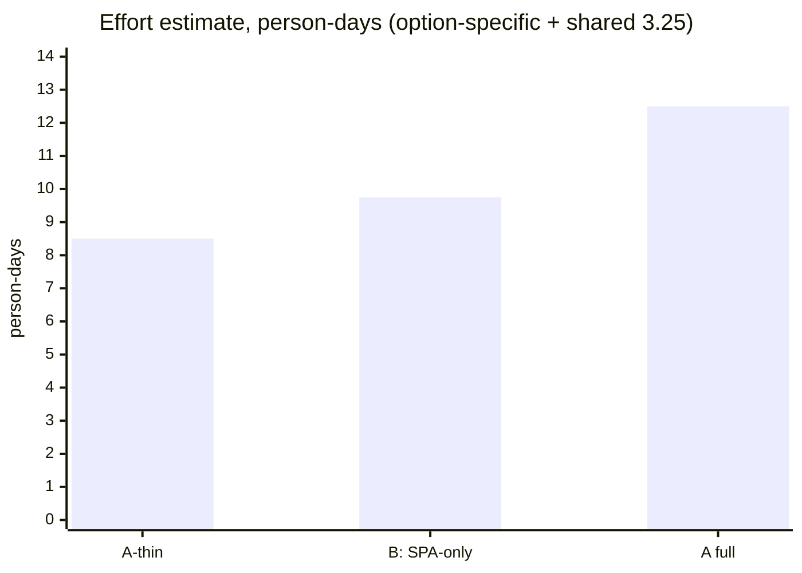
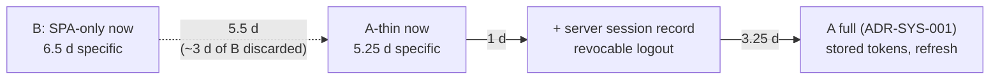
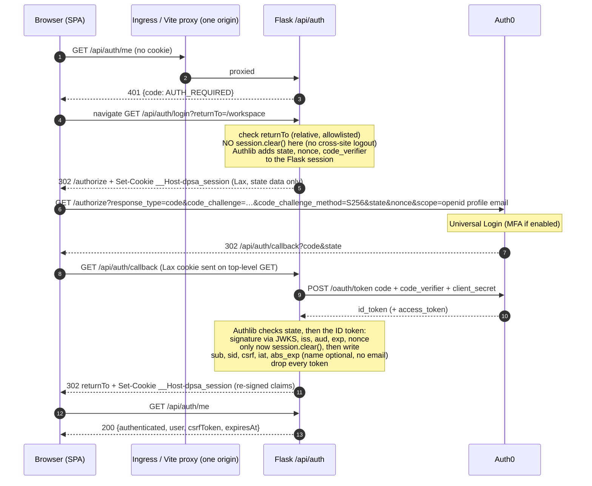
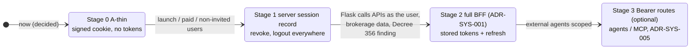
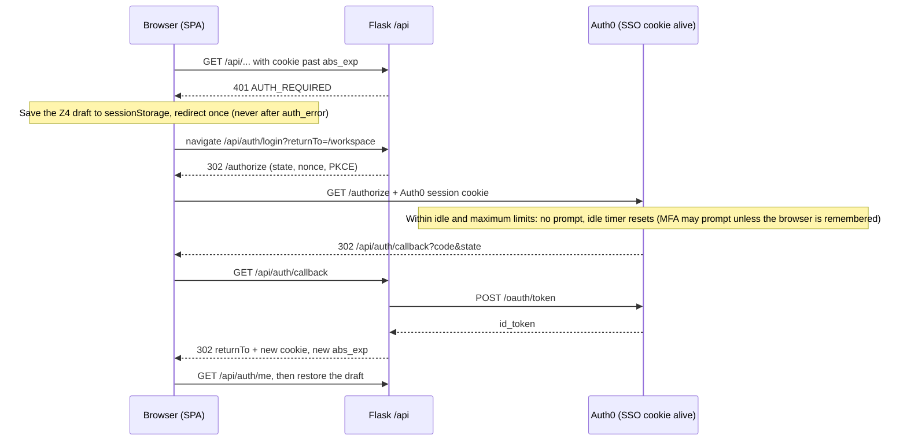
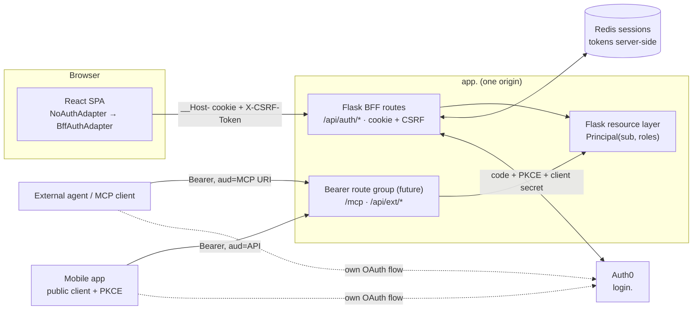

# Auth0: BFF (Flask confidential client) vs SPA-only PKCE for dp-stock-investment-assistant

Prepared by Researcher for Phan Duy, 18 Nov 2026 (UTC+7). Sources were checked on that date. Updated 19 Nov 2026 with §1C (session lifetime, SSO and daily use), §8 and §9. Research input only, not an authoritative project doc; ADR-SYS-001 stays the governing decision.

## 1. Answer first (decided 18 Nov 2026: A-thin now, staged to the full BFF)

**Decision (Duy, 18 Nov 2026): ship a thin BFF (A-thin) now and move to the full ADR-SYS-001 BFF in stages (§1B).** Flask runs the Auth0 login as a confidential client and keeps only the user's `sub` (plus a CSRF secret and login time) in an HttpOnly, signed `__Host-` session cookie. There is no Redis, no stored token, no refresh logic and no Auth0 SDK in the SPA. In this repo it is the cheapest of the three options costed in §1A (**estimate 8.5 person-days**, against **9.75** for SPA-only PKCE and **12.5** for ADR-SYS-001 as written). Tokens still never reach JavaScript, and it grows into the full BFF with server-side changes only.

- Why not SPA-only PKCE: it is **not cheaper here**. The two estimates are within error of each other, and SPA-only needs a custom domain or localStorage to survive a reload in Safari. Its E2E login is harder, and moving to a BFF later costs about **5.5 person-days**, of which about 3 days of SPA-side work is thrown away.
- On standards (corrected after review, §1R): RFC 10017 §1 puts OIDC login followed by the app's own session out of its scope, and §7.1 describes that pattern, with server-side cookie session state, for single-domain apps. So A-thin is not a weaker BFF. Its real gap is that Stage 0 is stateless and cannot revoke a session; Stage 1 completes the §7.1 pattern. The BFF recommendation ([RFC 10017 §6.1.4.3](https://www.rfc-editor.org/rfc/rfc10017.html)) applies when the browser app is an OAuth client that needs tokens, which Stage 2 adds.
- A-thin needs a **new ADR-SYS-006 "Staged browser session (thin BFF)"** that partly supersedes ADR-SYS-001's token storage (§1R, H1).
- The original analysis below (keep the BFF as the target architecture) still holds.

### Original answer (unchanged)

**Keep ADR-SYS-001 (BFF). The 2025–2026 evidence backs it more firmly than when it was accepted.**

- The IETF browser-apps guidance is now a published Best Current Practice: **RFC 10017 / BCP 212 (August 2026)**. It says the BFF pattern "is strongly recommended for business applications, sensitive applications, and applications that handle personal data". It also says the browser-only OAuth client "is not recommended" for the same class of apps ([RFC 10017 §6.1.4.3, §6.3.4.3](https://www.rfc-editor.org/rfc/rfc10017)). This app stores theses, decisions and portfolio context, so it is in that class.
- Auth0's own guidance points the same way for our topology. It says: "When the SPA calls only an API that is served from a domain that can share cookies with the domain of the SPA, no tokens are needed. OAuth adds additional attack vectors without providing any additional value" ([Auth0 Token Storage](https://auth0.com/docs/secure/security-guidance/data-security/token-storage)). Our SPA calls only Flask, on the same origin.
- SPA-only PKCE has one serious weakness that better token storage can't fix. Injected script can start a fresh silent authorization flow and get its own tokens. Even a store that "completely isolates the stored tokens from the attacker" doesn't stop that, and DPoP doesn't either ([RFC 10017 §5.1.3, §6.3.4.2](https://www.rfc-editor.org/rfc/rfc10017)).
- The BFF has real costs for Pitch A: a Redis session store, a CSRF scheme, the Lax-versus-Strict cookie handling at the callback, and the choice of OAuth library. These are bounded engineering tasks. None of them is a reason to reverse the decision.
- For the future (an MCP server, a mobile app, a separate agent service), use a **hybrid**: the same Flask resource server also accepts audience-bound Bearer JWTs from those non-browser clients. That is additive and needs no ADR-SYS-001 reversal.

## 1R. Architecture review (Software Architect Assistant, 18 Nov 2026)

Software Architect Assistant (SAA) reviewed this report against ADR-SYS-001, the overview, the frontend architecture and technical design, `docs/openapi.yaml`, `src/` at 260c83f and RFC 10017. Its verdict: A-thin fits the trust boundaries. The backend owns identity, no token reaches the browser, there is one origin, and the AuthAdapter seam is unchanged. Below is each finding and how this report now handles it.

| # | Finding | Resolution in this report |
|---|---|---|
| **H1** | A-thin reverses three Accepted ADR-SYS-001 decisions: server-side tokens become none, the server-side session becomes a client-side signed cookie, and Strict becomes Lax. Accepted ADRs are superseded, not amended | Every "amendment" now reads: **new ADR-SYS-006 "Staged browser session (thin BFF)"**, which partly supersedes ADR-SYS-001's token storage. ADR-SYS-001 keeps Auth0 as the IdP and per-user isolation. The stage triggers become ADR-SYS-006's revisit conditions. ADR-SYS-006 is the next free number at 260c83f (001–005 exist) |
| **H2** | The Socket.IO path (`src/web/sockets/chat_events.py`, wired in `api_server.py` and `wsgi.py`) bypasses `g.user_id` | Now **mandatory** in Pitch A's definition of done: remove the path, or reject every connect, with a test. I confirmed the wiring in `src/wsgi.py` and `api_server.py` at 260c83f |
| **M1** | The RFC framing is overstated. §1 puts "OIDC login, then the app keeps its own session" out of scope, and §7.1 covers that pattern with server-side session state | Wording corrected in §1, §1A.1 and §9. RFC 10017 §1 says that scenario "is not within scope of this specification". §7.1 says the app "can rely on server-side cookie-based session state". **Where my reading differs slightly:** §7.1 sits under §7, "Discouraged and Deprecated Architecture Patterns", and §7's intro calls those patterns "not recommended for use in modern browser-based OAuth applications". §7.1's own text, though, presents the pattern as a simpler valid choice for single-domain apps, and §7.1.1 says it is exposed only to proxying through the browser. So I write "describes", not "recommends". Either way, A-thin is not a weaker BFF; its real gap is that Stage 0 is stateless and cannot revoke a session, and Stage 1 completes the §7.1 pattern ([RFC 10017](https://www.rfc-editor.org/rfc/rfc10017.html#section-7.1)) |
| **M2** | Flask's session cookie is signed, not encrypted | Confirmed: the user "could look at the contents of your cookie but not modify it" ([Flask sessions](https://flask.palletsprojects.com/en/stable/quickstart/#sessions)). Stage 0 claims are now `sub`, `sid`, `csrf`, `iat`, `abs_exp`; email is dropped and name is optional. The cookie is not called opaque before Stage 1. Any personal data in it falls under Decree 356 |
| **M3** | "No frontend change" holds for code after Stage 0, but Stage 0 still has frontend work, and the docs diverge | Stage 0's frontend work is listed: `BffAuthAdapter`, the `/api/auth/me` bootstrap, the `auth_error` screen, and the Z4 draft flush on a 401. Follow-up for Coding Orchestrator: frontend TECHNICAL_DESIGN §6.1a (rev at 260c83f) says Strict, a same-site landing page, Flask refreshing tokens, and `/api/auth/session`. `docs/openapi.yaml` should fix one name. I propose `/api/auth/me`, but keeping `/api/auth/session` saves a doc edit; either works |
| **M4** | Use one `__Host-` Lax cookie at Stage 0; `session.clear()` in GET `/api/auth/login` lets a cross-site link sign a user out | A single Lax cookie is now the recommendation: CSRF header, Sec-Fetch-Site or Origin check on unsafe methods, and side-effect-free GETs. Strict would cost the landing page (about 1 d, estimate) and make a first load from an external link look signed out. The login route no longer clears the session; the callback clears and rewrites it only after success. RFC 10017 §6.1.3.2 says a BFF SHOULD use Strict and that deviating "requires proper motivation", so record that motivation in ADR-SYS-006 |
| **M5** | The Stage 0 revocation window | Stated in §1B.7. Logout clears only this browser, and a copied cookie works until `abs_exp`. `SECRET_KEY` rotation is the only kill switch. The absolute lifetime must be decided before Pitch A and recorded in ADR-SYS-006. RFC 10017 §6.1.2.3 likewise says client-side sessions make revocation "difficult" |
| L1 | The Vite proxy's `changeOrigin` rewrites Host, so the callback would be built for :5000 | A fixed `APP_BASE_URL` per environment is now the rule; `ProxyFix` is not relied on |
| L2 | The Pitch A row in `specs/pitches/README.md` says "ADR-SYS-001 token storage Accepted" | Follow-up once ADR-SYS-006 lands. At 260c83f the row reads "token storage and role mapping still Proposed", so the "Accepted" wording must be in a later working copy that I couldn't see |
| L3 | `sid` in the ID token is unverified | If it is missing, logout falls back to Auth0's logout consent prompt. Accepted |

## 1A. Complexity and implementation cost (added 18 Nov 2026)

Costed for d-dragon/dp-stock-investment-assistant at commit 260c83f, with Duy's priority: lowest cost and fastest time to market, with some security given up. **All effort figures are Researcher estimates, not measurements.**

### 1A.1 Three options costed

| Option | What it is | Tokens in the browser | Against RFC 10017 |
|---|---|---|---|
| **A: full BFF** (ADR-SYS-001 as written) | Flask confidential client; access and refresh tokens in a server-side session; server-side refresh; Strict session cookie plus Lax transaction cookie; CSRF token | None | The recommended pattern (§6.1) |
| **A-thin: thin BFF** (new) | Same Auth0 login via Authlib, but Flask keeps only `sub`, `sid`, a CSRF value and timestamps in its signed (not encrypted) `__Host-` HttpOnly cookie. No Auth0 tokens kept after login, no refresh, no Redis. One Lax cookie, so Authlib works as shipped | None | Outside its BFF scope (§1); the §7.1 single-domain pattern, completed at Stage 1. Stage 0 cannot revoke sessions |
| **B: SPA-only PKCE** | `@auth0/auth0-react` runs PKCE in the browser; Flask validates Bearer JWT access tokens (iss, aud, exp, RS256 via JWKS) | Access and refresh tokens in JS memory | "Not recommended" for personal-data apps (§6.3.4.3) |

A-thin is what Auth0's [Token Storage](https://auth0.com/docs/secure/security-guidance/data-security/token-storage) page describes for an SPA that calls only a same-origin API: no tokens are needed. It is ADR-SYS-001 minus the stored tokens, which our API does not need because Flask is both the BFF and the resource server. RFC 10017 §1 places this login-then-own-session pattern outside its scope, and §7.1 describes it for single-domain apps with server-side session state, which Stage 1 adds.

### 1A.2 Effort estimate (person-days, ESTIMATE)

| Item | A full | A-thin | B | What the work is |
|---|---:|---:|---:|---|
| Auth0 dashboard config | 0.25 | 0.25 | 0.5 | A: Regular Web App + API audience. A-thin: Regular Web App only. B: SPA app + API audience + rotation + Allowed Callback, Logout and Web Origins per environment |
| Login, callback, logout, session routes | 1.5 | 1.0 | 0 | Authlib. A adds the Strict/Lax cookie split and the same-site landing page |
| Session store | 1.0 | 0.25 | 0 | A: Redis or MongoDB with encrypted tokens. A-thin: Flask's signed cookie, config only |
| Token refresh | 1.0 | 0 | 0 | A: server-side, under a lock. B: the SDK does it |
| Access-token validation | 0.5 | 0 | 0.75 | PyJWT `PyJWKClient`; iss, aud, exp, RS256; 401 with `WWW-Authenticate` |
| CSRF | 0.5 | 0.5 | 0 | Header token + Origin/`Sec-Fetch-Site` check on unsafe methods |
| Frontend auth adapter | 0.5 | 0.5 | 1.0 | B: `Auth0Provider`, token getter, callback, error mapping |
| Credentials on fetch and chat stream | 0.25 | 0.25 | 0.25 | CSRF header, or `Authorization` header |
| Reload and Safari handling | 0 | 0 | 0.75 | B: custom domain, `useRefreshTokens`, fallback, Safari test |
| Local dev | 0.5 | 0.5 | 0.25 | A: `redirect_uri` behind the Vite proxy; Secure cookies on localhost |
| Backend tests | 1.0 | 0.75 | 0.5 | A: callback, CSRF, no token in responses. B: local RSA keys + JWKS stub |
| Frontend unit tests and MSW | 0.25 | 0.25 | 0.5 | B must mock the Auth0 SDK |
| E2E login (Playwright) | 0.5 | 0.5 | 1.0 | B: in-memory tokens are not in `storageState` |
| Cross-browser cookie spike | 0.5 | 0 | 0 | Strict cookie after the callback, three browsers |
| Infra, Helm, CI | 1.0 | 0.25 | 0.5 | A: Redis on AKS. B: Auth0 values per frontend build |
| ADR work (SAA) | 0 | 0.25 | 0.5 | A-thin: new ADR-SYS-006, partly superseding ADR-SYS-001. B: new ADR |
| **Option-specific subtotal** | **9.25** | **5.25** | **6.5** | |
| Shared work (any option, below) | 3.25 | 3.25 | 3.25 | |
| **Total (estimate)** | **12.5** | **8.5** | **9.75** | |

| Shared work, any option | Days (estimate) |
|---|---:|
| `Principal(sub)` replaces `X-User-ID` in `workspace_routes.py`, `session_routes.py`, `conversation_routes.py`, with per-user scoping tests | 1.5 |
| Login and logout UI; 401 → Z4 draft save → re-login | 0.5 |
| CSP header and a check of markdown rendering | 0.5 |
| Playwright login harness, Auth0 test user, CI secrets | 0.5 |
| Auth0 dev and prod tenants, test users | 0.25 |

**Assumptions:** one person-day is a focused day of Duy's time, including review of AI-agent output. Pitch B has already delivered Vite, the `AuthAdapter` seam and MSW. Auth0 signup and legal review are excluded. Treat each figure as ±30%, so A-thin and B overlap; A full is clearly larger. Neither A-thin nor B fits a one-week pitch together with the shared work, so plan two pitches or move the shared `Principal` work earlier.



### 1A.3 What gets built in this repo

| Area | A-thin (A full adds) | B: SPA-only PKCE |
|---|---|---|
| Backend files | `src/web/auth/`: `oauth.py` (Authlib registry), `routes.py` (`/api/auth/login`, `/callback`, `/me`, `/logout`), `csrf.py`, `principal.py`. A full adds a session store and refresh | `src/web/auth/bearer.py` (`PyJWKClient`, `require_auth`), `principal.py` |
| Frontend files | `BffAuthAdapter.ts`: GET `/api/auth/me`, login is a full-page navigation, logout is a POST. The API client adds `X-CSRF-Token` | `Auth0AuthAdapter.ts` behind the same `AuthAdapter` interface, `<Auth0Provider>` in `main.tsx`, `onRedirectCallback` for `returnTo`. The API client awaits `getAccessTokenSilently()` and maps `login_required` and `missing_refresh_token` to re-login |
| Auth0 dashboard | Regular Web Application: callback `/api/auth/callback`, logout URL. A full also registers an API audience and refresh settings | Single Page Application plus an API (audience); Refresh Token Rotation on; Allowed Callback, Logout and Web Origins per environment (the [React quickstart](https://auth0.com/docs/quickstart/spa/react) calls Web Origins "critical for silent authentication"); shorten the API token lifetime from the 24 h default |
| Chat stream (fetch POST, SSE format) | Cookie is sent automatically; add `X-CSRF-Token`; check auth once at stream start | Get a token before opening the stream and send `Authorization`; expiry mid-stream does not matter if checked at start |
| Socket.IO path (`src/web/sockets/chat_events.py`, wired in `api_server.py` and `wsgi.py`) | Mandatory in Pitch A: remove it, or reject every connect; it bypasses `g.user_id` | Same: remove it or reject connects |
| CORS and proxy | None needed: the Helm ingress already serves `/` and `/api` on one host. Keep `flask_cors` origins tight | None needed either: the API stays same-origin; Auth0 endpoints are covered by Allowed Web Origins |
| Infra | Two secrets: Auth0 client secret and Flask `SECRET_KEY`. A full: a session-critical Redis on AKS. docker-compose runs Redis 6.2 for caching, but the Helm chart and Terraform at 260c83f have none | Auth0 domain, client ID and audience baked into each Vite build, or served as runtime config; issuer and audience env on the API |
| Local dev | Build `redirect_uri` from a fixed `APP_BASE_URL` per environment, because Vite's `changeOrigin` rewrites Host to :5000. Check `Secure` cookies on http://localhost per browser | Add http://localhost:5173 to the app URLs. Reload in Safari logs you out without a custom domain ([spa-js FAQ](https://github.com/auth0/auth0-spa-js/blob/main/FAQ.md)) |
| Tests | MSW: one `/api/auth/me` handler. Playwright `storageState` keeps the cookie, so log in once per run | Mock the SDK (MSW cannot drive the hosted login). `storageState` saves cookies, localStorage and IndexedDB ([Playwright auth](https://playwright.dev/docs/auth)), not in-memory tokens, so tests log in again or use a test-only token path |
| Ongoing maintenance | Authlib (stable) upgrades. A full adds Redis operations and refresh races | SDK upgrades (v2 flipped `useRefreshTokensFallback` to false), browser cookie-policy changes, refresh-token reuse lockouts across tabs |

### 1A.4 Libraries (latest versions from the npm registry and PyPI, checked 18 Nov 2026)

| Package | Latest | Used by | Note |
|---|---|---|---|
| `@auth0/auth0-react` / `@auth0/auth0-spa-js` | 2.30.0 / 2.30.0 | B | In-memory cache by default ([auth0-react](https://github.com/auth0/auth0-react)) |
| Authlib | 1.9.9 | A, A-thin | Stable; writes OAuth state into Flask's session cookie (§3) |
| PyJWT | 2.15.1 | B, A full | `PyJWKClient` fetches Auth0's JWKS ([PyJWT usage](https://pyjwt.readthedocs.io/en/stable/usage.html)) |
| auth0-api-python | 1.0.0b11 (beta) | B alternative | Auth0's [Python API quickstart](https://auth0.com/docs/quickstart/backend/python) uses it, with async routes |
| auth0-server-python | 1.0.0b20 (beta) | A alternative | Async-only |
| flask-cors | 6.0.5 (repo pins 6.0.1) | Existing | Already wired in `api_server.py` |
| msw / @playwright/test | 3.0.7 / 1.65.1 | All | Test stack |
| react-markdown / rehype-sanitize | 10.1.0 / 6.0.0 | All | "Secure by default"; don't add `rehype-raw` ([react-markdown](https://github.com/remarkjs/react-markdown)) |

The repo runs Flask 3.1.1, sync, so the stable sync libraries (Authlib, PyJWT) avoid adding a second concurrency model.

### 1A.5 Migration paths and triggers



| Move | Cost (estimate) | What changes |
|---|---|---|
| B → A-thin | 5.5 d | New Regular Web App in Auth0 (same users; everyone logs in once more); add the auth routes, CSRF and tests; swap `Auth0AuthAdapter` for `BffAuthAdapter` and remove the SDK; rework E2E login. About 3 d of B work is discarded (SDK adapter and mocks, Safari handling, E2E token path, SPA config). The JWT middleware is kept for future Bearer routes |
| A-thin → server session record | 1 d | Opaque session id in the cookie; record in MongoDB (already a dependency) with a TTL index, or Redis. Gives logout-everywhere and admin revoke. No frontend change |
| Server session → A full | 3.25 d | Store encrypted tokens, server-side refresh, access-token validation, Strict cookie split with the landing page and spike, Redis on AKS if chosen. No frontend change |

**Keep the seam cheap:** every Auth0 SDK call stays inside the adapter; never put a token in localStorage; keep the API on `/api` same-origin; resolve identity in one backend `current_principal()`.

**Triggers (proposed):**

1. Before public launch, paid plans, or users outside an invited group: add the server session record.
2. Before storing real brokerage or securities-account data, connecting a broker, or if legal review puts portfolio data under Decree 356 Art. 4: go to A full.
3. When Flask must call another API as the user (a separate agent service, MCP, Auth0 Management API): go to A full.
4. Any XSS finding, third-party scripts such as analytics, or user-shared rich content: move off B at once if B was chosen.

### 1A.6 Security trade-offs accepted and cheap mitigations

| Option | What you give up | Cheap mitigation |
|---|---|---|
| B | XSS can read tokens and, worse, mint fresh ones with a silent flow; storage choices do not stop that (RFC 10017 §6.3.4.2) | Strict CSP with no inline script and no third-party script hosts ([MDN CSP](https://developer.mozilla.org/en-US/docs/Web/HTTP/Guides/CSP)); shared 0.5 d |
| B | A stolen refresh token keeps working | Keep the SDK's in-memory cache (its Worker isolates the refresh token); never `cacheLocation: 'localstorage'`; [Refresh Token Rotation](https://auth0.com/docs/secure/tokens/refresh-tokens/configure-refresh-token-rotation) with reuse detection; short idle and absolute refresh lifetimes |
| B | Access tokens are trusted until `exp` | Set the API token lifetime to minutes, not the 24 h default ([Auth0](https://auth0.com/docs/secure/tokens/access-tokens/update-access-token-lifetime)) |
| B | Reload logs users out in Safari and Brave | Custom domain `login.<domain>` with `useRefreshTokensFallback`; free on the Free plan with a card on file ([custom domains](https://auth0.com/docs/customize/custom-domains)) |
| A-thin | Logout clears only this browser; a copied cookie stays valid until `abs_exp`; an Auth0 block applies at next login | Absolute lifetime decided before Pitch A and recorded in ADR-SYS-006; rotating `SECRET_KEY` is the only kill switch; add the session record at the launch trigger |
| A-thin | Lax session cookie instead of Strict | Header token plus Origin check on unsafe methods; keep GETs side-effect-free |
| Both | XSS acting through the open tab | react-markdown without `rehype-raw` (it escapes HTML by default), [rehype-sanitize](https://github.com/rehypejs/rehype-sanitize) if HTML is ever allowed, lockfile plus Dependabot or `npm audit` |

**Vietnam:** Law 91/2025/QH15 and Decree 356/2025 apply whichever option ships (see §4). A legal finding that portfolio data is sensitive is itself a trigger to go to A full.

## 1B. A-thin: chosen path (detail) (added 18 Nov 2026)

**Decision (Duy, 18 Nov 2026):** A-thin now, staged to the full ADR-SYS-001 BFF, recorded in a new ADR-SYS-006 (§1R). This is Stage 0 of that path. Names such as `__Host-dpsa_session` and the env var names are proposals for Coding Orchestrator to confirm in the technical design and `docs/openapi.yaml`. ADR-SYS-001 leaves route names to those documents.

### 1B.1 Login flow



**One cookie, two jobs.** In single-cookie mode, Flask's own session cookie is the `__Host-` cookie with `SameSite=Lax`. Before login it holds only Authlib's `_state_<name>_<state>` entry. In the Authlib 1.9.9 source (`base_client/framework_integration.py`), that entry expires after 3600 s and is cleared once the token exchange succeeds. After a successful callback, Flask clears the session and re-signs the same cookie with the session claims; the login route itself never clears it (§1R, M4). The cookie is **signed, not encrypted**: Flask's docs say the user "could look at the contents of your cookie but not modify it" ([Flask sessions](https://flask.palletsprojects.com/en/stable/quickstart/#sessions)). So it carries no email, and it is not opaque until Stage 1. Lax matters because the callback is a cross-site navigation, and it also lets a first load from an external link arrive signed in. In split mode (the ADR text), the Flask session cookie stays Lax for the state, and a second `Strict` app cookie is issued. That needs the same-site landing page and about 1 d more (estimate). Authlib validates the ID token, including the nonce, when the openid scope is used ([Authlib Flask client](https://docs.authlib.org/en/stable/oauth2/client/web/flask.html); [Auth0 Validate ID Tokens](https://auth0.com/docs/secure/tokens/id-tokens/validate-id-tokens); [Auth0 Authorization Code Flow](https://auth0.com/docs/get-started/authentication-and-authorization-flow/authorization-code-flow)).

### 1B.2 Login error paths and logout

| Case | What happens | Flask response |
|---|---|---|
| State mismatch or missing state entry | Authlib raises `MismatchingStateError`, for example on an expired or replayed callback | Clear the session; 302 to `/?auth_error=state`; log it |
| User denies consent or Auth0 returns an error | The callback arrives with `error` and `error_description`; Authlib raises `OAuthError` (1.9.9 source) | 302 to `/?auth_error=<code>`; log the description server-side only |
| User abandons the Auth0 page | No callback; the state entry expires | Nothing; the SPA stays signed out |
| Token exchange or ID-token validation fails | Network error, bad secret, or a claim check fails | 302 to `/?auth_error=login_failed`; alert on repeats |
| Invalid `returnTo` | An absolute URL or a route outside the allowlist | Ignore it and use `/` |

When `auth_error` is present, the SPA shows a sign-in screen with a message and never auto-redirects again, which prevents login loops.

**Logout:**

1. The SPA sends `POST /api/auth/logout` with `X-CSRF-Token`. Using POST means a cross-site link cannot log the user out.
2. Flask reads `sid`, runs `session.clear()` and expires the cookie. It returns 200 with `logoutUrl`, because a fetch can't usefully follow a cross-origin redirect.
3. The SPA sets `window.location = logoutUrl`, which is `https://<tenant>/oidc/logout?client_id=…&logout_hint=<sid>&post_logout_redirect_uri=https://<host>/`.
4. Auth0 ends its session and redirects to the app. The URL must be in Allowed Logout URLs.

Auth0 recommends `id_token_hint`. An app that "cannot securely store ID tokens" may send `logout_hint` and `client_id` instead. With neither, Auth0 shows a logout consent prompt ([Auth0 logout](https://auth0.com/docs/authenticate/login/logout/log-users-out-of-auth0); [OIDC Logout endpoint](https://auth0.com/docs/api/authentication/logout/oidc-logout)). Keeping `sid` in the cookie makes that possible without keeping the ID token. Authlib's `logout_redirect()` builds the URL from the tenant's discovery document. End Session Endpoint Discovery is on by default for tenants created on or after 14 Nov 2023. The older [`/v2/logout`](https://auth0.com/docs/api/authentication/logout/auth-0-logout) with `returnTo` also exists.

### 1B.3 Application flow

```mermaid
sequenceDiagram
  participant S as SPA (AuthAdapter + API client)
  participant F as Flask before_request
  participant R as Route handler
  S->>F: GET /api/workspaces (cookie sent automatically)
  Note over F: verify signature (SECRET_KEY, then fallbacks)<br/>check abs_exp; g.user_id = sub<br/>skip only /api/auth/* and health
  F->>R: current_user_id() replaces X-User-ID
  R-->>S: 200, records scoped to sub
  S->>F: POST /api/chat (fetch) X-CSRF-Token, Accept: text/event-stream
  Note over F: unsafe method: header == session csrf<br/>and Sec-Fetch-Site / Origin same-origin
  F->>R: user_id captured before streaming starts
  R-->>S: 200 text/event-stream chunks
  S->>F: later call after abs_exp
  F-->>S: 401 {code: AUTH_REQUIRED}
  Note over S: save Z4 draft, then navigate<br/>/api/auth/login?returnTo=<current route>
```

| Concern | A-thin behaviour |
|---|---|
| Identity in handlers | One `before_request` (or `@require_user`) sets `g.user_id`. `workspace_routes.py`, `session_routes.py` and `conversation_routes.py` call `current_user_id()` and stop reading `X-User-ID` |
| CSRF | SameSite=Lax, plus a session-bound token from `/api/auth/me` sent as `X-CSRF-Token` on POST, PUT, PATCH and DELETE, plus a Fetch Metadata or Origin check. OWASP lists custom request headers and Fetch Metadata as API defences and treats SameSite as defence in depth ([OWASP CSRF](https://cheatsheetseries.owasp.org/cheatsheets/Cross-Site_Request_Forgery_Prevention_Cheat_Sheet.html)) |
| Expiry before a call | 401 with a stable JSON code; the AuthAdapter handles it once for every call |
| Expiry or logout mid-stream | Auth is checked at stream start only, so a running stream finishes or hits the 60 s idle timeout. At Stage 0, logout in another tab doesn't stop it, because the cookie is stateless |
| Socket.IO path | Mandatory: remove `src/web/sockets/` from `api_server.py` and `wsgi.py`, or reject every connect. Today it bypasses `g.user_id` |
| Tokens in responses | None: `/api/auth/me` returns profile fields and the CSRF token only |

### 1B.4 Configuration

| Setting | Value | Note |
|---|---|---|
| `SECRET_KEY` | Random, from env `FLASK_SECRET_KEY` (Kubernetes Secret) | Signs the session; whoever holds it can forge any session |
| `SECRET_KEY_FALLBACKS` | Old keys during rotation | Added in Flask 3.1; the repo pins 3.1.1. Rotating without a fallback logs everyone out, which is the Stage 0 kill switch |
| `SESSION_COOKIE_NAME` | `__Host-dpsa_session` in prod | Env override for local dev (below) |
| `SESSION_COOKIE_SECURE` / `HTTPONLY` / `SAMESITE` | True / True / `"Lax"` | `__Host-` also needs `Path=/` and no `Domain`, so leave `SESSION_COOKIE_DOMAIN` unset |
| `PERMANENT_SESSION_LIFETIME` | Your absolute-lifetime decision | Flask's cookie session checks the signature is not older than this |
| `SESSION_REFRESH_EACH_REQUEST` | False | The cookie is re-signed only at login, so the lifetime is absolute; also enforce `abs_exp` |
| Base URL | Fixed env `APP_BASE_URL` per environment | Builds `https://<host>/api/auth/callback` and the logout return URL. Don't rely on Werkzeug [`ProxyFix`](https://werkzeug.palletsprojects.com/en/stable/middleware/proxy_fix/): Vite's `changeOrigin` rewrites Host to :5000 |
| Env vars (proposed names) | `AUTH0_DOMAIN`, `AUTH0_CLIENT_ID`, `AUTH0_CLIENT_SECRET`, `FLASK_SECRET_KEY`, `FLASK_SECRET_KEY_FALLBACKS`, `APP_BASE_URL`, `AUTH_SESSION_MAX_AGE` | None goes into the frontend build |

Source for the Flask keys: [Flask configuration](https://flask.palletsprojects.com/en/stable/config/).

| Auth0 dashboard | Setting |
|---|---|
| Application type | Regular Web Application; token endpoint auth by client secret |
| Allowed Callback URLs | `https://<host>/api/auth/callback` per environment, plus `http://localhost:5173/api/auth/callback` for dev |
| Allowed Logout URLs | `https://<host>/` per environment, plus `http://localhost:5173/` |
| Grant types | Authorization Code only; no refresh token yet |
| API / audience | None until Stage 2; no `offline_access` scope |
| Allowed Web Origins | Not needed: there's no SPA SDK |
| Tenant advanced settings | RP-Initiated Logout End Session Endpoint Discovery on (the default for tenants created on or after 14 Nov 2023) |

**Local dev (partly unverified).** MDN says the https requirement of `Secure` "is ignored when the Secure attribute is set by localhost". It also says a `__Host-` cookie must be set "by a secure page (HTTPS)" ([MDN Set-Cookie](https://developer.mozilla.org/en-US/docs/Web/HTTP/Reference/Headers/Set-Cookie)). I haven't verified whether each browser accepts `__Host-` from `http://localhost`. Fallback: set the env override `SESSION_COOKIE_NAME=dpsa_session_dev` in dev only, keeping Secure and HttpOnly, or serve Vite over HTTPS.

### 1B.5 Evolution from A-thin to the full BFF



| Stage | Trigger | What changes | Frontend change | Effort (estimate) | Re-login and data |
|---|---|---|---|---|---|
| 0: A-thin | Now (decided) | Login routes, signed cookie, CSRF, `current_user_id()`, Socket.IO closed | Yes, planned once: `BffAuthAdapter`, `/api/auth/me` bootstrap, `auth_error` screen, Z4 draft flush on 401 | 8.5 d incl. 3.25 shared | First login for everyone; records keyed by `sub` from day one |
| 1: server session record | Public launch, paid plans, users outside an invited group, or a need for logout everywhere or admin revoke | The cookie value becomes an opaque random id, the first stage where it is opaque. A Flask `SessionInterface` is backed by MongoDB with a TTL index, or by Redis. Logout deletes the record, and an idle timeout becomes cheap | None | 1 d | Old signed cookies stop being read, so everyone signs in once, unless a dual-read is added for one lifetime (extra, not estimated). No data migration |
| 2: full BFF (ADR-SYS-001) | Flask must call another API as the user; real brokerage data; or legal review finds portfolio data sensitive under Decree 356 | Register an Auth0 API audience and request `offline_access`. Store encrypted tokens in the record, refresh server-side under a lock, validate access tokens, and revoke the refresh token at logout. Optional Strict plus Lax split | None (the landing page is served by Flask) | 3.25 d | Everyone signs in once to get tokens, or lazily the first time a feature needs a token. No data migration |
| 3: Bearer routes (optional) | External agents or MCP scoped under ADR-SYS-005 | A separate route group validating Bearer JWTs with their own audience; MCP spec rules (§5) | None | Not estimated; JWT validation alone was 0.5–0.75 d in §1A | None for browser users |

Adding an Auth0 custom domain at any stage forces everyone to log in again (§3), so pick its timing on purpose. The Auth0 application and its client ID stay the same through every stage. After Stage 0, no stage changes frontend code. The docs still need follow-ups (frontend TECHNICAL_DESIGN §6.1a, `docs/openapi.yaml`). The stage triggers become ADR-SYS-006's revisit conditions.

### 1B.6 Seams to reserve now, so later stages are backend-only

1. Fix the cookie name `__Host-dpsa_session` from Stage 0. Only its value format changes at Stage 1.
2. Put the `/api/auth/login`, `/callback`, `/me`, `/logout` contract and the `/me` response shape in `docs/openapi.yaml`.
3. Use one 401 JSON shape (`AUTH_REQUIRED`) and one CSRF header name, `X-CSRF-Token`.
4. The SPA reaches auth only through `AuthAdapter`. It never sees a token and never reads the cookie.
5. Resolve identity in one backend function, `current_user_id()` / `g.user_id`. No handler reads the cookie or a header itself.
6. Put session access behind Flask's `SessionInterface`, so Stage 1 can swap the store without touching routes.
7. Store `sid` in the session from day one, for `logout_hint` now and back-channel or admin revoke later.
8. Keep Stage 0 claims to `sub`, `sid`, `csrf`, `iat`, `abs_exp` (name optional); whoever holds the cookie can read it.
9. Clear the session only after a successful callback, never in the login route.
10. Key every user-owned record on the Auth0 `sub`, never on email.
11. Keep Auth0 scopes and audience in one config place, so Stage 2 adds `offline_access` and an audience in one edit.
12. Keep `/api` same-origin in every environment.

### 1B.7 Accepted risks against the full BFF

| Accepted at Stage 0 | Cheap mitigation | Removed at |
|---|---|---|
| Logout clears only this browser; a copied cookie stays valid until `abs_exp` | The cookie is HttpOnly, so XSS can't read it. Decide the absolute lifetime before Pitch A and record it in ADR-SYS-006. `SECRET_KEY` rotation is the only kill switch | Stage 1 |
| An Auth0 block or delete applies only at the next login | Same as above | Stage 1 (admin revoke) |
| Lax instead of Strict | `X-CSRF-Token` plus a Fetch Metadata or Origin check; GETs never change state; `returnTo` allowlist | Stage 2, if the split is chosen |
| The cookie is signed, not encrypted, so it is readable from logs, HAR files or proxies | Store only `sub`, `sid`, `csrf`, `iat`, `abs_exp` (name optional); no email and never a token. Personal data in it falls under Decree 356 | Stage 1 (opaque id) |
| A `SECRET_KEY` leak lets anyone forge sessions | Keep it in a Kubernetes Secret, never in `config.yaml` or the repo; rotate with fallbacks | Stage 1 reduces it |
| No downstream tokens | Features that need them wait for Stage 2 | Stage 2 |
| XSS acting through the open tab | CSP; react-markdown without `rehype-raw` | Never; the full BFF accepts this too ([RFC 10017 §6.1.4.1](https://www.rfc-editor.org/rfc/rfc10017.html)) |

### 1B.8 Definition of done for A-thin

- [ ] The Auth0 dev tenant has the Regular Web Application with dev callback and logout URLs.
- [ ] `/api/auth/login`, `/callback`, `/me` and `/logout` match `docs/openapi.yaml`.
- [ ] `X-User-ID` is gone from the three route modules; every read goes through `current_user_id()`.
- [ ] Backend unit tests cover:
  - cookie verification: valid, tampered signature, expired `abs_exp`, wrong key, fallback key accepted;
  - CSRF: a missing or wrong header and a cross-site `Sec-Fetch-Site` are rejected;
  - the `returnTo` allowlist and every login error path;
  - no token in any response body or cookie.
- [ ] A callback test runs against a stubbed Auth0: a fake token endpoint and a JWKS with a local RSA key, no network.
- [ ] MSW has handlers for `/api/auth/me`: signed in, signed out (401), and a session expiring between calls.
- [ ] The AuthAdapter calls `/api/auth/me` on boot. On a 401 it saves the Z4 draft and redirects once.
- [ ] Playwright logs in once against the Auth0 dev tenant with a test user and reuses `storageState` ([Playwright auth](https://playwright.dev/docs/auth)). The alternative is a stubbed OIDC provider on PRs and the real tenant on a schedule. Either way, include one chat stream with cookie plus CSRF.
- [ ] **Mandatory:** the Socket.IO path (`src/web/sockets/chat_events.py`, wired in `api_server.py` and `wsgi.py`) is removed or rejects every connect, with a test.
- [ ] GET `/api/auth/login` does not clear the session, and a test shows a cross-site hit on it leaves the user signed in.
- [ ] Frontend: `BffAuthAdapter`, the `/api/auth/me` bootstrap, the `auth_error` screen, and the Z4 draft flush on a 401.
- [ ] Config is in place: Secure, HttpOnly, Lax, lifetime set, refresh-each-request off, secrets in Kubernetes Secrets, a fixed `APP_BASE_URL`, and a CSP header.
- [ ] ADR-SYS-006 is accepted, with the absolute lifetime recorded, before the auth code merges.

## 1C. Session lifetime, SSO and daily use (added 19 Nov 2026)

Duy's goal is for people to use the app day after day without typing a password every workday. At Stage 0 that continuity comes from Auth0's own SSO session, not from a long app cookie. Software Architect Assistant proposed the content below, and every Auth0 and cookie fact was checked against current Auth0 docs and MDN on 18 Nov 2026 (UTC+7). One proposal was corrected: an inactivity timeout of about 7 days is not available below Enterprise. Numbers marked "recommendation" are recommendations. Duy decides, and the values go into ADR-SYS-006 at the start of Pitch M-000-A.

### 1C.1 Cookie basics: SameSite and `__Host-`

| Attribute | What it does (MDN) | Effect in A-thin |
|---|---|---|
| `SameSite=Lax` | Sent on same-site requests. On cross-site requests it is sent only for a top-level navigation (the address bar changes) with a safe method. It is not sent on `fetch()`, `img` or `script` subresources, iframe navigations, or POST, PUT and DELETE | Sent on the Auth0 callback and when a user follows an email or chat link into the app. Not sent on cross-site POST, fetch, iframe or img requests. So GET routes must have no side effects, and unsafe methods still need `X-CSRF-Token` plus the Sec-Fetch-Site or Origin check |
| `SameSite=Strict` | Sent only on requests that originate from the same site that set the cookie | Dropped on the Auth0 callback and on links from outside. That is why ADR-SYS-001's design needed a second, Lax login cookie plus a same-site landing page |
| `__Host-` prefix | The cookie must be `Secure`, be set from an HTTPS page, have no `Domain`, and have `Path=/` | A sibling subdomain cannot plant or overwrite the session cookie |
| `HttpOnly` | Not readable from JavaScript | An XSS payload cannot read the cookie, though it can still act through the open tab |
| `Max-Age` / `Expires` | Without either, the cookie is a session cookie, deleted when the browser session ends | Persistent app cookie: Flask sets `Expires` from `PERMANENT_SESSION_LIFETIME` when `session.permanent` is true |

Sources: [MDN Set-Cookie](https://developer.mozilla.org/en-US/docs/Web/HTTP/Reference/Headers/Set-Cookie) and [Flask configuration](https://flask.palletsprojects.com/en/stable/config/).

### 1C.2 Two sessions, no refresh at Stage 0

| Session | Where it lives | Lifetime | Who controls it |
|---|---|---|---|
| App session | Signed `__Host-dpsa_session` cookie on our origin with `sub`, `sid`, `csrf`, `iat`, `abs_exp` | Absolute only. It is not re-signed per request (`SESSION_REFRESH_EACH_REQUEST=False`) | Flask config, recorded in ADR-SYS-006 |
| Auth0 SSO session | Auth0's cookie on the tenant domain (`auth0` / `auth0_compat`) plus a server-side session record | Idle timeout and absolute (maximum) timeout, persistent or non-persistent | Auth0 Dashboard > Tenant Settings > Advanced > Session Expiration |

- **No refresh.** A-thin keeps no tokens, so there is nothing to refresh. The app session simply ends at `abs_exp`.
- **On app-session expiry.** The API returns 401, and the SPA saves the Z4 draft, then does a full-page navigation to `/api/auth/login?returnTo=`. If the Auth0 SSO session is alive, Auth0 redirects straight back with no prompt; otherwise the user signs in. That is two redirects and a page reload, and the time it takes has not been measured.
- **What keeps Auth0 alive.** Auth0's idle timer resets on each interaction with Auth0: calls to `/authorize`, silent authentication, or an SSO login to another app. Our own API calls do not touch Auth0, so at Stage 0 only the daily bounce resets it.
- **Logout.** Clear our cookie, then send the browser to `/oidc/logout` with `logout_hint=sid` and `client_id`. Without that step the Auth0 session survives and the next login signs the user straight back in.
- **Revoke or block in Auth0.** This takes effect at the next login only, and our cookie stays valid until `abs_exp`. That is the accepted Stage 0 risk, and Stage 1 fixes it.
- **Chat streams.** Auth is checked once, at stream start, so a stream that outlives `abs_exp` finishes.

### 1C.3 Daily silent re-login



### 1C.4 Recommended Stage 0 settings

| Setting | Recommendation | Verified limit or fact |
|---|---|---|
| App cookie | Persistent (`session.permanent = True`) with an absolute lifetime of 24 h. Use 12 h if a shorter copied-cookie and revoke window matters more than one extra bounce a day | No external limit. Software Architect Assistant sets 24 h as the most to accept while sessions are stateless |
| Auth0 session mode | Persistent | Persistent cookies survive a browser close. Non-persistent cookies use `Expires=0`, and browser session restore can defeat them anyway |
| Auth0 inactivity timeout | **3 days (4,320 min), corrected from about 7 days** | Maximum 3 days on self-service plans and 100 days on Enterprise. Higher values are lowered to the system limit |
| Auth0 maximum lifetime (Require log in after) | 30 days (43,200 min) | Maximum 30 days on self-service plans and 365 days on Enterprise |
| MFA remember browser | Optional: keep Remember Me on, with trusted-browser lifetimes chosen by Duy | Universal Login offers Remember Me by default. Dashboard > Security > Multi-factor Auth has Allow User to Skip MFA on Trusted Browsers, plus Idle and Maximum Trusted Browser Lifetime |
| SPA startup | Call `/api/auth/me` on first load. On a 401, auto-redirect once, and never auto-redirect after `auth_error` | A design rule that prevents login loops |
| Idle timeout in our app before Stage 1 | None | A stateless idle timeout must re-sign the cookie on activity, which weakens the absolute lifetime |

Sources: Auth0 [session lifecycle and limits](https://auth0.com/docs/manage-users/sessions/session-lifecycle), [configure session lifetime](https://auth0.com/docs/manage-users/sessions/configure-session-lifetime), [non-persistent sessions](https://auth0.com/docs/manage-users/sessions/non-persistent-sessions) and [customize MFA](https://auth0.com/docs/secure/multi-factor-authentication/customize-mfa).

### 1C.5 What a user sees with these values

| Situation | Outcome (24 h app, 3-day idle, 30-day maximum, persistent) |
|---|---|
| Opens the app every workday | About one silent bounce a day, when the 24 h app cookie ends, with no password |
| No Auth0 login for more than 3 days (a long weekend, leave) | Password, plus MFA unless the browser is remembered. Over a normal weekend, the gap from Friday's bounce to Monday's first visit is close to 72 h, so some Mondays will ask for a password |
| 30 days since the last password | Password, whatever the activity |
| Browser closed and reopened | Both sessions survive (persistent mode) |
| Logs out | Password at the next login |
| Account blocked in Auth0 | Takes effect at the next bounce, up to 24 h later |

Correction to the proposal: "a password roughly once a month" holds only with daily use. With the 3-day inactivity cap on self-service plans, any gap of more than 3 days since the last Auth0 login also asks for a password.

### 1C.6 Stage 1 and the trade-off

Stage 1 (about 1 d, estimate) adds the server-side session record. With it the app session can slide, for example 8 h renewed on activity (recommendation), under an absolute cap of 7 to 30 days (recommendation). That removes the daily bounce, makes the app session independent of Auth0's 3-day idle limit, and adds instant logout and revoke. The trade-off holds at every stage: longer sessions widen the stolen-device and copied-cookie window, and before Stage 1 nothing on the server can cut a stolen cookie short.

### 1C.7 Auth0 facts checked

| Claim | Status | Source |
|---|---|---|
| Persistent and non-persistent session modes, each with idle and absolute lifetimes | Confirmed | [Session lifecycle](https://auth0.com/docs/manage-users/sessions/session-lifecycle) |
| Inactivity about 7 days, maximum about 30 days | **Corrected** | The self-service maximum is 3 days inactivity and 30 days absolute; Enterprise allows 100 and 365 days (same page). The non-persistent sessions page states 4,320 and 43,200 min |
| Free plan uses the self-service limits | Unverified | The limits table compares Self-Service with Enterprise. The non-persistent sessions page names Essential, Professional, Developer and Developer Pro, not Free |
| Default idle and maximum values for a new tenant | Unverified | Not stated on the pages above; read them in the tenant's Dashboard |
| Idle timer resets on `/authorize`, silent auth and SSO | Confirmed | [Session lifecycle](https://auth0.com/docs/manage-users/sessions/session-lifecycle) |
| `/oidc/logout` with `logout_hint` (sid) and `client_id` | Confirmed | [Log users out of Auth0](https://auth0.com/docs/authenticate/login/logout/log-users-out-of-auth0) |
| Silent return to the app when the SSO session is alive | Consistent with docs, not tested | An MFA rule without a remembered browser can still prompt |
| MFA remember browser | Confirmed | [Customize MFA](https://auth0.com/docs/secure/multi-factor-authentication/customize-mfa); Actions [`allowRememberBrowser`](https://auth0.com/docs/actions/reference/post-login/post-login-api-object) |
| MFA and remember browser on the Free plan | Partly unverified | [Pricing](https://auth0.com/pricing) lists Pro MFA Factors as not included on Free. It doesn't say which factors and trusted-browser settings Free has |
| SameSite Lax and Strict behaviour; `__Host-` rules | Confirmed | [MDN Set-Cookie](https://developer.mozilla.org/en-US/docs/Web/HTTP/Reference/Headers/Set-Cookie) |

## 2. Standards stance (current versions)

| Source | Status (checked 18 Nov 2026) | What it says that matters here |
|---|---|---|
| RFC 10017 *OAuth 2.0 for Browser-Based Applications* (was draft-ietf-oauth-browser-based-apps) | Best Current Practice, BCP 212, Aug 2026 ([datatracker](https://datatracker.ietf.org/doc/draft-ietf-oauth-browser-based-apps/)) | Three patterns "presented in decreasing order of security": BFF, then token-mediating backend, then browser-based client (§6). BFF: "strongly recommended for business applications, sensitive applications, and applications that handle personal data" (§6.1.4.3). Browser client: "not recommended" for those (§6.3.4.3). |
| OAuth 2.1, draft-ietf-oauth-v2-1-17 | Active I-D, updated 2026-10-30; WG milestone "Dec 2026 submit to IESG" ([datatracker](https://datatracker.ietf.org/doc/draft-ietf-oauth-v2-1/)) | §9 lists the same three patterns "in decreasing order of security" and defers to RFC 10017. It says "The BFF MUST act as a confidential client"; browser apps "MUST use the authorization code grant"; the implicit grant "MUST NOT be used". PKCE is REQUIRED unless the client is confidential *and* uses the OIDC nonce correctly, and it is still RECOMMENDED then (§7.5.1.1). |
| RFC 9700 *OAuth 2.0 Security BCP* (Jan 2025) | BCP | "Public clients MUST use PKCE". For confidential clients, PKCE is RECOMMENDED. Authorization servers MUST detect refresh-token replay for public clients, by sender-constraining or by rotation (§2.1.1, §4.14.2) ([RFC 9700](https://www.rfc-editor.org/rfc/rfc9700)). |

### RFC 10017 threat model applied to the two options

RFC 10017 §5 names four attacks that malicious JavaScript can run (XSS, a compromised dependency, or a hostile extension):

| Attack (RFC 10017 §5.1) | A: BFF | B: SPA-only PKCE |
|---|---|---|
| Single-execution token theft | Mitigated: "there are simply no tokens to be stolen" (§6.1.4.2) | Exposed |
| Persistent token theft (the refresh token) | Mitigated | Exposed. Rotation makes it detectable but doesn't prevent it |
| Acquisition of new tokens (hidden-iframe silent flow) | Mitigated, because the BFF is a confidential client: the attacker can't exchange the code without client credentials (§6.1.4.2) | Exposed. RFC calls it "the most dangerous attack scenario" (§6.3.4.1) |
| Proxying requests through the user's browser ("acting on behalf") | **Still possible** while the tab is open. Inherent to web apps; defend with CSP and output sanitisation (§6.1.4.1) | Still possible |

The difference that matters: under A, an XSS attacker can act only while the victim's tab is open, and only through our Flask API, with our rate limits and audit log in the path. Under B, the attacker leaves with a portable credential that works from anywhere until it expires (refresh tokens: up to the configured lifetime).

## 3. Auth0 specifics (verified)

### SPA side (option B)

- **auth0-spa-js / @auth0/auth0-react**: both at 2.30.0 on npm (published 29–30 Oct 2026). The default cache is in memory, which "does not provide persistence across page refreshes and browser tabs". `cacheLocation: 'localstorage'` is opt-in, with Auth0's own XSS warning ([SPA SDK docs](https://auth0.com/docs/libraries/auth0-single-page-app-sdk)).
- **Silent auth under tracking prevention**: "Getting an Access Token silently without using Refresh Tokens will not work in browsers that block third-party cookies, such as Safari and Brave" ([SPA SDK docs](https://auth0.com/docs/libraries/auth0-single-page-app-sdk)). The workarounds are a same-site custom domain or rotating refresh tokens.
- **Refresh tokens in a browser**: Auth0 returns a refresh token to a browser only if Refresh Token Rotation is enabled ([Token Storage](https://auth0.com/docs/secure/security-guidance/data-security/token-storage)). With in-memory storage, "refresh tokens will be lost when refreshing the page" ([SPA SDK](https://auth0.com/docs/libraries/auth0-single-page-app-sdk)). So option B forces a choice: re-login or iframe on every reload, or refresh tokens in localStorage, which XSS can read.
- **Reuse detection**: if a used refresh token is replayed, Auth0 invalidates the whole token family and logs `ferrt` ([Refresh Token Rotation](https://auth0.com/docs/secure/tokens/refresh-tokens/refresh-token-rotation)).
- **DPoP**: Auth0 supports DPoP for `authorization_code`, `refresh_token`, `client_credentials` and other grants ([Auth0 DPoP](https://auth0.com/docs/secure/sender-constraining/demonstrating-proof-of-possession-dpop)). auth0-spa-js has `useDpop: true`, ES256 only, with a non-extractable key in IndexedDB ([spa-js DPoP example](https://github.com/auth0/auth0-spa-js/blob/main/examples/dpop.md)). On the API side, auth0-api-python (1.0.0b11, beta) verifies both Bearer and DPoP. DPoP stops exfiltrated tokens from being replayed. RFC 10017 §6.3.4.2.2 notes that it does **not** stop the attacker from binding a *fresh* token to their own key. I found no Auth0 plan restriction for DPoP on the docs page; confirm on the tenant.

### Backend side (option A)

- **Auth0's Flask quickstart** now uses **auth0-server-python** (the Regular Web Application type) with `flask[async]` ([Flask quickstart](https://auth0.com/docs/quickstart/webapp/python)). PyPI shows **1.0.0b20 (beta)**, released 23 Oct 2026. It is async-only and framework-agnostic, and you plug in a `TransactionStore` (PKCE verifier and state) and a `StateStore` (session) ([ConfigureStore](https://github.com/auth0/auth0-server-python/blob/main/examples/ConfigureStore.md)). The quickstart's in-memory stores "won't work in multi-instance deployments".
- **Flask async caveat**: "Each request still ties up one worker, even for async views" ([Flask docs](https://flask.palletsprojects.com/en/stable/async-await/)). That works, but it's a second concurrency model next to our sync streaming views.
- **Authlib**: a stable alternative (1.9.9 on PyPI, 17 Nov 2026) with a Flask OAuth client that supports PKCE through `code_challenge_method` ([Authlib web clients](https://docs.authlib.org/en/stable/oauth2/client/web/index.html)). **There is a trap here, checked in the 1.9.9 source.** `FrameworkIntegration.set_state_data` always writes a `_state_<name>_<state>` key into Flask's `session` cookie, even when a cache is configured. If that Flask session cookie is `SameSite=Strict`, the Auth0 callback (a cross-site navigation) arrives without it and state validation fails. ADR-SYS-001 already splits the cookies into a Lax transaction cookie and a Strict session cookie. With Authlib, make Flask's own session cookie the **Lax transaction cookie** and issue the Strict `__Host-` app session cookie separately. The alternative is to drive Authlib's lower-level OAuth2 client yourself.
- **Lifetimes**: the access-token lifetime defaults to 86,400 s (24 h), with a maximum of 2,592,000 s (30 days) ([Auth0](https://auth0.com/docs/secure/tokens/access-tokens/update-access-token-lifetime)). For rotating refresh tokens, the default lifetime is 30 days, the maximum is 1 year, and "The lifetime does not extend when tokens are rotated". Rotation has a configurable **Rotation Overlap Period** (leeway, off by default) for concurrent use ([Configure rotation](https://auth0.com/docs/secure/tokens/refresh-tokens/configure-refresh-token-rotation)). Idle refresh lifetime defaults to 30 days ([Configure expiration](https://auth0.com/docs/secure/tokens/refresh-tokens/configure-refresh-token-expiration)). Auth0 allows at most 200 active refresh tokens per user per application and revokes the oldest beyond that ([Refresh tokens](https://auth0.com/docs/secure/tokens/refresh-tokens)).
- **Client authentication**: the client secret is available on every plan. **Private Key JWT is Enterprise-only** ([Auth0](https://auth0.com/docs/get-started/applications/configure-private-key-jwt)). mTLS in auth0-server-python needs Enterprise plus the Highly Regulated Identity add-on ([README](https://github.com/auth0/auth0-server-python)).
- **Logout**: call `/oidc/logout` with `id_token_hint`, which Auth0 recommends, and `post_logout_redirect_uri` ([Auth0 logout](https://auth0.com/docs/authenticate/login/logout/log-users-out-of-auth0)). **OIDC Back-Channel Logout is Enterprise-only** ([Auth0](https://auth0.com/docs/authenticate/login/logout/back-channel-logout)).
- **Custom domain**: one is free, but the tenant needs a credit card on file for verification. Switching an existing tenant to one later means "users must log in again" ([Auth0 custom domains](https://auth0.com/docs/customize/custom-domains); [pricing](https://auth0.com/pricing)). Self-managed certificates are Enterprise-only.

### Plan facts relevant to us ([auth0.com/pricing](https://auth0.com/pricing), default plan view, 18 Nov 2026)

| Plan | Listed price | Relevant inclusions |
|---|---|---|
| Free | $0 | Up to 25,000 MAU, 1 custom domain (credit card verification), 5 Organizations, basic attack protection |
| Essentials | from $35/month (500 MAU) | Pro MFA, RBAC per Organization, 10 Organizations, log streaming, separate prod/dev environments |
| Professional | from $240/month (500 MAU) | Enterprise MFA, Custom Token Exchange, enhanced attack protection |
| Enterprise | contact sales | Back-channel logout, Private Key JWT, self-managed certificates |

The table marks Pro MFA factors "Not included" on Free. Check what MFA Free includes before you count on MFA for an MVP that holds financial data. **The choice between BFF and SPA doesn't change the plan or the MAU count.** Both are one Auth0 application per user login.

## 4. Comparison matrix for this project

| Dimension | A: BFF (ADR-SYS-001) | B: SPA-only PKCE + Bearer |
|---|---|---|
| XSS impact | The attacker can act through the open tab; no tokens leave the browser | Tokens can be exfiltrated, and new tokens minted with a silent flow (RFC 10017 §5.1.3) |
| CSRF | Must defend: SameSite=Strict, same origin, plus a header token (RFC 10017 §6.1.3.3: "MUST implement a proper CSRF defense") | Mostly not applicable to the API (Bearer isn't sent automatically); state/PKCE protects the redirect |
| Token theft at rest | Tokens sit in Redis, server-side; the cookie is opaque, HttpOnly, `__Host-` | Memory (lost on reload) or localStorage (readable by XSS) |
| Revocation / logout | Delete the Redis session and revoke the refresh token: effective immediately for our API | Access token stays valid until `exp` unless the API introspects; logout depends on the SDK and the iframe |
| Refresh handling | Server-side, client-authenticated; RFC 10017 §6.1.2.2 says to tie session lifetime to the refresh-token maximum | Rotation required; risk of reuse-detection lockouts across tabs; refresh token lost on reload when in memory |
| Silent re-auth / Safari ITP | Not needed: the session cookie is first-party | Iframe silent auth fails in Safari/Brave; needs rotation and storage trade-offs, or a custom domain |
| Multi-tab | One cookie, one session across tabs | In-memory cache is per tab, so each tab acquires its own tokens |
| Streaming chat (fetch POST + ReadableStream) | Works: cookie plus CSRF header; auth checked once at stream start | Works: Authorization header; token expiry mid-stream isn't a problem if checked at start |
| Re-auth UX (Z4 draft) | On 401: save the draft to sessionStorage, navigate to `/api/auth/login?returnTo=…` (relative paths only) | Same, through `loginWithRedirect` with `appState` |
| Dev experience (Vite proxy, agentic coding) | Same origin through the Vite proxy is the natural fit; the SPA's AuthAdapter stays thin (session check plus a CSRF header). Auth logic lives in one Python module, which is easier to spec and test | No proxy needed for auth, but an SDK provider wraps the React tree, tokens go into every fetch, and the CORS and Allowed Web Origins config has to be right |
| Ops cost on AKS | Redis becomes session-critical (HA needed); no sticky sessions with a shared store. RFC 10017 §6.1.2.3 notes that server-side sessions raise scaling concerns ("only recommended in small-scale scenarios") when you rely on stickiness or replication; a shared Redis avoids both | Stateless API; no session store |
| Implementation size (Pitch A) | Larger: login, callback, logout, session, CSRF, refresh, transaction cookie | Smaller on the backend (JWT validation only); SDK setup on the frontend |
| Future: MCP server for external agents | Independent: MCP clients use their own Bearer tokens; the MCP spec forbids token passthrough | Same |
| Future: mobile app | The mobile app is its own public client with PKCE and Bearer to the same API (hybrid) | Bearer API already exists |
| Future: separate agent service | The BFF calls it with a server-held, audience-bound token; never exposed to the browser | The SPA would need tokens for a second audience, or the API forwards them |
| Future: third-party API | Add a Bearer route group | Bearer API already exists |
| Vietnam PDPL (brief) | Fewer copies of credentials on end-user devices; central audit point | More credential exposure on the client side |

**Vietnam compliance note (brief, not legal advice).** Decree 13/2023 is **no longer in force**. Law 91/2025/QH15 on Personal Data Protection took effect on 1 Jan 2026, and Decree 356/2025/ND-CP replaced Decree 13 ([DLA Piper](https://www.dlapiperdataprotection.com/?c=VN&t=law); [Government portal](https://vanban.chinhphu.vn/?classid=1&docid=214590&orggroupid=1&pageid=27160)). Decree 356 Art. 4 lists sensitive personal data. That includes financial and securities transaction information held by regulated institutions, and behavioural-tracking data on online services. When processing sensitive data, organisations must set access-restriction rules, processing procedures and security measures (Art. 4(2), Researcher's translation of the Vietnamese text). Whether our user-entered portfolio and decision data counts as sensitive under Art. 4 needs legal review. Also check cross-border transfer obligations, since Auth0 is a foreign processor. Neither question changes the BFF/SPA choice.

## 5. Hybrid options and where each fits



| Pattern | Fits when | Here |
|---|---|---|
| **BFF + Bearer on the same resource server** | Browser users plus non-browser clients | Recommended target. Both auth paths resolve to one `Principal(sub, roles)`, and record scoping to `sub` stays in one place. Keep the route groups separate: cookie routes require CSRF and ignore `Authorization`; Bearer routes ignore cookies and validate `aud`. |
| **Token-mediating backend** (RFC 10017 §6.2) | The SPA must call third-party or cross-site resource servers directly | Not needed. RFC 10017: consider it only "when the use cases or system requirements would prevent the use of a proxying BFF". |
| **MCP server as a separate resource** | External agents (ADR-SYS-005) | The MCP spec (2026-07-28) makes the MCP server an OAuth 2.1 resource server. Clients MUST use RFC 8707 resource indicators. The server MUST check that tokens were issued for it and "MUST NOT accept or transit any other tokens" ([MCP authorization](https://modelcontextprotocol.io/specification/2026-07-28/basic/authorization)). Auth0's MCP guide needs the tenant toggles "Resource Parameter Compatibility Profile" and "Include Issuer in Authorization Responses" ([Auth0 MCP](https://auth0.com/ai/docs/mcp/get-started/authorization-for-your-mcp-server)). Give it its own Auth0 API audience. |
| **Mobile app** | Native client later | Its own Auth0 Native application with PKCE and Bearer. Auth0 advises OS secure storage (Keychain/Keystore) ([Token Storage](https://auth0.com/docs/secure/security-guidance/data-security/token-storage)). |
| **Agent extracted to a service** | ADR-SYS-003 triggers | The BFF calls it with a server-held token for an agent-service audience. Use Custom Token Exchange only if needed; it's listed under Professional. |

## 6. Risks of the BFF and mitigations

| Risk | Mitigation |
|---|---|
| XSS "acting on behalf" through the user's tab | CSP, the sanitised-output rules already in the frontend architecture, per-user rate limits, and audit logging at the BFF (RFC 10017 §6.1.4.1) |
| CSRF, including bodiless POSTs and same-site sibling subdomains | SameSite=Strict + `__Host-` + same origin + a session-bound token header on POST/PUT/PATCH/DELETE + Origin/`Sec-Fetch-Site` checks. OWASP treats SameSite as defence in depth, not a defence on its own ([OWASP CSRF](https://cheatsheetseries.owasp.org/cheatsheets/Cross-Site_Request_Forgery_Prevention_Cheat_Sheet.html)). Don't host untrusted content on sibling subdomains (RFC 10017 §6.1.3.3.1). |
| Callback cookie flow (Lax transaction, Strict session) | ADR's "same-site landing" step. Spike it in Chrome, Firefox and Safari: a Strict cookie must be sent on the first `/api/auth/me` after landing. |
| Library mismatch (Authlib state in Flask's session; auth0-server-python is beta and async) | See §3. Decide in Pitch A's TD. |
| Redis outage means everyone is signed out | Redis HA on AKS (replica + sentinel, or the managed Azure Cache for Redis); session TTL equal to refresh-token lifetime; a failure mode that degrades to re-login, not to errors |
| Refresh races (parallel requests, multiple tabs) | Per-session Redis lock around refresh, or Auth0 Rotation Overlap Period if rotation is enabled |
| Open redirect via `returnTo` | Accept only relative paths that match the SPA's route allowlist |
| BFF as an open proxy (if it later forwards to other services) | Allowlist of upstream hosts and paths (RFC 10017 §6.1.3.6 MUST) |
| Mixed-auth confusion when Bearer routes are added | Separate route groups and middleware; reject requests that carry both credentials on the same route |

### What would make us revisit ADR-SYS-001

1. The SPA has to be served from a **different site** than the API, with no edge proxy to put them on one origin.
2. The browser must call **third-party resource servers directly** with user tokens, which leads to the token-mediating backend.
3. The BFF becomes a measured latency or throughput bottleneck for streaming that can't be fixed by scaling Flask.
4. A future IETF/OAuth revision changes the RFC 10017 ranking. (RFC 10017 calls the remaining client-hijack risk "inherent", so a reversal on security grounds is unlikely.)

## 7. Recommendation and Pitch A implementation notes (Auth0)

**Recommendation (target architecture):** keep the BFF. Implement it as below and add Bearer routes only when ADR-SYS-005 or a mobile app needs them. These notes describe A full; for A-thin (§1A), use the same Auth0 app, flow and routes, but keep no tokens, skip refresh and the session store, and use one Lax `__Host-` Flask session cookie.

| Item | Proposal | Basis |
|---|---|---|
| Auth0 app type | **Regular Web Application**, token endpoint auth = client secret (Private Key JWT needs Enterprise) | Auth0 quickstart; Private Key JWT doc |
| Auth0 API | Register an API (audience e.g. `https://api.<domain>`) so the BFF gets a JWT access token that Flask validates (ADR: BFF is also the resource server) | ADR-SYS-001 |
| Flow | Authorization Code + PKCE S256 + `state` + OIDC `nonce`; scopes `openid profile email offline_access` | RFC 9700 §2.1.1; OAuth 2.1 §7.5.1.1 |
| Library | **Option 1 (recommended): Authlib**, stable and sync, with Flask's own session cookie as the Lax transaction cookie and a separate Strict app session. **Option 2: auth0-server-python**, the official option, but beta 1.0.0b20 and async | §3 |
| Routes (Pitch A, `/api/auth/*`) | `GET /login?returnTo=` → 302 to Auth0; `GET /callback` → exchange code, create session, then a same-site landing page that navigates to `returnTo`; `GET /me` → `{authenticated, user, csrfToken}`; `POST /logout` (CSRF) → delete session, revoke refresh token, 302 to `/oidc/logout?id_token_hint=…&post_logout_redirect_uri=…` | RFC 10017 §6.1.2.1; Auth0 logout docs |
| Cookies | Session: `__Host-Http-sid` or `__Host-sid`; `Secure; HttpOnly; SameSite=Strict; Path=/`; no `Domain`. Transaction: `__Host-txn`; `Secure; HttpOnly; SameSite=Lax; Path=/`; Max-Age around 10 min | RFC 10017 §6.1.3.2 recommends a `__Host-Http-` prefix; Chrome 140+ and Firefox 143+ support it, Safari doesn't yet, and it stays backwards-compatible because it still starts with `__Host-` ([caniuse](https://caniuse.com/mdn-http_headers_set-cookie_http_host-http_prefixes)) |
| Session store | Redis: opaque random session id → {sub, id_token, access_token, refresh_token, exp, csrf_secret}. Encrypt token fields at rest; TTL equal to session absolute lifetime | RFC 10017 §6.1.2.2–6.1.2.3 |
| CSRF | Session-bound synchronizer token returned by `/api/auth/me`, sent as `X-CSRF-Token` on POST/PUT/PATCH/DELETE (including `/api/chat`), plus an Origin/`Sec-Fetch-Site` check | RFC 10017 §6.1.3.3; OWASP |
| Token refresh | Server-side. Refresh when the access token is within 60 s of `exp`, under a per-session Redis lock. Short access-token lifetime (e.g. 10–15 min, a proposal) so Auth0-side blocks take effect quickly. Non-rotating expiring refresh tokens are acceptable for a confidential client (RFC 9700 makes rotation mandatory only for public clients). If you enable rotation, set an overlap period | RFC 9700 §4.14.2; Auth0 rotation docs |
| Session lifetime | Session absolute lifetime ≤ refresh-token maximum lifetime; on `invalid_grant`, destroy the session | RFC 10017 §6.1.2.2 |
| Custom domain | Set up `login.<domain>` **before launch**: free on Free (credit card verification). Not functionally needed for a BFF, but it avoids forcing everyone to log in again when added later, and it keeps future SPA/mobile options open | Auth0 custom domains |
| Streaming | Authenticate and check CSRF at stream start; don't re-authenticate mid-stream; a 401 before the first byte triggers the Z4 draft-save and re-login path | Project TD (60 s idle timeout) |
| Tests (from ADR follow-ups) | No token in any browser-readable response; state-changing calls without CSRF are rejected; Strict cookie present after callback landing in three browsers; cross-user `sub` isolation | ADR-SYS-001 |

## 8. Decisions for Duy

**New (18 to 19 Nov 2026, from §1A, §1B and §1C):**

- **N1. Approach for M-000/MVP: decided.** Duy chose A-thin on 18 Nov 2026, staged to the full BFF (§1B, §9).
- **N5. Logout endpoint:** OIDC logout with `logout_hint` (the stored `sid`) and `client_id`, recommended here because A-thin keeps no ID token, or the older `/v2/logout` with `returnTo`.
- **N6. Idle timeout before Stage 1:** the recommendation is none, so only the absolute lifetime applies. A stateless sliding timeout would re-sign the cookie on activity and weaken the absolute lifetime. Stage 1 brings a real sliding timeout (§1C.6).
- **N7. Stage 1 store:** MongoDB (already a dependency) or Redis (not yet in the AKS chart).
- **N2. New ADR-SYS-006:** "Staged browser session (thin BFF)", which partly supersedes ADR-SYS-001's token storage; ADR-SYS-001 keeps Auth0 and per-user isolation. Duy gives the go-ahead for Software Architect Assistant to draft it locally, uncommitted. Researcher does not edit the repo.
- **N3. Cookie mode:** **recommended: one `__Host-` Lax cookie** (Software Architect Assistant agrees). The alternative is the Strict plus Lax split, which costs about 1 d more, and a first load from an external link then looks signed out.
- **N8. App absolute lifetime, 12 h or 24 h (required):** the recommendation is 24 h (one silent bounce a day), the most to accept while sessions are stateless. 12 h halves the copied-cookie and revoke window, at the cost of a second bounce on some days. Record it in ADR-SYS-006 before Pitch A.
- **N9. Auth0 inactivity and maximum:** the recommendation is 3 days (4,320 min) and 30 days (43,200 min), the self-service maxima. The proposed 7 days isn't possible below Enterprise (which allows 100 days) (§1C.4).
- **N10. Auth0 session mode:** the recommendation is Persistent, so closing the browser doesn't sign people out.
- **N11. MFA remember browser:** optional. Keep Remember Me on and choose the trusted-browser idle and maximum lifetimes. Check in the tenant which MFA factors and settings the Free plan offers.
- **N4. Triggers:** accept, change or extend the triggers in §1A.5 and §1B.5. They become ADR-SYS-006's revisit conditions.

**Earlier decisions (still open; 3 applies to A full only; 5 is effectively required if B is chosen):**

1. **OAuth library for Pitch A:** Authlib (stable, sync) or auth0-server-python (official, beta, async). Researcher leans Authlib.
2. **Cookie prefix:** keep `__Host-` or adopt `__Host-Http-`, which RFC 10017 recommends (SHOULD). Chrome 140+ and Firefox 143+ support it, Safari doesn't yet, and it is backwards-compatible. This is a one-line ADR clarification.
3. **Refresh-token mode for the BFF:** non-rotating with expiry (simpler, since rotation is mandatory only for public clients) or rotating with overlap and a lock.
4. **Session lifetimes:** superseded by N6, N8, N9 and N10 (§1C).
5. **Custom domain before launch:** it needs a credit card on the Auth0 tenant, and is free on the Free plan. It is effectively required if B is chosen and optional for A-thin, but adding it later forces everyone to log in again.
6. **Hybrid Bearer path:** record it under ADR-SYS-005 when external agents are scoped, not now.

Not verified: Auth0's default tenant session lifetimes, whether the Free plan is held to the self-service session limits, exactly which MFA factors and trusted-browser settings Free includes, and Strict-cookie behaviour after the callback in every browser.

## 9. Conclusion

**A-thin now, full BFF in stages.** Flask runs the Auth0 login as a confidential client, keeps only a signed HttpOnly `__Host-` cookie with the user's `sub`, and discards the tokens. Each later stage, from revocable sessions to stored tokens to Bearer routes, changes only the backend.

| Why | Evidence |
|---|---|
| Lowest cost and time to market | Estimate 8.5 person-days, against 9.75 for SPA-only and 12.5 for the full BFF; no Redis, no refresh logic, no Auth0 SDK in the SPA |
| Same origin already exists in production | The Helm ingress serves `/` and `/api` on one host, so cookie auth needs no CORS and no new proxy |
| Tokens stay out of JavaScript | No token ever reaches the browser, which SPA-only can't offer (RFC 10017 §6.3.4.2). The pattern is the single-domain one in §7.1, complete once Stage 1 adds server-side state |
| Daily continuity without long app sessions | Keep the app session short and absolute (recommendation 24 h). Auth0's persistent SSO session (3-day idle, 30-day maximum on self-service plans) gives a silent bounce each day, and a password after a gap of more than 3 days or every 30 days. Stage 1 adds sliding sessions and revocation (§1C) |
| Cheap to grow | The cookie name, the `/api/auth/*` contract and the `AuthAdapter` seam stay fixed, so Stages 1 to 3 need no frontend code change; Stage 0 builds the frontend pieces once |

| Still open | Who makes the call |
|---|---|
| Go-ahead for ADR-SYS-006 (partly supersedes ADR-SYS-001's token storage; the triggers become revisit conditions) | Duy decides; Software Architect Assistant drafts |
| Cookie mode: one Lax cookie (recommended by Researcher and Software Architect Assistant), or the Strict plus Lax split | Duy |
| App absolute lifetime, 12 h or 24 h (recommendation 24 h): required before ADR-SYS-006 and Pitch A | Duy |
| Auth0 session settings: Persistent, inactivity 3 days, maximum 30 days (recommendations); MFA remember browser | Duy, in the Auth0 tenant |
| Idle timeout before Stage 1 (recommendation: none) | Duy |
| Custom domain now or before launch (adding it later forces everyone to log in again) | Duy |
| Upgrade triggers for Stages 1, 2 and 3 | Duy |
| Logout endpoint and Stage 1 store | Duy, with Coding Orchestrator |

| Suggested next action | Suggested owner |
|---|---|
| Draft ADR-SYS-006 with the stage table and triggers from §1B.5, plus status notes in the ADR index and overview | Software Architect Assistant |
| Align frontend TECHNICAL_DESIGN §6.1a (Strict, landing page, Flask refresh, `/api/auth/session`) with ADR-SYS-006; fix one auth route name in `docs/openapi.yaml`; update the Pitch A row in `specs/pitches/README.md` once ADR-SYS-006 lands | Coding Orchestrator |
| Put `/api/auth/*` and the 401 shape in `docs/openapi.yaml`, then build A-thin in Pitch A against §1B.8 | Coding Orchestrator |
| Track the Stage 1 to 3 triggers as watch items, not as backlog | Task Keeper |
| Create the Auth0 dev tenant and Regular Web Application, and decide on the custom domain | Duy |

On sessions: keep the app session short and absolute, and let Auth0's persistent SSO session carry daily continuity. Move to Stage 1 when sliding sessions or revocation are wanted. The numbers are recommendations; Duy decides, and they are recorded in ADR-SYS-006 at the start of Pitch M-000-A.

These are suggestions for Chief of Staff to route, not assignments. Researcher made no repo edits.

## References

1. RFC 10017 / BCP 212, OAuth 2.0 for Browser-Based Applications (Aug 2026) — https://www.rfc-editor.org/rfc/rfc10017 · datatracker: https://datatracker.ietf.org/doc/draft-ietf-oauth-browser-based-apps/
2. OAuth 2.1, draft-ietf-oauth-v2-1-17 — https://datatracker.ietf.org/doc/draft-ietf-oauth-v2-1/
3. RFC 9700, OAuth 2.0 Security Best Current Practice — https://www.rfc-editor.org/rfc/rfc9700
4. RFC 9449, DPoP — https://www.rfc-editor.org/rfc/rfc9449
5. Auth0, Token Storage — https://auth0.com/docs/secure/security-guidance/data-security/token-storage
6. Auth0, SPA SDK — https://auth0.com/docs/libraries/auth0-single-page-app-sdk · repo: https://github.com/auth0/auth0-spa-js · DPoP: https://github.com/auth0/auth0-spa-js/blob/main/examples/dpop.md
7. Auth0, Refresh Token Rotation — https://auth0.com/docs/secure/tokens/refresh-tokens/refresh-token-rotation
8. Auth0, Configure Refresh Token Rotation — https://auth0.com/docs/secure/tokens/refresh-tokens/configure-refresh-token-rotation
9. Auth0, Configure Refresh Token Expiration — https://auth0.com/docs/secure/tokens/refresh-tokens/configure-refresh-token-expiration
10. Auth0, Refresh Tokens (limits) — https://auth0.com/docs/secure/tokens/refresh-tokens
11. Auth0, Update Access Token Lifetime — https://auth0.com/docs/secure/tokens/access-tokens/update-access-token-lifetime
12. Auth0, DPoP — https://auth0.com/docs/secure/sender-constraining/demonstrating-proof-of-possession-dpop
13. Auth0, Flask quickstart — https://auth0.com/docs/quickstart/webapp/python
14. auth0-server-python — https://github.com/auth0/auth0-server-python · PyPI: https://pypi.org/project/auth0-server-python/ · stores: https://github.com/auth0/auth0-server-python/blob/main/examples/ConfigureStore.md
15. auth0-api-python — https://pypi.org/project/auth0-api-python/
16. Auth0, Private Key JWT — https://auth0.com/docs/get-started/applications/configure-private-key-jwt
17. Auth0, Logout — https://auth0.com/docs/authenticate/login/logout/log-users-out-of-auth0
18. Auth0, Back-Channel Logout — https://auth0.com/docs/authenticate/login/logout/back-channel-logout
19. Auth0, Custom Domains — https://auth0.com/docs/customize/custom-domains
20. Auth0, Session Lifetime — https://auth0.com/docs/manage-users/sessions/configure-session-lifetime-settings
21. Auth0, Pricing — https://auth0.com/pricing
22. Auth0 Blog, The Backend for Frontend Pattern (Oct 2026) — https://auth0.com/blog/the-backend-for-frontend-pattern-bff/
23. Auth0 for AI Agents, Authorization for your MCP server — https://auth0.com/ai/docs/mcp/get-started/authorization-for-your-mcp-server
24. MCP spec 2026-07-28, Authorization — https://modelcontextprotocol.io/specification/2026-07-28/basic/authorization
25. Authlib, OAuth web clients — https://docs.authlib.org/en/stable/oauth2/client/web/index.html
26. Flask, Using async and await — https://flask.palletsprojects.com/en/stable/async-await/
27. OWASP CSRF Prevention Cheat Sheet — https://cheatsheetseries.owasp.org/cheatsheets/Cross-Site_Request_Forgery_Prevention_Cheat_Sheet.html
28. Can I use: `__Http-` / `__Host-Http-` prefixes — https://caniuse.com/mdn-http_headers_set-cookie_http_host-http_prefixes
29. DLA Piper, Data protection laws in Vietnam — https://www.dlapiperdataprotection.com/?c=VN&t=law
30. Law 91/2025/QH15 (Government portal) — https://vanban.chinhphu.vn/?classid=1&docid=214590&orggroupid=1&pageid=27160
31. ADR-SYS-001 (repo, branch features/pitch-m000-B-frontend-foundation) — https://github.com/d-dragon/dp-stock-investment-assistant/blob/features/pitch-m000-B-frontend-foundation/docs/architecture/DECISIONS/ADR-SYS-001-IDENTITY-AND-PER-USER-ISOLATION.md
32. Auth0, React quickstart — https://auth0.com/docs/quickstart/spa/react
33. Auth0, Python API quickstart — https://auth0.com/docs/quickstart/backend/python
34. Auth0, Validate Access Tokens — https://auth0.com/docs/secure/tokens/access-tokens/validate-access-tokens
35. auth0-spa-js FAQ — https://github.com/auth0/auth0-spa-js/blob/main/FAQ.md
36. auth0-react — https://github.com/auth0/auth0-react
37. PyJWT usage (PyJWKClient) — https://pyjwt.readthedocs.io/en/stable/usage.html
38. Flask configuration — https://flask.palletsprojects.com/en/stable/config/
39. Playwright authentication — https://playwright.dev/docs/auth
40. react-markdown — https://github.com/remarkjs/react-markdown
41. rehype-sanitize — https://github.com/rehypejs/rehype-sanitize
42. MDN Content Security Policy — https://developer.mozilla.org/en-US/docs/Web/HTTP/Guides/CSP
43. RFC 10017 (HTML) — https://www.rfc-editor.org/rfc/rfc10017.html
44. Auth0, Authorization Code Flow — https://auth0.com/docs/get-started/authentication-and-authorization-flow/authorization-code-flow
45. Auth0, Validate ID Tokens — https://auth0.com/docs/secure/tokens/id-tokens/validate-id-tokens
46. Auth0, OIDC Logout endpoint — https://auth0.com/docs/api/authentication/logout/oidc-logout
47. Auth0, /v2/logout endpoint — https://auth0.com/docs/api/authentication/logout/auth-0-logout
48. Authlib, Flask OAuth client — https://docs.authlib.org/en/stable/oauth2/client/web/flask.html
49. MDN, Set-Cookie — https://developer.mozilla.org/en-US/docs/Web/HTTP/Reference/Headers/Set-Cookie
50. Werkzeug, ProxyFix — https://werkzeug.palletsprojects.com/en/stable/middleware/proxy_fix/
51. Flask quickstart, Sessions — https://flask.palletsprojects.com/en/stable/quickstart/#sessions
52. RFC 10017 §1 and §7.1 — https://www.rfc-editor.org/rfc/rfc10017.html#section-7.1
53. Auth0, Session Lifecycle (modes, idle, limits) — https://auth0.com/docs/manage-users/sessions/session-lifecycle
54. Auth0, Configure Session Lifetime — https://auth0.com/docs/manage-users/sessions/configure-session-lifetime
55. Auth0, Non-Persistent Sessions — https://auth0.com/docs/manage-users/sessions/non-persistent-sessions
56. Auth0, Customize MFA (remember browser) — https://auth0.com/docs/secure/multi-factor-authentication/customize-mfa
57. Auth0, Actions post-login API (allowRememberBrowser) — https://auth0.com/docs/actions/reference/post-login/post-login-api-object

Not verified: whether each browser accepts a `__Host-` cookie from http://localhost (§1B.4); the effort figures in §1A are estimates, not measurements; whether `Secure`/`__Host-` cookies work on http://localhost in every browser; Auth0 default tenant session lifetimes (the docs page lists the settings but not the defaults); the exact MFA factors included on Free; whether a SameSite=Strict cookie set on the callback response is sent on the first same-site request in every browser (spike it).
