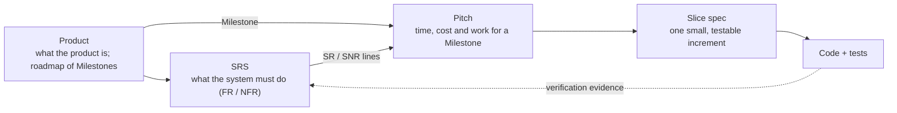

# Requirements Method and Governance

> **Status**: Draft 0.6 — filled for the Phase 1 SRS pilot; pitch and slice templates refined per [documentation methodology](../study-hub/project-documentation-and-specification-methodology.md) Section 12.2, Phase 1.

## Document Control

| Field | Value |
|-------|-------|
| Owner | Requirements and Delivery Lead drafts; Product Owner approves (roles: §6) |
| Status | Draft 0.5 |
| Date | 2026-11-05 |
| Applies to | [Master System SRS](SYSTEM_REQUIREMENTS_SPECIFICATION.md), subordinate domain SRSs, pitches and spec-kit slices under `specs/` |

## 1. Introduction

### 1.1 Purpose

Defines how requirements are authored, approved, changed, traced, and retired across the master system SRS and subordinate domain SRS documents.

### 1.2 Why this method

This project turns product intent into working code through one chain: **Product (Milestones) → Pitch → SRS lines → Slice spec → Code**. The Product roadmap defines Milestones for the delivery plan and lists the SRS lines each one needs; a pitch translates one Milestone, or part of it, into time, cost and work against those functional (SR) and non-functional (SNR) lines. Each step answers one question, and each fact has one home.

*Naming.* **Product** is short for the [Product Definition and Specification](PRODUCT_SPECIFICATION.md). In this method "spec" means only a spec-kit slice `spec.md`.



1. **Product intent stays free of technology.** The Product describes the product and its value; how it is built is decided further down.
2. **Requirements are testable statements.** The SRS says what must be true, line by line, so every line can be verified and nothing else lives there: no ranking, timing or solution sketch ([ISO/IEC/IEEE 29148](https://www.iso.org/standard/72089.html)).
3. **Shape before building.** A pitch takes a Milestone and translates it into time (appetite), cost and work (slices) against the SRS lines it delivers. It bounds that work in time and names its risks and exclusions before any code starts, so scope is cut rather than the deadline slipped ([Shape Up](https://basecamp.com/shapeup/1.5-chapter-06)).
4. **The spec drives the code.** Each slice is small enough for a coding agent to build from its spec and prove with tests ([spec-driven development](https://github.com/github/spec-kit/blob/main/spec-driven.md), [Spec-kit HOW-TO](../spec-driven%20development%20%28SDD%29/spec-kit%20HOW-TO.md)).
5. **Intent flows down, evidence flows up.** Each layer links up only to the layers directly above, by ID, and never restates them; the one downward link is the Product roadmap, where each Milestone lists the SRS IDs it needs and the pitches that deliver them; test results flow back up as verification status on the SRS.
6. **Layers change at their own speed.** Product and SRS change by approved baseline; pitches are re-ranked at each betting table; slices open and close. Keeping them apart stops fast-moving plans from rewriting slow-moving requirements.
7. **Docs live with the code.** Every artifact is Markdown on the branch, reviewed like code, linked rather than copied ([Docs as Code](https://www.writethedocs.org/guide/docs-as-code/)).
8. **People decide, agents draft and verify.** The Product Owner approves plans, the betting order, baselines and every commit; the agent team drafts, builds and proves.

## 2. Requirement Authoring Standards

### 2.1 Layers (one home per fact)

| Layer | Artifact | Answers | Owner |
|-------|----------|---------|-------|
| L0 Product truth | [Product Definition and Specification (Product)](PRODUCT_SPECIFICATION.md) with its roadmap of Milestones, [IA map](CONCEPTUAL_IA_MAP.md), [Journeys](USER_JOURNEYS_WITH_WIREFRAMES.md), UX/UI designs | What the product is, and the Milestones of the delivery plan | Product Owner (IA map and Journeys: UX Designer maintains) |
| L1 Requirements | Master System SRS + domain SRSs | What must be true, testably (ID, priority, pointer) | Requirements and Delivery Lead drafts, Product Owner approves |
| L1.5 Pitch | One page per bet on a Milestone (`specs/pitches/M-nnn-<slug>.md`); a Milestone may have several | Why now, how much time and cost, which SR / SNR lines | Requirements and Delivery Lead shapes; Product Owner bets |
| L2 Slice | spec-kit `spec.md` → plan → tasks | What one 1–2 week slice delivers | Slice owner; built and tested by the Software Engineer |

Each layer cites the layers directly above it by ID and never restates them. The Product roadmap is the one place that links down: each Milestone lists the SRS IDs it needs and links to the pitches that deliver them. The SRS links up only to Product sections for meaning; it never cites Milestones or pitches. A pitch cites its Milestone and the SRS lines it delivers; a slice cites its pitch and its SRS lines. The [ranking file](../../specs/pitches/README.md) holds the betting order across all pitches.

`specs/pitches/` belongs to this method, not to spec-kit: spec-kit only creates and numbers `specs/NNN-<slug>/` folders, never reads or writes pitches, and its numbering ignores folders without a numeric prefix.

### 2.2 Rules

1. **One home per fact.** SRS lines point to the Product (and IA map, Journeys, ADRs) by section or ID; they never copy domain text.
2. **No technical detail in the Product.** Mechanisms live in ADRs, technical design and slices.
3. **EARS sentences.** One requirement per line using one pattern: Ubiquitous ("The system SHALL …"), State ("While …"), Event ("When …"), Optional ("Where …"), Unwanted ("If … then …"). End with `→` pointers.
4. **Stable IDs.** Keep `SR-x.y.z` / `SNR-x.y.z` (domain SRSs: `FR-` / `NFR-`) and Milestone IDs `M-nnn` (for example M-001). Never renumber or reuse; deprecate instead.
5. **Priorities** P0–P3 mirror the Milestone priorities in the [product roadmap](PRODUCT_SPECIFICATION.md#product-roadmap) for the phase in question.
6. **Acceptance lives in slices** as Given/When/Then, one scenario per testable behaviour; unresolved points are marked `[NEEDS CLARIFICATION]` and block planning.
7. **Draft marking.** Lines that are not final carry *(draft)* in the title and an "initial draft" note on the group.

### 2.3 Pitch template (L1.5)

A pitch shapes a Milestone into a bet. It is the translation between the product plan and the requirements: it turns the Milestone's time (appetite), cost and work (slices) into the functional (SR) and non-functional (SNR) lines it commits to. A Milestone may have one pitch or several; a pitch names the Milestone it serves and lives at `specs/pitches/M-nnn-<slug>.md`, where the slug tells pitches under the same Milestone apart. It stays one page.

```markdown
# Pitch: M-nnn <pitch name>

| Field | Value |
|---|---|
| Milestone | [M-nnn <milestone name>](../../docs/system/PRODUCT_SPECIFICATION.md#m-nnn) |
| Priority | P0 / P1 / P2 / P3 (from the Milestone) |
| Requirements covered | FR: [SR-…](../../docs/system/SYSTEM_REQUIREMENTS_SPECIFICATION.md#sr-…), … · NFR: [SNR-…](../../docs/system/SYSTEM_REQUIREMENTS_SPECIFICATION.md#snr-…), … or "none" *(mark "partly" or "closes" where needed)* |
| Status | shaped / bet / in delivery / delivered / cut |
| Appetite | N weeks (time) |
| Cost | Who builds it, plus any paid service, data or model spend *(estimate)* |
| Slices | S1 [specs/NNN-<slug>](../NNN-<slug>/spec.md) — the exact SR / SNR lines it delivers; S2 … *(proposed, may change in delivery; or "not created yet")* |
| Last re-ranked | YYYY-MM-DD |
| References | Architecture: [overview §…](…), [ADR-SYS-00N](…) (<ADR status>) · Design: [IA map §…](…), [Journeys W…](…) |

## Problem   <!-- cite the Milestone for why it matters and the SRS lines for what must be true -->
## Appetite
## Solution sketch (IA zones, no tech)
## Rabbit holes   <!-- MUST repeat every Proposed or partly accepted ADR listed in References -->
## No-gos
## Done means   <!-- outcome level: the SRS lines whose verification closes the pitch; Given/When/Then lives in slices -->
## Open questions   <!-- each marked [NEEDS CLARIFICATION] -->
```

**Rules.**
- **Statuses:** `shaped` (written, not yet chosen) → `bet` (chosen at the betting table for the next cycle) → `in delivery` (at least one slice planned) → `delivered` (all its SR / SNR lines `verified`) or `cut` (dropped; keep the file with the reason).
- **Appetite** is a time budget set before the solution, not an estimate. If a slice's `tasks.md` outgrows it, re-shape the slice or cut scope; the time stays fixed.
- **Ownership.** Each SR or SNR line belongs to at most one active pitch, even when several pitches serve one Milestone. A pitch that covers only part of a line marks it "partly"; the pitch that finishes it marks it "closes".
- **Slices** each name the exact SR / SNR lines they deliver; UX acceptance criteria in the slice `spec.md` are written against those lines, not against the Milestone. Slices are proposed while shaping and may be split, merged or renamed during delivery.
- **Link to spec-kit.** Each slice is the feature description passed to `/speckit.specify`, which creates `specs/NNN-<slug>/spec.md`. Problem and SRS IDs feed its stories and requirements; No-gos and Rabbit holes feed its out-of-scope and assumptions; References feed the `/speckit.plan` checks. Once created, the pitch's Slices line links forward and the slice header links back.
- **Milestone link.** When a pitch is shaped, add a link to it in its Milestone's Pitches cell in the [product roadmap](PRODUCT_SPECIFICATION.md#product-roadmap); when it is cut, mark the link "cut" rather than removing it.
- **Which side wins.** The pitch header's Milestone field is authoritative; the Pitches cell in the product roadmap is navigation only and is updated whenever a pitch is shaped, renamed or cut. If they disagree, fix the roadmap cell. The `M-nnn-` prefix of a pitch file never changes; only the slug may.
- **Scope check.** A Milestone's SRS IDs are its target scope. Every SR / SNR line a pitch lists must be one of its Milestone's SRS IDs; a line outside that set needs the Milestone row updated first. A Milestone is covered once each of its SRS IDs is claimed by some pitch.
- **References** are side links for context only (architecture, IA map, Journeys); they are not part of the requirement chain. References list links only. Each ADR carries its current status in brackets; any ADR that is not Accepted is repeated under Rabbit holes.
- **Ranking file:** `specs/pitches/README.md` is the ordered list chosen at the betting table, not a weighted score. Rows are ordered by Rank only, not grouped by Milestone. Columns: Rank, Pitch (link), Milestone + priority, Status, Appetite, Why now (one line), Readiness (what is ready, and what blocks the rest: ADR status, identity slice or open item), Last re-ranked. An optional RICE column (Reach × Impact × Confidence ÷ Effort) may be shown; it is advisory only and its values are marked as estimates.

### 2.4 Slice header template (top of each spec-kit `spec.md`)

```markdown
# Slice: <name>            ID: specs/NNN-<slug>   Status: draft|clarified|planned|implemented|verified
| Field | Value |
|---|---|
| SRS IDs | Only the SR-… / SNR-… this slice delivers |
| Journey step | J-TFI-… / W… |
| IA zone | Z1–Z4 (UX Designer) |
| ADRs | ADR-… (Software Architect) or none |
| Pitch | [M-nnn <pitch name>](../pitches/M-nnn-<slug>.md) or "quick slice (≤2 days)" |
| Appetite | ≤ 2 weeks, within the pitch's appetite |
| Out of scope | … |

## UX acceptance criteria (owned by the UX Designer)
- UX-1 (SR-…): Given … When … Then …
```

Given/When/Then acceptance lives only here, never in the pitch. Each UX acceptance criterion is a Given/When/Then scenario owned by the UX Designer and maps to at least one test, per the [Verification and Traceability Strategy](../testing/VERIFICATION_AND_TRACEABILITY_STRATEGY.md) §4. A quick slice (≤ 2 days) may skip the pitch but never the header.

## 3. Change Classification and Approval Path

- Classes follow methodology Section 10.3: **Major** (breaking, retired requirements, structural baseline), **Minor** (additive, clarifications, new allocations), **Patch** (editorial, reference-only).
- Flow: trigger → classification → impact map (point → target doc/section → action) → **Product Owner approval** → baseline update → downstream sync → verification closeout.
- No long-lived document edit without an approved plan; no commit or push unless the Product Owner approves that exact write in the same message.

## 4. Traceability Obligations

- **Scope:** only P0 and P1 requirements are registered in `specs/spec-traceability.yaml`; P2/P3 are traced when they enter a slice.
- Every slice header lists the SRS IDs it delivers.
- A registry row is added when a slice first references an ID; status moves `analyzed → planned → implemented → verified`.
- A slice is done only when all its IDs are `verified` (see [Verification and Traceability Strategy](../testing/VERIFICATION_AND_TRACEABILITY_STRATEGY.md)).

## 5. Versioning and Baseline Management

- The SRS uses SemVer (Major/Minor/Patch as in §3) and records each change in its Revision History.
- A baseline is taken at each phase cut ([product roadmap](PRODUCT_SPECIFICATION.md#product-roadmap) phases).
- Retired requirements stay listed as deprecated with the version that retired them.

## 6. Roles and Responsibilities

| Role | Responsibility | Project assignment |
|------|----------------|--------------------|
| Product Owner | Owns the Product, its Milestones, the IA map and Journeys; approves plans, the betting order, SRS baselines and every commit | Phan Duy |
| Requirements and Delivery Lead | Drafts SRS lines and pitches; runs the betting table and keeps the ranking file; coordinates handoffs | Chief of Staff (bot) |
| Research Analyst | Method research and benchmarks | Researcher (bot) |
| Software Architect | ADRs and architecture boundaries cited by SRS lines and pitches | Software Architect Assistant (bot) |
| UX Designer | Maintains the IA map and Journeys under Product Owner ownership; IA zones, Journey references and UX acceptance criteria in slice headers | Designer (bot) |
| Software Engineer | Builds and tests slices; produces verification evidence | Coding Orchestrator (bot) |
| Traceability Manager | Maintains the traceability registry | Task Keeper (bot) |

Other sections name roles only. The Project assignment column is the single place that maps a role to a person or bot; change it there when assignments change.

## 7. Revision History

| Version | Date | Author | Notes |
|---------|------|--------|-------|
| 0.0 | 2026-04-03 | GitHub Copilot | Skeleton created |
| 0.1 | 2026-10-16 | Chief of Staff (approved by Phan) | Filled all planned sections for the Phase 1 SRS pilot: layers, EARS rules, pitch and slice header templates, change flow, P0+P1 trace scope, roles |
| 0.2 | 2026-10-17 | Chief of Staff (approved by Phan) | Pitch/slice template refinement (pitch header fields, Shape Up body, statuses, UX acceptance criteria in slice header); pilot pitch `specs/pitches/adaptive-visual-canvas.md`; ranking file `specs/pitches/README.md` |
| 0.3 | 2026-10-17 | Chief of Staff (approved by Phan) | Purpose and new "Why this method" merged into §1 Introduction; Document Control moved to top, unnumbered, so §2–§7 keep their numbers; pitch rules on appetite, provisional slices and the spec-kit link; `specs/pitches/` ownership line; single Readiness column in the ranking file |
| 0.4 | 2026-10-17 | Chief of Staff (approved by Phan) | One pitch per SRS group, named `SR-x.y-<slug>.md`; each layer cites only the layer above, so the Spec and SRS no longer link to pitches; ownership rule (one active pitch per SRS line, "partly"/"closes"); References marked as side links; roadmap item IDs `RM-nn`; "Spec §5.3" replaced by a link to the product roadmap; slice header drops its "Spec §" field, so a slice cites only its SRS IDs and pitch |
| 0.6 | 2026-11-05 | Requirements and Delivery Lead (approved by Product Owner) | Ranking file ordered by Rank only (not grouped by Milestone). Product Owner owns IA map and Journeys; UX Designer is maintainer (headers, L0, §6). |
| 0.5 | 2026-10-19 | Requirements and Delivery Lead (approved by Product Owner) | The product doc is now Product (Product Definition and Specification), so "spec" means only a spec-kit `spec.md`. Chain becomes Product (Milestones) → Pitch → SRS lines → slice → code. Milestone IDs `M-nnn` replace `RM-nn`; each Milestone links down to its SRS IDs and to the pitches that deliver them, and the SRS no longer cites Milestones. A pitch serves a Milestone (several allowed), is named `M-nnn-<slug>.md`, and carries appetite, cost and its FR (SR) and NFR (SNR) lines; each slice names the exact lines it delivers; ownership rule kept per line; ranking ordered by Rank only. Owners are named as roles; §6 adds a Project assignment column mapping roles to Phan and the bots. Added the "Which side wins" rule (the pitch header's Milestone field is authoritative, the roadmap Pitches cell is navigation) and the "Scope check" rule (a pitch's SR / SNR lines come from its Milestone's SRS IDs) |
