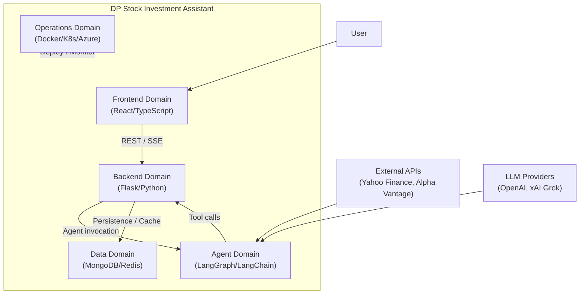

# DP Stock Investment Assistant — System Requirements Specification

## 1. Document Control

| Field | Value |
|-------|-------|
| Project | DP Stock Investment Assistant |
| Document Type | Master System SRS |
| Standards Stance | Aligned to ISO/IEC/IEEE 29148 |
| Governance | Subject to the SRS versioning and change-control mechanism defined in [documentation methodology](../study-hub/project-documentation-and-specification-methodology.md) Section 10.3 |
| Date | 2026-11-13 |
| Status | Draft 0.3.3 — requirement families seeded; SR-1.3.5 docked chart proof of concept for M-001; SR-1.3, SR-4.4 and SR-9.1 Phase 1 pilot retained; M-000 Platform foundation adds draft SR-10 (auth/session from OI-1), SR-1.4 (modular shell; SR-1.4.2 `sessionRef` clarified), SNR-6.1.4 (FE testability from OI-3); SR-5.2.1 and SR-5.2.2 Superseded by SSE-only transport; SNR-8.1.2 already amended to HTTPS+SSE; SNR-7.1.1 viewport 768–1920 px (1920 px primary; below 768 px Future); launch UI `vi-VN` with Vietnamese price-board price display (dot decimal; comma thousands for volume and ₫ totals; dates standard vi-VN); OpenAPI path `docs/openapi.yaml`; other entries populated incrementally through SDD delivery |
| Audience | Engineering, architecture, product, and technical documentation maintainers |

## 2. Purpose, Scope, and Intended Use

### 2.1 Purpose

This document is the **authoritative upstream requirement pool** for the DP Stock Investment Assistant system. It defines the cross-domain behavior the system must provide, the non-functional qualities it must satisfy, and the domain allocation metadata that connects each requirement to the delivery and verification model.

### 2.2 Scope

The SRS covers the full system boundary:

- **Frontend domain**: user interaction, UX flow, client-side state, and rendering
- **Backend domain**: API surface, orchestration, business workflows, integration mediation, and owned contracts (OpenAPI)
- **Agent domain**: AI reasoning workflow, tool orchestration, memory behavior, and response composition
- **Data domain**: persistence, schema and index policy, retention, migration, and caching
- **Operations domain**: release readiness, observability, reconciliation, migration safety, and runbooks

### 2.3 Intended Use

- Feature specs under `specs/` reference requirement IDs from this document (SR-x.y.z, SNR-x.y.z)
- The traceability registry (`specs/spec-traceability.yaml`) tracks which requirements have been delivered and verified
- Domain technical design documents under `docs/domains/` explain how allocated requirements are realized
- Subordinate domain SRS documents (e.g., agent domain) may extend this baseline with domain-local specialization, but must not contradict it

### 2.4 What This Document Does Not Own

- **Detailed API schemas** — owned by the executable contract (`docs/openapi.yaml`)
- **Implementation algorithms** — owned by domain technical design documents
- **Feature delivery detail** — owned by SDD feature specs under `specs/`
- **Architecture decisions** — owned by ADRs under `docs/architecture/DECISIONS/` and `docs/domains/*/DECISIONS/`

## 3. Related Documents and Governance

| Document | Relationship |
|----------|-------------|
| [Product Definition and Specification (Product)](PRODUCT_SPECIFICATION.md) | Authoritative master charter establishing business goals, retail investor obstacles, Techno-Fundamental Investor (TFI) persona, 360° company lenses, and dual-track lifecycle capabilities |
| [Documentation Methodology](../study-hub/project-documentation-and-specification-methodology.md) | Defines the documentation architecture, SDD lifecycle integration, and governance model that this SRS operates within |
| [Requirements Method and Governance](REQUIREMENTS_METHOD_AND_GOVERNANCE.md) | Defines authoring standards, change-control processes, and approval paths for this SRS |
| [Project Constitution](../../.specify/memory/constitution.md) | Non-negotiable governance layer; all requirements must be consistent with constitution principles and golden rules |
| [Agent Domain SRS](../domains/agent/SOFTWARE_REQUIREMENTS_SPECIFICATION.md) | Subordinate domain SRS for agent-specific requirements |
| [OpenAPI Specification](../openapi.yaml) | Executable API contract; prevails for schema shape when prose and contract disagree |
| [Spec Traceability Registry](../../specs/spec-traceability.yaml) | Machine-readable traceability from requirement IDs to feature specs and delivery status |
| [Architecture Review](../architecture-review.md) | Cross-domain architecture assessment providing system-wide technical context |

### 3.1 Precedence Rules

1. This master system SRS prevails for system outcomes and cross-domain qualities.
2. A subordinate domain SRS prevails for domain-local specialization, provided it does not weaken or contradict this document.
3. Executable contracts prevail for schema shape; prose must be reconciled when they disagree.
4. Conflicts trigger reconciliation, not silent override — see [documentation methodology](../study-hub/project-documentation-and-specification-methodology.md) Section 11.3.

## 4. System Context and Domain Model

### 4.1 System Purpose

The DP Stock Investment Assistant is an AI-assisted investment workspace for the investment lifecycle (Insights → Thesis → Decision → Portfolio). Product vision and shape are owned by the [Product](PRODUCT_SPECIFICATION.md) (§1.2, §0.5); the AI companion supports the work and is not the whole product.

### 4.2 Domain Model

### 4.3 External Interfaces

| Interface | Type | Owner |
|-----------|------|-------|
| User browser | HTTP / SSE | Frontend domain |
| REST API | HTTP (JSON) | Backend domain |
| SSE streaming | HTTP (text/event-stream) | Backend domain |
| WebSocket (Socket.IO) *(current-state legacy; being removed)* | WebSocket | Backend domain |
| LLM provider APIs | HTTP | Agent domain (via model factory) |
| Financial data APIs | HTTP | Agent domain (via tools) |
| MongoDB | TCP | Data domain |
| Redis | TCP | Data domain |

## 5. System Functional Requirements

> **Namespace**: `SR-` prefix for system-level functional requirements. Subordinate domain SRS documents use `FR-` prefix.
>
> **Entry format**: Each requirement follows the lightweight template defined in [documentation methodology](../study-hub/project-documentation-and-specification-methodology.md) Section 10.6. Rich detail (rationale, acceptance scenarios, verification evidence) lives in the feature spec that delivers the requirement.

### SR-1: User Interaction and Experience Continuity

| ID | Title | Statement | Pri | Primary | Contributing | Spec Coverage |
|----|-------|-----------|-----|---------|-------------|---------------|
| SR-1.1.1 | Multi-turn chat interaction | The system SHALL support multi-turn conversations where users submit natural-language queries and receive contextually aware responses. | P0 | Frontend | Backend, Agent | — |
| SR-1.1.2 | Conversation history display | The system SHALL display conversation history so users can review prior exchanges within a session. | P0 | Frontend | Backend | — |
| SR-1.2.1 | Model selection | The system SHALL allow users to select the AI model used for response generation from a list of available models. | P1 | Frontend | Backend | — |
| SR-1.2.2 | User preference persistence | The system SHALL persist user preferences (selected model, workspace settings) across sessions. | P1 | Backend | Frontend, Data | — |

#### SR-1.3: Adaptive Visual Canvas (Phase 1 pilot)

> Pilot lines for the Adaptive Visual Canvas (multi-pane, context preserved). Lines state what must be true; layout is owned by the [IA map](CONCEPTUAL_IA_MAP.md) and [Journeys](USER_JOURNEYS_WITH_WIREFRAMES.md).

| ID | Title | Statement | Pri | Primary | Contributing | References | Spec Coverage |
|----|-------|-----------|-----|---------|-------------|------------|---------------|
| SR-1.3.1 | Zoned workspace with both tracks visible | The system SHALL present the workspace through the four zones Z1–Z4 and SHALL keep both tracks (Research Sandbox and Execution Portfolio) visible at the same time in Z1. | P0 | Frontend | Backend | [IA map](CONCEPTUAL_IA_MAP.md) §2.1, §2.6; Product §2.5, §2.6; [Journeys](USER_JOURNEYS_WITH_WIREFRAMES.md) W2b | — |
| SR-1.3.2 | Context preserved on switching | When the user switches symbol, work object or track, the system SHALL preserve the context of the open work. | P0 | Frontend | Backend | [IA map](CONCEPTUAL_IA_MAP.md) §2; Product §2.6 | — |
| SR-1.3.3 | Generated UI stays in its place and never writes Core *(Future)* | Where the AI generates UI, the Agent SHALL only propose it and the Frontend SHALL render it only in Z4 or as a draft in Z3; generated UI SHALL NOT write to Core objects, and its content SHALL become a Core object only through explicit user action. | P2 (Future, not Phase 1) | Frontend | Agent | [IA map](CONCEPTUAL_IA_MAP.md) §2.4, §2.5; [overview §4.2.2](../architecture/SYSTEM_OVERVIEW_AND_BOUNDARIES.md#422-responsibility-and-dependency-boundaries); Product §3.5 (AI boundary) | — |
| SR-1.3.4 | Chart yields at the Decision gate (Sandbox only) | While the Decision gate is open in the Research Sandbox, the system SHALL let the price chart yield to the gate checklist, and on Pass the named levels SHALL carry over to the Position; this SHALL NOT apply on the Execution Portfolio. | P0 | Frontend | Backend | [IA map](CONCEPTUAL_IA_MAP.md) §2.4 (Sandbox chart lock); Product §4.6; [Journeys](USER_JOURNEYS_WITH_WIREFRAMES.md) W2b, W3b, W4 | — |
| SR-1.3.5 | Docked price chart (proof of concept) | In the Research Sandbox canvas (Z3), the system SHALL show a docked price chart for the active symbol with a candlestick or line series plus volume and a selectable time range, and SHALL mark the reference, ceiling and floor prices as supplied by the Backend; the Frontend SHALL NOT compute price bands. The chart SHALL carry the chart library's required attribution. Richer charting and the chart yielding at the Decision gate stay with SR-1.3.4 (M-006). | P0 | Frontend | Backend | [IA map](CONCEPTUAL_IA_MAP.md) 2.4 (Sandbox chart lock); Product 4.6; [ADR-FRONTEND-004](../domains/frontend/DECISIONS/ADR-FRONTEND-004-CHART-ENGINE-ADAPTER.md) | - |

#### SR-1.4: Modular presentation shell (Platform foundation — draft)

> Draft enablement lines for the FE foundation under Product Milestone M-000. Zone geometry stays owned by the [IA map](CONCEPTUAL_IA_MAP.md) and [Journeys](USER_JOURNEYS_WITH_WIREFRAMES.md). Canvas behaviors remain on SR-1.3.x (M-001). GenUI (SR-1.3.3), chart-yield (SR-1.3.4 / M-006), and saved layouts (M-009) are out of M-000.

| ID | Title | Statement | Pri | Primary | Contributing | References | Spec Coverage |
|----|-------|-----------|-----|---------|-------------|------------|---------------|
| SR-1.4.1 | Modular zone shell | The system SHALL present the workspace through a modular shell that hosts the four zones Z1–Z4 as distinct composition slots so later Canvas features can mount without rewriting the shell. | P0 | Frontend | — | [IA map](CONCEPTUAL_IA_MAP.md) §2.1; Product §5.3 M-000; [ADR-FRONTEND-001](../domains/frontend/DECISIONS/ADR-FRONTEND-001-MODULAR-APPLICATION.md) (Accept pending) | — |
| SR-1.4.2 | In-session workspace context | The system SHALL maintain an in-session workspace context (active track, focused symbol, open Core-object reference, and Z4 Backend-session reference (`sessionRef`: the Backend session id plus conversation id, per the API hierarchy workspace > session > conversation in [`docs/openapi.yaml`](../openapi.yaml))) so shell surfaces share one context without copying Backend session state into a second source of truth. | P0 | Frontend | Backend | [IA map](CONCEPTUAL_IA_MAP.md) §2; Product §5.3 M-000; [ADR-FRONTEND-002](../domains/frontend/DECISIONS/ADR-FRONTEND-002-MODERNIZE-FRONTEND-FOUNDATION.md) (Amend pending). Context across reload, device or account depends on SR-10 / [ADR-SYS-001](../architecture/DECISIONS/ADR-SYS-001-IDENTITY-AND-PER-USER-ISOLATION.md) | — |

### SR-2: Workspace, Session, and Conversation Lifecycle

| ID | Title | Statement | Pri | Primary | Contributing | Spec Coverage |
|----|-------|-----------|-----|---------|-------------|---------------|
| SR-2.1.1 | Workspace creation and management | The system SHALL allow users to create, list, and manage workspaces as top-level containers for investment analysis activities. | P0 | Backend | Frontend, Data | — |
| SR-2.2.1 | Session lifecycle | The system SHALL support session creation, listing, archival, and closure within a workspace context. | P0 | Backend | Frontend, Data | — |
| SR-2.2.2 | Session context | The system SHALL maintain session-level context including assumptions, pinned intent, and focused symbols. | P1 | Backend | Agent, Data | — |
| SR-2.3.1 | Conversation lifecycle | The system SHALL support conversation creation, listing, archival, and summary retrieval within a session. | P0 | Backend | Frontend, Data | — |
| SR-2.3.2 | Conversation archival behavior | The system SHALL reject new messages to archived conversations with an appropriate error response and SHALL NOT allow reactivation of archived conversations. | P1 | Backend | Frontend | — |
| SR-2.3.3 | Conversation message limits | The system SHALL enforce a configurable maximum message count per conversation, after which the conversation is automatically archived. | P1 | Backend | Agent, Data | — |

### SR-3: AI-Assisted Response Generation and Analysis

| ID | Title | Statement | Pri | Primary | Contributing | Spec Coverage |
|----|-------|-----------|-----|---------|-------------|---------------|
| SR-3.1.1 | Natural-language query processing | The system SHALL accept natural-language investment queries and generate contextually relevant analysis responses using LLM-based reasoning. | P0 | Agent | Backend | — |
| SR-3.1.2 | Tool-augmented analysis | The system SHALL augment LLM reasoning with tool-based data retrieval (market data, financial fundamentals, news) to ground responses in factual information. | P0 | Agent | Backend | — |
| SR-3.2.1 | Conversation-scoped memory | The system SHALL maintain conversation-scoped short-term memory so the agent can refer to earlier turns within the same conversation. | P0 | Agent | Backend, Data | — |
| SR-3.3.1 | Market manipulation safeguards | The system SHALL NOT generate responses that constitute or encourage market manipulation, insider trading, or other prohibited financial activities. | P0 | Agent | — | — |

### SR-4: Market, Portfolio, and Supporting Data Acquisition

| ID | Title | Statement | Pri | Primary | Contributing | Spec Coverage |
|----|-------|-----------|-----|---------|-------------|---------------|
| SR-4.1.1 | Real-time market data retrieval | The system SHALL retrieve current market data (price, volume, change) for user-specified symbols from external financial data providers. | P0 | Agent | Data | — |
| SR-4.1.2 | Fundamental data retrieval | The system SHALL retrieve fundamental financial data (financials, ratios, company info) for user-specified symbols. | P1 | Agent | Data | — |
| SR-4.2.1 | Symbol search and resolution | The system SHALL support searching for and resolving stock symbols by company name or ticker. | P1 | Backend | Data | — |
| SR-4.3.1 | Watchlist management | The system SHALL allow users to create and manage watchlists of tracked symbols within a workspace. | P2 | Backend | Frontend, Data | — |
| SR-4.3.2 | Portfolio tracking | The system SHALL allow users to create portfolios and track positions within a workspace. | P2 | Backend | Frontend, Data | — |

#### SR-4.4: Vietnam-first Data Hub and Provenance (Phase 1 pilot — initial draft)

> **Initial draft**, to be refined and finalized later. Pilot lines for the Vietnam-first Data Hub with provenance. No provider is named here; the data pipeline and its sources are owned by Backend/Data per [ADR-SYS-004](../architecture/DECISIONS/ADR-SYS-004-DATA-PIPELINE-AND-RECORDS.md). Open question on "confidence": see OI-6.

| ID | Title | Statement | Pri | Primary | Contributing | References | Spec Coverage |
|----|-------|-----------|-----|---------|-------------|------------|---------------|
| SR-4.4.1 | Vietnam-first sourcing *(draft)* | The system SHALL treat Vietnam-listed symbols as the primary market for data used in Insights, sourced through the Backend/Data-owned data pipeline, which the Agent uses to collect data. | P0 | Backend, Data | Agent | Product §2.6 (Knowledge Hub); [ADR-SYS-004](../architecture/DECISIONS/ADR-SYS-004-DATA-PIPELINE-AND-RECORDS.md); [overview §4.1](../architecture/SYSTEM_OVERVIEW_AND_BOUNDARIES.md#41-context-and-boundary) (providers as neighbours); [overview §4.2.1](../architecture/SYSTEM_OVERVIEW_AND_BOUNDARIES.md#421-logical-building-blocks) (Ingestion pipeline); [overview §4.2.2](../architecture/SYSTEM_OVERVIEW_AND_BOUNDARIES.md#422-responsibility-and-dependency-boundaries) (Data collection; Provider choice and licensing); [risk R4](../architecture/SYSTEM_OVERVIEW_AND_BOUNDARIES.md#48-risks) | — |
| SR-4.4.2 | Provenance on ingress *(draft)* | When external data enters Insights, the system SHALL record its source, timestamp and confidence. | P0 | Data | Backend, Agent | Product §3.5 (Data ingress), §4.7 (3); [overview §4.3](../architecture/SYSTEM_OVERVIEW_AND_BOUNDARIES.md#43-information-view); [overview §4.7](../architecture/SYSTEM_OVERVIEW_AND_BOUNDARIES.md#47-cross-cutting-concepts) (Evidence); [risk R3](../architecture/SYSTEM_OVERVIEW_AND_BOUNDARIES.md#48-risks) | — |
| SR-4.4.3 | Provenance shown *(draft)* | Where external data is shown to the user, the system SHALL display its provenance. | P0 | Frontend | Backend, Data | Product §3.5, §4.7 (3); [overview §4.7](../architecture/SYSTEM_OVERVIEW_AND_BOUNDARIES.md#47-cross-cutting-concepts) (Evidence); [overview §4.2.3](../architecture/SYSTEM_OVERVIEW_AND_BOUNDARIES.md#423-layered-boundaries) (Presentation layer) | — |

### SR-5: Real-Time Delivery and Streaming Behavior

| ID | Title | Statement | Pri | Primary | Contributing | Spec Coverage |
|----|-------|-----------|-----|---------|-------------|---------------|
| SR-5.1.1 | Streaming response delivery | The system SHALL deliver assistant responses incrementally to the user interface for streaming-capable chat requests. | P0 | Backend | Frontend, Agent | — |
| SR-5.1.2 | SSE streaming protocol | The system SHALL use Server-Sent Events (SSE) with `text/event-stream` content type for HTTP-based streaming delivery. | P0 | Backend | Frontend | — |
| SR-5.2.1 | WebSocket real-time events *(Superseded)* | **Superseded** by SSE-only transport ([SR-5.1.2](#sr-5-1-2), [SNR-8.1.2](#snr-8-1-2), and [ADR-FRONTEND-002](../domains/frontend/DECISIONS/ADR-FRONTEND-002-MODERNIZE-FRONTEND-FOUNDATION.md) Socket.IO retirement). Original statement (retained as history): The system SHALL support real-time bidirectional communication via Socket.IO for chat interactions that require server-initiated updates. | P1 *(Superseded)* | Backend | Frontend | — |
| SR-5.2.2 | WebSocket reconnection *(Superseded)* | **Superseded** by SSE-only transport ([SR-5.1.2](#sr-5-1-2), [SNR-8.1.2](#snr-8-1-2), and [ADR-FRONTEND-002](../domains/frontend/DECISIONS/ADR-FRONTEND-002-MODERNIZE-FRONTEND-FOUNDATION.md) Socket.IO retirement). Original statement (retained as history): The system SHALL handle client reconnection gracefully when WebSocket connections are interrupted. | P1 *(Superseded)* | Frontend | Backend | — |

> **M-000 transport note:** Client transport is HTTPS + SSE only ([SR-5.1.2](#sr-5-1-2); Product M-000 / [ADR-FRONTEND-002](../domains/frontend/DECISIONS/ADR-FRONTEND-002-MODERNIZE-FRONTEND-FOUNDATION.md): Socket.IO retired). **SR-5.2.1** and **SR-5.2.2** are Superseded by that SSE-only transport, [SNR-8.1.2](#snr-8-1-2) and ADR-FRONTEND-002. **SNR-8.1.2** has already been amended from WebSocket/Socket.IO wording to HTTPS+SSE streaming event contracts. Typed stream events are a follow-up Backend contract (see §8.1).

### SR-6: Model and Provider Selection with Fallback

| ID | Title | Statement | Pri | Primary | Contributing | Spec Coverage |
|----|-------|-----------|-----|---------|-------------|---------------|
| SR-6.1.1 | Multi-provider model support | The system SHALL support multiple LLM providers (OpenAI, xAI Grok) and allow selection of provider and model at runtime. | P0 | Backend | Agent | — |
| SR-6.1.2 | Model fallback | The system SHALL automatically retry with a fallback model when the primary model fails, according to a configured fallback order. | P1 | Agent | Backend | — |
| SR-6.2.1 | Model catalog discovery | The system SHALL expose the list of available models per provider so consumers can enumerate and select models. | P1 | Backend | Frontend | — |
| SR-6.2.2 | Default model configuration | The system SHALL support setting a default model per provider that is used when no explicit model is specified in a request. | P1 | Backend | — | — |

### SR-7: Administration, Support, and Operational Tooling

| ID | Title | Statement | Pri | Primary | Contributing | Spec Coverage |
|----|-------|-----------|-----|---------|-------------|---------------|
| SR-7.1.1 | System health check | The system SHALL expose a health check endpoint that reports the operational status of all critical components (API, database, cache, agent). | P0 | Backend | Data, Agent | — |
| SR-7.2.1 | User profile management | The system SHALL support creating and retrieving user profiles with configurable preferences. | P1 | Backend | Frontend, Data | — |
| SR-7.3.1 | Runtime reconciliation tooling | The system SHALL provide operator tooling to detect and report drift between runtime state (database, cache) and the expected state defined by specifications and configuration. | P2 | Operations | Backend, Data | — |
| SR-7.3.2 | Legacy data migration tooling | The system SHALL provide operator tooling to migrate legacy data structures (e.g., thread-based to conversation-based) with dry-run capability and audit output. | P2 | Operations | Data | — |

### SR-8: Contract Exposure and Integration Compatibility

| ID | Title | Statement | Pri | Primary | Contributing | Spec Coverage |
|----|-------|-----------|-----|---------|-------------|---------------|
| SR-8.1.1 | OpenAPI contract publication | The system SHALL maintain an OpenAPI specification that accurately describes all registered API endpoints, including request/response schemas, error codes, and authentication requirements. | P0 | Backend | — | — |
| SR-8.1.2 | Contract-code alignment | The system SHALL keep the OpenAPI contract synchronized with the implemented API surface; any divergence is treated as a defect. | P0 | Backend | Operations | — |
| SR-8.2.1 | CORS support | The system SHALL support configurable CORS origins so the frontend can communicate with the API from permitted origins. | P1 | Backend | Frontend | — |

### SR-9: Investment Lifecycle Core

> New family for Investment Core objects (Product §4.3, §4.5). SR-9.1 is the Phase 1 pilot for the Insights foundation (evidence capture); later groups will host Working Thesis, Decision gate and Position.

| ID | Title | Statement | Pri | Primary | Contributing | References | Spec Coverage |
|----|-------|-----------|-----|---------|-------------|------------|---------------|
| SR-9.1.1 | Evidence capture as Insights | The system SHALL let the user capture evidence items as Insights for a symbol, and Insights SHALL be owner-scoped. | P0 | Backend | Frontend, Data | Product §2.6 (Insights), §4.5; [ADR-SYS-001](../architecture/DECISIONS/ADR-SYS-001-IDENTITY-AND-PER-USER-ISOLATION.md) (partly accepted). Depends on the identity slice (ADR-SYS-001, OI-4): not verifiable on `X-User-ID` header scoping alone | — |
| SR-9.1.2 | AI-assisted attribution | When the user accepts an AI-suggested Insight, the system SHALL tag it as AI-assisted. | P0 | Backend | Agent, Frontend | Product §3.5 (AI boundary), §4.7 (3) | — |

### SR-10: Authentication, Authorization, and Session Identity

> Promoted from [OI-1](#oi-1). Draft family for Product Milestone M-000 Pitch A (identity-and-session). Completes the identity slice with [ADR-SYS-001](../architecture/DECISIONS/ADR-SYS-001-IDENTITY-AND-PER-USER-ISOLATION.md) (token storage and role mapping still open on that ADR). Owner isolation for Core objects continues to cite [SNR-3.2.1](#snr-3-2-1); full multi-tenant enforcement remains [OI-4](#oi-4).

| ID | Title | Statement | Pri | Primary | Contributing | References | Spec Coverage |
|----|-------|-----------|-----|---------|-------------|------------|---------------|
| SR-10.1.1 | User authentication | The system SHALL authenticate the user before granting access to owner-scoped workspace, session, conversation, and Investment Core data. | P0 | Backend | Frontend | Product §3.5 (Isolation); [ADR-SYS-001](../architecture/DECISIONS/ADR-SYS-001-IDENTITY-AND-PER-USER-ISOLATION.md) (partly accepted → complete under M-000) | — |
| SR-10.1.2 | Sign-in and sign-out | The system SHALL provide sign-in and sign-out flows, and SHALL end the authenticated session on sign-out so subsequent requests are unauthenticated. | P0 | Frontend | Backend | [ADR-SYS-001](../architecture/DECISIONS/ADR-SYS-001-IDENTITY-AND-PER-USER-ISOLATION.md); Product §5.3 M-000 | — |
| SR-10.1.3 | Expired or rejected session | When an authenticated session expires or is rejected, the system SHALL require re-authentication and SHALL NOT expose another user's data; where feasible, unsent client input for the same user MAY be preserved across the re-auth step. | P0 | Frontend | Backend | [ADR-SYS-001](../architecture/DECISIONS/ADR-SYS-001-IDENTITY-AND-PER-USER-ISOLATION.md) | — |

## 6. System Non-Functional Requirements

> **Namespace**: `SNR-` prefix for system-level non-functional requirements. Subordinate domain SRS documents use `NFR-` prefix.

### SNR-1: Performance and Latency

| ID | Title | Statement | Pri | Primary | Contributing |
|----|-------|-----------|-----|---------|-------------|
| SNR-1.1.1 | API response time | The system SHALL return non-streaming API responses within 2 seconds under normal load for health, model catalog, and configuration endpoints. | P1 | Backend | — |
| SNR-1.1.2 | Streaming first-token latency | The system SHALL deliver the first token of a streaming chat response within 5 seconds of request receipt under normal load. | P1 | Backend | Agent |
| SNR-1.2.1 | Cache effectiveness | The system SHALL use caching (Redis) with data-type-appropriate TTLs to reduce redundant external API calls and database queries. | P1 | Data | Backend |

### SNR-2: Availability, Resilience, and Graceful Degradation

| ID | Title | Statement | Pri | Primary | Contributing |
|----|-------|-----------|-----|---------|-------------|
| SNR-2.1.1 | Service health monitoring | The system SHALL expose health check endpoints for all independently deployable components (API, agent, frontend). | P0 | Backend | Agent, Frontend |
| SNR-2.2.1 | Cache failure resilience | The system SHALL continue to operate with degraded performance when Redis is unavailable, falling back to in-memory caching. | P1 | Data | Backend |
| SNR-2.2.2 | LLM provider failure resilience | The system SHALL degrade gracefully when the primary LLM provider is unavailable, using configureed fallback providers. | P1 | Agent | Backend |

### SNR-3: Security, Privacy, and Tenant Isolation

| ID | Title | Statement | Pri | Primary | Contributing | References |
|----|-------|-----------|-----|---------|-------------|------------|
| SNR-3.1.1 | Secret management | The system SHALL NOT store API keys, passwords, or credentials in source code, logs, or version control. | P0 | Operations | Backend, Agent | — |
| SNR-3.1.2 | Environment-based secrets | The system SHALL load secrets from environment variables (local/staging) or Azure Key Vault (production). | P0 | Backend | Operations | — |
| SNR-3.2.1 | User data isolation | The system SHALL scope workspace, session, and conversation data to the owning user identifier so that users cannot access other users' data; Investment Core objects (SR-9, Insights first) SHALL be owner-scoped. | P0 | Backend | Data | Product §3.5 (Isolation), §4.7 (6); [ADR-SYS-001](../architecture/DECISIONS/ADR-SYS-001-IDENTITY-AND-PER-USER-ISOLATION.md) (partly accepted). Depends on the identity slice (ADR-SYS-001, OI-4): not verifiable on `X-User-ID` header scoping alone |
| SNR-3.3.1 | Input validation | The system SHALL validate and sanitize all user inputs at the API boundary before processing. | P0 | Backend | — | — |

### SNR-4: Data Integrity, Consistency, and Recoverability

| ID | Title | Statement | Pri | Primary | Contributing |
|----|-------|-----------|-----|---------|-------------|
| SNR-4.1.1 | Schema validation | The system SHALL apply JSON schema validation on MongoDB collections to enforce data integrity at the persistence layer. | P1 | Data | Backend |
| SNR-4.1.2 | Index coverage | The system SHALL maintain database indexes on frequently queried fields to ensure query performance within SLA targets. | P1 | Data | — |
| SNR-4.2.1 | Migration safety | The system SHALL provide migrations that are additive and non-destructive; data removal or schema-breaking changes require explicit operator action with dry-run capability. | P1 | Data | Operations |

### SNR-5: Observability and Diagnosability

| ID | Title | Statement | Pri | Primary | Contributing |
|----|-------|-----------|-----|---------|-------------|
| SNR-5.1.1 | Structured logging | The system SHALL use structured logging with appropriate levels (DEBUG, INFO, WARNING, ERROR) and contextual fields (user ID, request ID, conversation ID). | P0 | Backend | Agent, Data |
| SNR-5.2.1 | Conversation processing observability | The system SHALL emit sufficient logs, metrics, and traces to diagnose failures across conversation handling, agent invocation, and persistence boundaries. | P1 | Backend | Agent, Data, Operations |

### SNR-6: Maintainability and Testability

| ID | Title | Statement | Pri | Primary | Contributing |
|----|-------|-----------|-----|---------|-------------|
| SNR-6.1.1 | Layered architecture | The system SHALL maintain separation between route, service, and repository layers so that each can be tested and evolved independently. | P0 | Backend | — |
| SNR-6.1.2 | Dependency injection | The system SHALL use factory-based dependency injection for services and repositories to enable isolated unit testing without live infrastructure. | P0 | Backend | Agent |
| SNR-6.1.3 | Test coverage baseline | The system SHALL maintain a minimum meaningful test coverage of 56% as measured by pytest with coverage reporting. | P1 | Backend | Agent |
| SNR-6.1.4 | Frontend testability baseline | The Frontend SHALL maintain automated unit/component tests for the presentation shell and critical client seams (workspace context store, streaming client) so regressions are caught without manual-only verification. *(Promoted from OI-3; coverage target TBD when the Vitest baseline lands under M-000 Pitch B.)* | P1 | Frontend | — |
| SNR-6.2.1 | Configuration layering | The system SHALL support hierarchical configuration loading (base YAML → environment overlay → environment variables → cloud secrets) to accommodate local, staging, and production environments without code changes. | P1 | Backend | Operations |

### SNR-7: Usability, Accessibility, and Responsive Behavior

| ID | Title | Statement | Pri | Primary | Contributing |
|----|-------|-----------|-----|---------|-------------|
| SNR-7.1.1 | Responsive layout *(amended)* | The system SHALL render correctly on viewport widths from 768 px to 1920 px, with 1920 px as the primary design and test width. Widths below 768 px (phones) are Future. | P2 | Frontend | — |
| SNR-7.2.1 | Accessibility baseline | The system SHALL target WCAG 2.2 AA compliance for all user-facing UI components. | P2 | Frontend | — |

> **Launch UI language and number format (Product Owner decision, 2026-11-13):** The launch UI is `vi-VN`. Prices use Vietnamese price-board style: thousands of VND with a dot decimal (for example, `25.30` = 25,300 VND). Percent change uses the same dot (`+6.98%`). Volume is a whole number of shares with comma grouping (`1,234,500`). ₫ totals also use comma grouping (`25,300,000 ₫`). Across all numbers, the dot is only ever a decimal and the comma only ever groups thousands. Dates stay standard `vi-VN`.

### SNR-8: Compatibility, Versioning, and Change Safety

| ID | Title | Statement | Pri | Primary | Contributing |
|----|-------|-----------|-----|---------|-------------|
| SNR-8.1.1 | API backward compatibility | The system SHALL not introduce breaking changes to published API endpoints without a versioned migration path (e.g., `/api/v1/` → `/api/v2/`). | P1 | Backend | Frontend |
| SNR-8.1.2 | Client streaming event compatibility *(amended draft)* | The system SHALL centralize HTTPS+SSE streaming event names and contracts in shared configuration so frontend and backend remain aligned. *(Amends prior WebSocket/Socket.IO wording to match M-000 / ADR-FRONTEND-002 carve-out; SR-5.2.1 / SR-5.2.2 are Superseded.)* | P1 | Backend | Frontend |
| SNR-8.2.1 | Container platform support | The system SHALL run on Docker (local) and Kubernetes/AKS (production) with Helm-managed deployments. | P1 | Operations | Backend |

## 7. Requirement Allocation by Domain

The table below summarizes requirement family ownership. Each requirement entry in Sections 5–6 carries its own primary and contributing domain assignment.

| Domain | Primary Ownership (Families) | Key Contributing Roles |
|--------|------------------------------|----------------------|
| **Frontend** | SR-1 (User Interaction, incl. SR-1.4 modular shell draft — P0 M-000; SR-1.3.1, SR-1.3.2, SR-1.3.4, SR-1.3.5 Canvas — P0; SR-1.3.3 generated UI — P2/Future), SR-4.4.3 (P0, draft), SR-10.1.2–10.1.3 (sign-in UX, draft), SNR-6.1.4 (FE testability, draft), SNR-7 (Usability/Accessibility) | SR-2 (Workspace UI), SR-5 (Streaming display), SNR-8 (Compatibility) |
| **Backend** | SR-2 (Lifecycle), SR-9 (Investment Lifecycle Core; SR-9.1 P0), SR-10 (Authentication; SR-10.1.1 P0 draft), SR-4.4.1 (P0, draft, shared with Data), SR-5 (Streaming delivery), SR-6 (Model selection), SR-7 (Admin), SR-8 (Contracts), SNR-1 (Performance), SNR-3 (Security), SNR-5 (Observability), SNR-6 (Maintainability) | Most requirement families — backend mediates cross-domain coordination |
| **Agent** | SR-3 (AI Response), SR-4 (Data Acquisition), SR-6.1.2 (Fallback) | SR-5 (Streaming composition), SNR-2 (LLM resilience), SR-4.4.1 (collects data through the pipeline), SR-1.3.3 (proposes generated UI) |
| **Data** | SNR-4 (Data Integrity), SR-4.4.1 (pipeline and sources, P0 draft, shared with Backend), SR-4.4.2 (Provenance, P0 draft), SNR-1.2.1 (Caching) | SR-2 (Lifecycle persistence), SNR-2.2.1 (Cache resilience) |
| **Operations** | SR-7.3 (Operational Tooling), SNR-3.1 (Secret Management), SNR-8.2 (Container Platform) | SNR-5 (Observability), SNR-4.2.1 (Migration Safety) |

## 8. Owned Contracts and Subordinate Requirement Sets

### 8.1 Executable Contracts

| Contract | Location | Owner | Standard |
|----------|----------|-------|----------|
| OpenAPI Specification | `docs/openapi.yaml` | Backend domain | Conformant to OpenAPI 3.1 |
| SSE stream contract | `docs/openapi.yaml` (`POST /api/chat`, `text/event-stream`) | Backend domain (definition), Frontend domain (consumption) | OpenAPI 3.1; typed stream events are a follow-up Backend contract |

### 8.2 Subordinate Requirement Sets

| Subordinate SRS | Location | Domain | Status |
|-----------------|----------|--------|--------|
| Agent Domain SRS | `docs/domains/agent/SOFTWARE_REQUIREMENTS_SPECIFICATION.md` | Agent | Existing (v2.2, 302 items); pending migration from `docs/langchain-agent/` |

> Additional subordinate SRS documents should only be created when a domain has sustained change pressure that the master SRS plus domain technical design cannot cleanly manage. See [documentation methodology](../study-hub/project-documentation-and-specification-methodology.md) Section 7.4, Rule 6.

## 9. Verification, Traceability, and Change Control

### 9.1 Traceability Model

- Each requirement ID (SR-x.y.z, SNR-x.y.z) is registered in `specs/spec-traceability.yaml`.
- Feature specs reference requirement IDs to establish delivery coverage.
- The traceability registry tracks status gates: `analyzed → planned → implemented → verified`.
- `scripts/sync_spec_status.py` generates forward and reverse traceability reports.
- **Deferred:** registry rows for the pilot IDs (SR-1.3.x, SR-4.4.x, SR-9.1.x, widened SNR-3.2.1) and the new M-000 draft IDs (SR-10.1.x, SR-1.4.x, SNR-6.1.4) are not yet in `specs/spec-traceability.yaml`; they are added when a slice first references them. **Do not edit** `specs/spec-traceability.yaml` in this draft. Trace scope rules live in [Requirements Method and Governance](REQUIREMENTS_METHOD_AND_GOVERNANCE.md).

### 9.2 Verification Approach

- Requirements are verified through SDD feature specs, not through isolated SRS-level tests.
- Each feature spec carries its own acceptance scenarios and verification evidence.
- The traceability registry records which requirements have been proven through delivered feature work.

### 9.3 Change Control

This document follows the SRS versioning and change-control mechanism defined in [documentation methodology](../study-hub/project-documentation-and-specification-methodology.md) Section 10.3:

- **Major** — breaking changes, retired requirements, or structural baseline changes
- **Minor** — additive requirements, behavioral clarifications, new domain allocations
- **Patch** — editorial, formatting, or reference-only updates

Changes to approved requirements follow the seven-step change-control flow: trigger → classification → impact assessment → decision → baseline update → downstream sync → verification closeout.

## 10. Open Issues and Deferred Decisions

| ID | Topic | Status | Notes |
|----|-------|--------|-------|
| OI-1 | Authentication and authorization | In progress (promoted) | Draft **SR-10.1.x** added under Product M-000 Pitch A; completion depends on finishing [ADR-SYS-001](../architecture/DECISIONS/ADR-SYS-001-IDENTITY-AND-PER-USER-ISOLATION.md) (token storage, role mapping still open). Phase 1 Canvas pilot (SR-1.3) stays separate. OI-4 remains dependent on this family. |
| OI-2 | Rate limiting | Deferred | No rate limiting on API or external provider calls; SNR entry to be added when approach is defined |
| OI-3 | Frontend testing coverage | In progress (promoted) | Draft **SNR-6.1.4** added under Product M-000 Pitch B; Frontend still has no automated tests until the Vitest baseline lands. Coverage numeric target TBD. |
| OI-4 | Multi-tenant isolation enforcement | Deferred | User isolation is still scoped by `X-User-ID` header without authentication; full tenant isolation depends on SR-10 / OI-1 completion and verifiable [SNR-3.2.1](#snr-3-2-1) |
| OI-5 | Metrics and distributed tracing | Deferred | Logging exists; structured metrics and tracing infrastructure requirements to be defined when observability strategy matures |
| OI-6 | Definition of "confidence" on raw external data | Open | SR-4.4.2 requires confidence on ingress; what confidence means for raw external data (and who sets it) is undefined. Resolve before SR-4.4.x leaves draft |

> **Note (non-requirement):** The "Case" object referenced in frontend documents is not yet introduced by any Milestone module.

## 11. Revision History

| Version | Date | Author | Notes |
|---------|------|--------|-------|
| 0.1.0 | 2026-04-03 | GitHub Copilot | Initial draft: seeded all 8 functional and 8 non-functional requirement families with representative requirements based on current system capabilities; established domain allocation model; documented open issues |
| 0.2.0 | 2026-10-16 | Chief of Staff (approved by Phan) | Minor: Phase 1 pilot for Spec §5.3 first three P0 items — added SR-1.3 (Canvas), SR-4.4 (Vietnam-first Data Hub + provenance, initial draft) and new family SR-9 (Investment Lifecycle Core, SR-9.1 Insights); widened SNR-3.2.1 to owner-scope Core objects; EARS-style lines pointing to Spec/IA/Journeys/ADRs; refreshed §4.1 purpose and §3 persona wording; §7 allocation updated; traceability rows deferred; identity noted as separate slice (OI-1) |
| 0.2.1 | 2026-10-16 | Chief of Staff (approved by Phan) | Patch/review fixes (Designer, SAA): References column added to pilot tables and SNR-3; SR-1.3.2 split, new SR-1.3.4 (chart yields at gate, named levels carry to Position); SR-1.3.1 Z1 + W2b; SR-1.3.3 scoped to Z4/draft in Z3, explicit user action, P2/Future; SR-4.4.1 owned by Backend/Data with Agent contributing; SR-4.4.2–3 references retargeted; OI-6 confidence question; SR-9.1.1 and SNR-3.2.1 depend on identity slice; SR-1.3 and SR-4.4 headings demoted to ####; §7 updated |
| 0.2.2 | 2026-10-16 | Chief of Staff (approved by Phan) | Patch: architecture references for SR-4.4 per SAA review |
| 0.2.3 | 2026-10-17 | Chief of Staff (approved by Phan) | Patch: pilot group notes cite roadmap IDs RM-01 to RM-03; SR-1.3 group anchor added. The SRS does not link to pitches; the pitch ranking file is the index |
| 0.3.3 | 2026-11-13 | Requirements and Delivery Lead (approved by Product Owner) | Patch: SNR-7 launch-UI number-format note — volume and ₫ totals use comma grouping (`1,234,500`, `25,300,000 ₫`); across all numbers the dot is only a decimal and the comma only groups thousands; dates stay standard vi-VN. |
| 0.3.2 | 2026-11-13 | Requirements and Delivery Lead (approved by Product Owner) | Patch: SR-5.2.1 and SR-5.2.2 marked Superseded (SSE-only transport, SNR-8.1.2, ADR-FRONTEND-002 Socket.IO retirement); §4.2 / §4.3 and §8.1 contracts retargeted from WebSocket/Socket.IO to the SSE stream contract in `docs/openapi.yaml` (typed stream events a follow-up Backend contract); all OpenAPI path references corrected to `docs/openapi.yaml`; SR-5.1.2 in-doc anchor fixed (`#sr-5-1-2`); transport note updated (SNR-8.1.2 already amended); SR-1.4.2 clarifies `sessionRef` as the Backend session id plus conversation id (API hierarchy workspace > session > conversation); SNR-7.1.1 amended to supported viewport 768–1920 px with 1920 px primary (below 768 px Future; priority unchanged); launch UI `vi-VN` price-board display note (prices in thousands of VND with a dot decimal; other numbers, dates and VND totals use standard `vi-VN`); non-requirement note that the Case object has no Milestone yet. SNR-7.2.1 priority unchanged. |
| 0.3.1 | 2026-11-10 | Requirements and Delivery Lead (approved by Product Owner) | Patch: new SR-1.3.5 docked price chart proof of concept (P0, Milestone M-001): reference, ceiling and floor as supplied by the Backend; chart library attribution required. Richer charting and chart-yield stay SR-1.3.4 / M-006. Allocation table updated. |
| 0.3.0 | 2026-11-05 | Requirements and Delivery Lead (draft for Product Owner) | Minor: Product M-000 Platform foundation — draft SR-10.1.x (auth/session from OI-1), SR-1.4.x (modular shell + in-session context), SNR-6.1.4 (FE testability from OI-3); amend SNR-8.1.2 toward SSE; flag SR-5.2.x Socket.IO conflict; OI-1/OI-3 in progress; §7 allocation updated. |
| 0.2.5 | 2026-11-05 | Requirements and Delivery Lead (approved by Product Owner) | SR-1.3.2 adds "or track". Status wording: "P0 roadmap deliverables". SR-1.3.4 ownership moves to Milestone M-006 (Product). |
| 0.2.4 | 2026-10-19 | Requirements and Delivery Lead (approved by Product Owner) | Patch: the product doc is now called Product (Product Definition and Specification), so "Spec §" pointers read "Product §". Group notes no longer cite roadmap IDs: Product Milestones (`M-nnn`) link down to SRS IDs, and the SRS links up only to Product sections for meaning |
